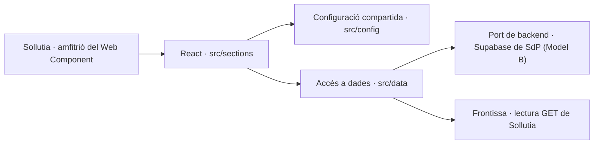
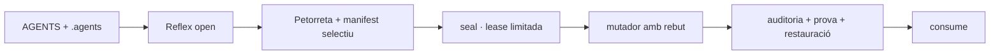

# Arquitectura tècnica unificada

Mapa de com està construït Sóc de Poble hui: una aplicació web React i Vite, online-first, amb un frontend modular que s'endolla a Sollutia segons el Model B. Distingix el que ja funciona, el que és contracte vigent i el que encara és recerca.

Este document explica, no autoritza cap execució. Quan discrepe amb el repositori, prevalen `AGENTS.md`, `.agents/`, el codi i les proves. Cada afirmació porta un nivell d'evidència:

- **Implementat:** existeix al codi o a la configuració actual i es pot verificar.
- **Contracte:** decisió vigent que tot canvi nou ha de respectar.
- **Futur:** hipòtesi o línia d'investigació; no es pot usar com si ja funcionara.

## 1. Arquitectura implementada

La base actual de `socdepoble.org` és una aplicació web React 18 construïda amb Vite. Les dependències de producció declarades a `package.json` són React, TipTap, Supabase JS, DOMPurify i Lucide. La capa `src/data/` exposa un port de backend (`src/data/backendPort.js`) que valida el contracte i es pot segellar, i una Frontissa (`src/data/adaptadors/sollutia/client.js`) que només llig de Sollutia per `GET`. Cada garantia concreta s'ha de demostrar amb una prova.

Sollutia és l'amfitrió i el soci d'infraestructura: allotja el Web Component `<soc-de-poble>` i li pot passar la sessió, però no injecta cap implementació al port ni governa el frontend. La decisió completa és a [[ADR-2026-09-SOLLUTIA-MODEL-B]] i la relació, a [[soci_sollutia]].

Contractes de localització del codi:

1. Una funció específica d'una secció viu en `src/sections/<seccio>/`.
2. La configuració transversal viu en `src/config/`.
3. La lectura i l'escriptura de dades viuen en `src/data/`; les escriptures cap a Sollutia continuen tancades (`ESCRIPTURES_PERMESES` és buida).
4. L'arquitectura és online-first ([[ADR-2026-08-ONLINE-FIRST]]): Supabase és la font de veritat de les dades compartides, la memòria cau local és opcional i no autoritativa, i un error de xarxa es mostra amb honestedat.
5. El Baseline 2022 és el sòl de compatibilitat; una API disponible al baseline s'usa directament, sense detecció ni fallback (vegeu `.agents/BASELINE.md`).

## 2. Estat de les tecnologies descentralitzades

La descentralització, el P2P i la resiliència rural formen part de la història i de la visió de [[el_projecte]], però no de l'arquitectura vigent. L'ADR-2026-08 va retirar la pila offline; el que en queda és recerca.

| Capacitat | Estat en esta baseline | Condició per reobrir-la |
|---|---|---|
| Persistència local amb Dexie o IndexedDB | Retirada per l'ADR-2026-08 | ADR nova que substituïsca l'online-first |
| Supabase amb fallback local (mode híbrid) | Retirat; Supabase és l'única font de veritat | ADR nova que substituïsca l'online-first |
| PWA/Workbox i service workers | Retirats; els ja instal·lats es desregistren en la transició | ADR nova que substituïsca l'online-first |
| Y.js o un altre CRDT | Recerca; cap garantia de reconciliació | ADR, prototip, proves de convergència i límits de GC |
| WebRTC/P2P remot | Recerca | Signaling, identitat, xifratge, NAT i proves multi-dispositiu |
| OPFS | Recerca | Cas d'ús online-first, compatibilitat Safari 16 i migració |
| PowerSync | Recerca; no és dependència actual | ADR i integració demostrable |
| LoRa/Meshtastic, drons o satèl·lit | Recerca | Prototip físic, pressupost, legalitat i model d'amenaça |
| Xifrat homomòrfic o postquàntic | Recerca | Cas d'ús, revisió criptogràfica i implementació auditada |

No existeixen en esta baseline `MassiveFusionEngine`, `sync-wiki-crdt.js`, `dron_link_protocol.js` ni una malla Y.js operativa. Els noms històrics poden orientar un experiment, però no són API, control de seguretat ni criteri d'acceptació.

## 3. Contracte de la Wiki

La Wiki és un vault de Markdown governat per fitxers, Git i l'Acte Reflex; no és una base CRDT.

- L'esquema únic de frontmatter és `tooling/wiki/schema.json`.
- Les carpetes vigents de `_wiki_de_poble/` són `01_ser` (identitat), `02_saber` (coneixement) i `03_actuar` (plantilles i procediments), més les zones de cicle de vida `04_escriptori`, `10_actes` i `90_arxiu_historic`. El mapa de dimensions és a [[00_index_identitat]].
- Els bundles i les Petorretes són documents d'esdeveniment de l'Escriptori; el que ja no val passa a `90_arxiu_historic/`, que queda fora del RAG automàtic.
- Un orfe amb contingut no s'elimina ni es mou automàticament. Només un fitxer físicament buit, sense arestes i amb pla reversible pot entrar en quarantena.
- El protocol autoritatiu és `.agents/PROTOCOL_PETORRETA.md`; esta pàgina només l'explica.

## 4. Arquitectura cognitiva

L'agent no carrega tot l'historial ni tota la Wiki. Comença per l'autoritat mínima i amplia el context segons la tasca:

1. `AGENTS.md` i les normes `.agents/` aplicables.
2. Codi, proves i configuració que acrediten l'estat real.
3. Pàgines canòniques estrictament relacionades.
4. Arxiu o documentació de proveïdor només quan la pregunta ho requerix.

El manifest de context registra `path`, `reason`, `classification` i `role`. Una afirmació sense font, fórmula o prova és una hipòtesi; una mètrica sense denominador i finestra temporal no és una mètrica operativa.

## 5. Criteris per a madurar una tecnologia futura

Una idea passa de **Futur** a **Implementat** només quan té:

1. un problema i un propietari explícits;
2. una decisió d'arquitectura amb alternatives i cost de reversió;
3. codi localitzable i configuració reproduïble;
4. proves d'èxit, fallada i recuperació en el dispositiu objectiu;
5. model de dades, privacitat i amenaces;
6. observabilitat amb fórmules i llindars justificats;
7. documentació actualitzada en la mateixa operació.

Fins que es complisquen els set punts, Antigravity ha de dir «proposat» o «no verificat», mai «curat», «blindat» o «100% operatiu».

## Vincles

- [[00_index]]
- [[00_index_identitat]]
- [[02_genotip]]
- [[00_visio_i_pilars]]
- [[el_projecte]]
- [[ADR-2026-08-ONLINE-FIRST]]
- [[ADR-2026-09-SOLLUTIA-MODEL-B]]
- [[soci_sollutia]]
- [[sdp_lock]]
- [[auditoria_canonica]]
- [[a11y_seo_trellat]]
- [[futur_adaptacio]]
- [[index_trellat]]
- [[seguretat_execucio]]
- [[self_repair]]
- [[successio_lazaro_execucio]]
- [[homepage]]
- [[plugins]]
- [[antigravity]]
