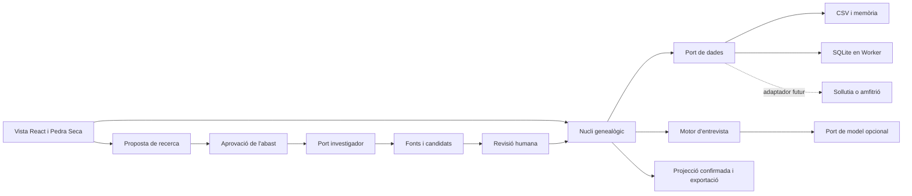

# Arquitectura de l'Arbre Genealògic d'IA

**Estat del Pla:** en elaboració

Arquitectura teòrica lliurada per encàrrec del Mestre. Els quatre requisits queden dissenyats; no s'activa cap tractor ni es processen dades familiars. La llavor continua al Full de Ruta, Memòria Històrica, 2027-H2. La persistència local d'este mòdul respon a l'encàrrec concret i no canvia la doctrina general de la plataforma.

<!-- SDP:SECTION pla.implementacio.s1 -->
## Registre

| Camp | Valor |
| --- | --- |
| Identificador | sdp:torn_87c5a8df-b38f-4cb1-b3c6-4dd91b055765:f8495097-6655-4b74-9aef-c9e5a80b6386 |
| Versió del document | 1.1.0 |
| Entorn | entorn-dev-local |
| Creació | 2026-10-02T00:04:40.622Z |
| Modificació | 2026-10-02T00:39:01.380Z |
| Propietari | codex |
| Aprovació humana | pendent |
| Plantilla | _wiki_de_poble/03_actuar/plantilles/pla_implementacio.md (v2.0.0) |
| Model IA | Codex, GPT-6 |
| Tokens consumits | Sense telemetria exacta disponible |

<!-- SDP:SECTION pla.implementacio.s2 -->
## Acte reflex

Plantilla entregada: _wiki_de_poble/03_actuar/plantilles/pla_implementacio.md; SHA-256 30f1b3310dd558c625a0cef2562b28ee8f08351afd719136367464a3b12aff38. El rebut acredita entrega, no comprensió.

<!-- SDP:SECTION pla.implementacio.s3 -->
## Historial

2026-10-02T00:04:40.622Z: esborrany creat; contingut i verificació pendents.

2026-10-02: disseny complet de dades, entrevista, investigació i vista; contrastats el Calendari vigent, SQLite WASM i GEDCOM 7. Incorporades les revisions d'aprovació de les auditories 0120, 0148 i 0155.

2026-10-02: MarIA ratifica el disseny a [[261002_0215_auditoria_maria_arbre]] i considera satisfet l'encàrrec teòric. Esta ratificació arquitectònica no és aprovació humana del tractor ni ordre d'implementar-lo ara.

2026-10-02: incorporada la revisió Claude 0120 v1.2, contrastada amb FamilySearch, WebKit, BIVALDI, Europeana i BOE. Es concreta el pilot de fonts i la còpia externa; els terminis d’accés arxivístic no es convertixen en una regla universal de publicació.

<!-- SDP:SECTION pla.implementacio.s4 -->
## Canvis proposats

### 1. Context, decisions i límits

Sóc de Poble continua trenta anys d'activisme rural, amb l'herència de socdepoble.net i el Rentonar. Este mòdul conserva memòria familiar en formats exportables i amb independència del proveïdor. La UI és React dins de l'SPA actual; el nucli és JavaScript pur. Sollutia, WordPress, Joomla i un futur amfitrió nadiu es connecten per ports explícits. No hi ha imports de Supabase, SDK d'IA ni SQL als components visuals.

**Decisió central:** conservar afirmacions i les seues fonts, a més de persones. «Confirmat» vol dir acceptat explícitament en este arbre, amb procedència visible; no implica certesa històrica absoluta. Un testimoni familiar pot ser una font confirmada sense haver-se verificat documentalment. Una inferència de la IA mai es confirma sola.

El primer increment serà importació local, entrevista i arbre confirmat. SQLite persistent i la investigació web seran adaptadors opcionals. La funció bàsica funciona amb CSV en memòria i exportació, sense serveis externs. Les preguntes es poden generar amb regles locals quan no hi haja model disponible.

Alternatives descartades: una taula plana amb «pare/mare» com a únic model, perquè perd fonts i parentius; un backend específic obligatori, perquè trenca l'enxufabilitat. El renderitzat de l'arbre usa dades i geometria deterministes, no una imatge inventada per un generador.

### 2. Mòduls i contractes

| Port proposat | Contracte mínim | Responsabilitat |
| --- | --- | --- |
| `GenealogyStore` | `readSnapshot`, `query`, `commit(patch, expectedRevision)`, `exportSnapshot` | Transaccions i revisió; errors tipats `conflict`, `quota`, `unavailable`, `invalid` |
| `ImportPort` | `inspect(file)`, `preview(mapping)`, `apply(importId)` | Parseig limitat, correspondència de columnes i importació idempotent |
| `InterviewPort` | `next(context)`, `interpret(answer, questionId)` | Una pregunta pendent; retorna propostes, sense permisos d'escriptura |
| `ResearchPort` | `capabilities`, `search(job, signal)`, `fetchSource(ref, signal)` | Consulta només l'abast aprovat; torna evidències i incidències |
| `TreeLayoutPort` | `layout(confirmedGraph, focus, limits)` | Posicions, connexions i representacions repetides d'una mateixa persona |
| `ExportPort` | `preview(scope)`, `export(snapshot, format)` | Dades portables i vista visual amb filtres de privacitat |

Cada missatge entre UI, Worker i adaptador porta `schemaVersion`, `requestId`, `treeId` i `revision`; una resposta tardana d'un altre arbre es descarta. Cancel·lació amb `AbortSignal`, pressupostos explícits i errors que la UI puga explicar. Un port absent desactiva només la seua capacitat. Una aprovació de consulta no autoritza un altre proveïdor ni una pujada completa de l'arbre.

### 3. Nucli de dades: identitat, parentius i procedència

| Entitat | Camps essencials proposats |
| --- | --- |
| `Tree` | UUID, títol privat, versió d'esquema, revisió, configuració i instant de còpia |
| `Person` | UUID estable, noms originals i variants, estat vital `living/deceased/unknown`, visibilitat |
| `Relationship` | UUID, persones origen/destí, tipus de filiació o unió, intervals, afirmacions de suport |
| `Event` | Naixement, defunció, residència, unió o altre; participants, lloc i data com a afirmacions |
| `Claim` | Subjecte, propietat, valor tipat, estat, font/cita, autor i moment de revisió, proposta que substituïx |
| `Source` / `Citation` | Tipus, títol, arxiu i signatura, URL si existix, pàgina/zona, fragment, consulta, drets i hash del document disponible |
| `Interview` / `Answer` | Persona enfocada, pregunta pendent, resposta original, saltats i propostes derivades |
| `ResearchJob` | Abast aprovat, proveïdors, pressupost, estat, consultes i evidències rebudes |
| `Change` | Revisió anterior/nova, operació i diferència reversible; sense còpia als logs globals |

Les dades originals es conserven: «cap al 1920» no es convertix en 01/01/1920. La data admet text original, precisió, interval i calendari. Els llocs tenen formes històriques i modernes separades; cap inferència automàtica d'origen ètnic. Camps desconeguts continuen desconeguts.

Una persona pot tindre múltiples filiacions tipades —biològica, adoptiva, acolliment, desconeguda— i unions successives. La vista no imposa dos progenitors ni un sexe inferit del nom. Els germans es poden deduir de filiacions confirmades; «germà recordat» també pot quedar com a afirmació explícita quan falten progenitors.

Les coincidències de noms, dates i pobles generen candidats de duplicat. La fusió és revisada, conserva IDs d'origen i es pot desfer. Un avantpassat compartit per diverses branques és una sola persona amb diverses aparicions visuals. Un cicle d'ascendència és una incidència; no s'arregla esborrant una font silenciosament.

Estats d'afirmació: `proposed`, `confirmed`, `rejected`, `conflicted`, `superseded`. Una revisió deixa traça de qui l'ha acceptada i amb quina evidència. La projecció principal usa només les afirmacions confirmades vigents; contradiccions no resoltes apareixen al panell de revisió. Dues pàgines que copien la mateixa esquela no compten com a dues verificacions independents.

### 4. Importació CSV i SQLite al navegador

**CSV inicial.** Selector de fitxer → detecció de codificació/separador → mostra de columnes → assignació explícita → informe d'incidències → importació transaccional. Admet un CSV senzill amb `person_id`, nom, dates, llocs i referències a progenitors, amb avís de les limitacions; per a intercanvi complet usa un paquet de CSV relacionats i un manifest d'esquema. UUID nous només quan no hi ha identificador estable. El hash del fitxer, fila i perfil d'importació evita duplicar una reimportació.

Es valida grandària, files, referències inexistents, dates ambigües, delimitadors, cometes i camps llargs. Cada valor importat conserva el fitxer i la fila com a procedència. El mode de confiança es tria en la previsualització: per defecte proposat; dades ja conegudes es poden confirmar explícitament en conjunt després de revisar les incidències. No s'executen fórmules de cel·les ni SQL aportat al CSV. Exportar CSV per a fulls de càlcul requerix un mode segur davant de fórmules, sense perdre el valor original en l'exportació canònica.

**Persistència opcional.** El primer increment conserva CSV/memòria amb exportació. Si necessita persistència abans d’avaluar WASM, es pot implementar el mateix port amb IndexedDB natiu, sense una nova dependència. SQLite continua dissenyat com a adaptador posterior, amb revisió expressa de compatibilitat i de la decisió de dependències abans d’instal·lar res. SQLite WASM en un Worker, consultes parametritzades i migracions versionades amb còpia prèvia. L'adaptador detecta WASM, Worker, OPFS i CSP. `opfs-sahpool` és una opció sense COOP/COEP, però no proporciona concurrència transparent entre pestanyes: una sessió escriptora per arbre i un missatge clar de bloqueig a la segona. Cal fixar una versió i provar el seu comportament de recuperació: cap inicialització o error pot esborrar automàticament una base de dades familiar. Si falta una capacitat, el mode CSV/memòria i l'exportació continuen disponibles. [Documentació oficial de persistència SQLite WASM](https://sqlite.org/wasm/doc/trunk/persistence.md).

No s'imposen canvis globals de CSP ni d'aïllament a WordPress/Joomla. Si l'amfitrió bloqueja el Worker o WASM, la UI informa del mode disponible. OPFS pertany a l'origen del lloc: canviar de domini no transporta l'arbre. Una còpia descarregable fora del navegador és imprescindible; la persistència del navegador no és una còpia de seguretat. L'usuari pot exportar, restaurar amb previsualització i eliminar un arbre concret. «Desenxufa» tanca sessions i ports; no elimina dades sense acció específica.

**Recuperació obligatòria.** La UI mostra l’última còpia externa i recorda exportar després dels canvis; prova de restauració abans d’acceptar persistència. `storage.estimate`, `persist` i `persisted` són capacitats opcionals, amb detecció abans de cridar-les. Una denegació no impedix exportar. WebKit documenta eliminació per pressió d’espai/inactivitat i suport complet de Storage API des de Safari 17; no es pressuposa en Safari 16. La regla d’ITP de set dies compta ús de Safari sense interacció amb el lloc, no una caducitat universal de set dies naturals. [Política d’emmagatzematge](https://webkit.org/blog/14403/updates-to-storage-policy/), [detall d’ITP](https://webkit.org/blog/10218/full-third-party-cookie-blocking-and-more/).

Un futur adaptador GEDCOM 7 facilitarà intercanvi amb altres programes, mantenint cites, dates parcials i extensions no interpretades. No es presentarà un CSV pla com a exportació sense pèrdua. Caldrà provar expressament la conversió entre 5.5.1 i 7, que no són formats directament compatibles. [Especificació GEDCOM 7](https://gedcom.io/specifications/FamilySearchGEDCOMv7.html).

### 5. Motor conversacional: una pregunta cada vegada

La selecció de la pregunta és un planificador pur: persona enfocada → buits que l'usuari podria recordar → una sola pregunta. Prioritza identificar la persona abans de buscar parents llunyans. Evita repetir preguntes marcades «No ho sé» o «Ara no» fins que hi haja informació nova o la persona les reprenga.

Flux: `preparat → pregunta → resposta o salt → proposta → confirmació/correcció → desament → pregunta següent`. La confirmació pot ser un botó al resum de la resposta; no són necessaris torns verbals artificials. En qualsevol moment es pot pausar o canviar de familiar. Només hi ha un `pendingQuestionId`; reintents i respostes duplicades no creen afirmacions repetides.

Exemple sintètic: «Com es deia l'àvia de qui acabes de parlar?» → «Rosa, de Benifont; crec que va nàixer cap al 1920» → targeta amb nom, lloc i data aproximada proposats → la persona confirma o corregix → «Recordes algun germà o germana de Rosa?». Benifont i Rosa són exemples ficticis. No s'ompli un buit d'identitat amb una coincidència web.

L'LLM opcional rep només els fets necessaris i el resum revisat d'eixa sessió. Retorna un esquema validat amb `question`, `focusPersonId`, `reason` i `proposedClaims`, mai ordres d'escriptura. La UI rebutja respostes amb més d'una pregunta operativa i conserva el torn per aclarir-lo. Si falla el model, preguntes de plantilla locals mantenen el flux. La resposta literal de l'usuari es conserva encara que l'extracció falle.

Les respostes sensibles es poden ometre i no s'endevinen adopcions, paternitats o altres vincles. Una dada contradictòria obri una revisió concreta; mai se substituïx pel valor amb una puntuació de confiança més alta.

### 6. Pont de l'agent investigador

L'agent és un consumidor limitat de `ResearchPort`; no té accés d'escriptura a `GenealogyStore`. No rep tot l'arbre ni credencials d'altres mòduls. L'amfitrió implementa la cerca per API autoritzada o servei de recerca separat. El navegador no pot assumir accés directe a qualsevol arxiu: CORS, autenticació i condicions del catàleg poden impedir-ho. En eixe cas es pot adjuntar manualment una font al mateix circuit.

Cada treball segueix `draft → approved → running → candidates → reviewed`, amb eixides `cancelled`, `failed` o `no_results`. La fitxa prèvia mostra persona, noms/variants que eixiran a la xarxa, interval i lloc, destinacions, límit de consultes/cost i duració. Per a persones vives o estat desconegut, la cerca externa està desactivada per defecte. El consentiment d'una cerca concreta no activa futures investigacions automàtiques.

1. El nucli proposa una consulta mínima; l'usuari revisa el que es compartirà.
2. L'executor valida l'aprovació contra l'empremta del flux i de l'operació. Ports, model o abast diferents invaliden eixa aprovació. Per a un agent extern, l'autoritat de verificació ha d'estar fora del seu domini de mutació; un registre editable del mateix navegador no és prova independent d'intervenció humana.
3. Es consulten catàlegs històrics mitjançant adaptadors amb dominis, operacions i drets verificats. Les esqueles queden inicialment en cerca assistida: proposta de consulta/enllaç, lectura humana i evidència aportada al circuit. Cap recol·lecció automàtica d’un lloc sense permís comprovat. Les claus API residixen a l’amfitrió autoritzat, mai al bundle.
4. Cada resultat guarda URL canònica, signatura d'arxiu, títol, data de consulta, pàgina o zona, fragment mínim pertinent, drets indicats i hash quan es conserva el document. L'OCR queda distingit de la transcripció comprovada. Les restriccions de conservació poden obligar a guardar només cita i enllaç.
5. L'agent compara identitat, període, lloc i parentius. Explica coincidències i contradiccions, amb cites comprovables. Un nom igual o un percentatge del model no prova un parentiu. «Sense resultats» tampoc prova que el familiar no existira.
6. L'usuari obri la font i accepta, corregix o rebutja cada candidat. Només este pas genera una transacció del nucli. Es pot conservar una pista per investigar sense incorporar-la a l'arbre confirmat.

Els textos de webs, PDFs i OCR són dades no fiables: no poden canviar permisos, instruccions o destinacions. L'executor restringix URL i redireccions, bloqueja recursos locals/interns quan actua des de servidor, limita mida/tipus de document, escapa HTML i controla temps, concurrència i cancel·lació. Reintentar la consulta és idempotent per `jobId`; una escriptura no es repetix per un timeout.

**Fonts inicials candidates, encara sense connector activat:** BIVALDI documenta la seua funció de repositori OAI; Europeana oferix API amb registre i clau. S’avaluen primer metadades i referències; un protocol accessible no autoritza descarregar o republicar totes les imatges. Prensa Histórica queda com a candidata proposada per Claude, pendent de comprovar endpoint, condicions i resposta de mostra en el pilot. [BIVALDI](https://bivaldi.gva.es/va/acerca/presentacion.do), [API Europeana](https://pro.europeana.eu/page/get-api).

FamilySearch queda com a enllaç assistit en el primer increment: la seua documentació distingix API d’arbre i accés als registres històrics, i exigix redirigir-hi la persona per examinar coincidències. No se’n deriva que qualsevol API siga inexistent ni que una col·lecció represente tots els arxius valencians. PARES, SAVEX i altres catàlegs sense contracte verificat també són enllaços assistits. [Requisits de FamilySearch](https://developers.familysearch.org/main/docs/compatibility-checklist).

No s’adopta la frase general «la mineria d’esqueles és il·lícita»: s’avaluen font, operació, drets i condicions. La restricció inicial és una decisió de disseny prudent i reversible, sense prometre una autorització jurídica global. Les condicions de Las Provincias no han sigut accessibles en este contrast; la reserva concreta citada per Claude queda atribuïda a la seua recerca, no verificada independentment ací.

La recerca d'arxius no s'implementa ni s'executa en esta entrega. Abans del pilot cal verificar un catàleg concret, el contracte d'accés i exemples públics no personals; no es pressuposa una API universal d'arxius.

### 7. Targeta visual i sidebar Pedra Seca

La referència contrastada és `src/sections/calendari/CalendariSection.jsx`: `ContentProvider`, `UniversalPage`, components de `src/components/PedraSeca/` i `PantallaCompleta`. El Calendari conserva la barra lateral de la closca amfitriona; l'arbre també la conserva. No es crea un segon router ni una còpia CSS de la sidebar.

El panell `PanellFontsCalendari` afegit per Claude aporta el patró concret de filtres, estat i maquetació lateral; es reutilitza la composició i els tokens per a branques i fonts, sense heretar credencials ni consultes de Google.

La composició proposada té navegació lateral d'Arbre, Persones, Entrevista, Fonts i Revisió; centre amb l'arbre de la persona enfocada; detall contextual de persona i cites. Es reutilitzen els patrons de panells i focus d'`AppGridShell` quan faça falta una columna pròpia. En mòbil, el detall es presenta com a panell accessible amb retorn de focus; no comprimeix tres columnes fins a fer-les il·legibles.

Cada node mostra nom confirmat, dates amb precisió visible i indicador de procedència; els camps encara desconeguts no s'inventen. Les connexions expressen el tipus de parentiu amb text accessible, a més de color o línia. Les propostes queden en «Revisió», amb comparació abans/després. La vista principal només inclou persones/relacions confirmades pertinents.

Controls: centrar persona, ampliar/reduir, expandir una branca, tornar a l'inici i pantalla completa amb el patró del Calendari. Noms llargs, persones repetides en diverses branques i arbres densos tenen tractament explícit. Es preserven tipografia, tokens, vores, espaiat, estats i contrast del sistema. La navegació per teclat i una vista de llista de parentius oferixen una alternativa al llenç.

La disposició es calcula a partir d'una instantània confirmada amb ordre estable; es renderitza en SVG o DOM accessible amb límit de nodes visibles. Un mapa immens es desplega progressivament; «10.000 persones» serà un escenari de prova, no una promesa de rendiment sense mesurar.

Exportació visual SVG/PNG/PDF proposada des de la mateixa instantània, amb títol, llegenda de confirmació, data i relació de fonts opcional. Abans d'exportar es revisen les persones vives/desconegudes, els camps sensibles també de difunts, tercers identificables en les cites i els drets de cada font. Cap data de defunció habilita automàticament la publicació. No es publica una URL ni una social card familiar per defecte.

### 8. Privacitat, aprovació i enxufabilitat

Els arbres i les entrevistes són privats. Cap nom, font familiar o identificador sensible entra al sitemap, OG, repositori, manifest públic de la Wiki, telemetria o logs globals. `noindex` és una instrucció als robots, no control d'accés. La UI no envia dades al xat comú pel fet de reutilitzar `UniversalPage`; les accions compartides s'han de desactivar o redirigir explícitament a context privat.

La clau del magatzem inclou amfitrió/tenant, espai local i arbre; canviar de compte tanca el Worker i neteja la memòria. Això evita barreges accidentals, però OPFS i altres dades del mateix origen no són una frontera davant de scripts hostils del mateix lloc. Un perfil compartit requerix exportació protegida o xifrat amb desbloqueig explícit abans de prometre confidencialitat. No es qualifica de xifrat allò que només és local.

El tractor proposat `genealogia.investiga` tindrà fitxa explicativa i manifest versionat, i `sdp.tool.v1` el referenciarà sense duplicar permisos. L'aprovació del flux a la Wiki precedirà l'activació; l'aprovació de la consulta i la confirmació de descobertes són passos diferents. CSV local, entrevista sense xarxa i port remot tindran capacitats separades, perquè l'usuari puga desenxufar la recerca mantenint les dades.

Els patrons d'Agent Skills orienten l'entrevista i la comprovació; els de Graphify inspiren procedència i arestes tipades. El graf familiar privat no entra al Mapa públic/documental de MarIA. Compartixen contractes i algoritmes purs, no contingut personal ni memòria cau.

L’article 57.1.c de la Llei 16/1985 regula la consulta de determinats documents del patrimoni documental, amb condicions i terminis de 25/50 anys. No s’usa com un temporitzador universal que autoritze exportar un arbre passats 25 anys. El port conserva restriccions d’accés/reproducció per font i la previsualització aplica una política explícita als camps sensibles. [BOE, article 57](https://www.boe.es/buscar/act.php?id=BOE-A-1985-12534#acincuentaysiete).

### 9. Itinerari proposat i responsabilitats

| Fase | Fitxers proposats, encara inexistents | Resultat revisable |
| --- | --- | --- |
| A · contracte | `src/sections/genealogia/nucli/{model,afirmacions,entrevista,projeccio}.js` i proves | Casos sintètics, transaccions, una pregunta i arbre confirmat |
| B · local | `src/sections/genealogia/adaptadors/{csv,memoria}.js` | Importació amb previsualització i còpia completa exportable |
| C · visual | `src/sections/genealogia/ArbreGenealogicSection.jsx` i components de secció | Prototip Pedra Seca en entorn de desenvolupament, sense activar rutes públiques |
| D · persistència | `src/sections/genealogia/adaptadors/sqlite.worker.js` | Migració, bloqueig, recuperació i exportació provades en navegadors objectiu |
| E · investigació | `src/sections/genealogia/ports/recerca.js`, adaptador autoritzat i fitxa del tractor | Pilot acotat amb fonts públiques i aprovació verificable |
| F · portabilitat | Adaptadors d'amfitrió i GEDCOM | Contract tests amb local/Sollutia simulat, sense canvis al nucli ni a la UI |

Les rutes de la taula són propostes, no fitxers creats ni una decisió de publicar ara. Abans d'implementar, revisar de nou el Calendari acabat per Claude i acordar l'encaix amb el registre de navegació vigent. No s'altera la data 2027-H2 del Full de Ruta.

**Preguntes resoltes per defecte:** dades locals amb exportació; confirmació separada de la inferència; una pregunta activa; genealogies diverses; cap servei d'IA obligatori. **Decisions per al pilot:** catàleg documental concret, proveïdor autoritzat, pressupost de recerca i política de compartició. No impedixen deixar tancat este disseny teòric.

<!-- SDP:SECTION pla.implementacio.s5 -->
## Verificació

Esta entrega verifica el disseny, no una implementació. S'han contrastat els components reals del Calendari, la llavor vigent, les auditories actives i les fonts primàries citades. El document passa pel circuit `context → create → check` i queda ancorat a l'Escriptori.

Proves d'acceptació per al futur desenvolupament:

1. CSV amb accents, delimitadors, IDs repetits, dates parcials i referències trencades; importació repetida sense duplicats i exportació/restauració sense perdre cites o propostes.
2. Dos homònims no es fusionen automàticament; un avantpassat comú conserva un ID; una filiació cíclica es marca; una font contradictòria no se sobreescriu.
3. Una sola pregunta activa; salt, pausa, resposta duplicada, model absent i canvi d'arbre no alteren altres sessions. Cap extracció es confirma sola.
4. Recerca sense aprovació rebutjada; abast canviat invalida l'aprovació; font amb instruccions malicioses no executada; resultat sense cita no presentat com a verificació.
5. APIs `estimate`/`persist` absents o denegades, quota plena, Worker interromput, dues pestanyes, origen diferent i migració fallida conserven l'última còpia; no hi ha neteja destructiva automàtica. Recuperació provada abans d'acceptar persistència.
6. Vista principal sense relacions proposades; navegació per teclat, focus, lector de pantalla, zoom i mòbil contrastats amb el Calendari. Casos de noms llargs i 10.000 persones amb mesura de memòria/latència.
7. Cap dada privada a HTML públic, logs, OG, cerca global o bundle; desconnexió del model/recerca manté l'edició local. Ports substituïbles amb el mateix conjunt de proves.
8. Exportació visual i de dades reproduïble a partir d'una revisió concreta, amb previsualització dels camps compartits i fonts; format GEDCOM contrastat amb un lector independent quan s'implemente.

<!-- SDP:SECTION pla.implementacio.s6 -->
## Riscos

| Risc principal | Resposta de disseny |
| --- | --- |
| Homònims i OCR erroni creen branques falses | Afirmacions amb cites, candidats separats i confirmació explícita |
| Base del navegador perduda o inaccessible | Còpies externes, exportació portable, errors no destructius i mode memòria |
| Proveïdor rep dades excessives | Consulta mínima revisada, allowlist de destinacions i port de model separat |
| L'arbre sembla cert perquè la UI és polida | Llegenda de procedència, precisió de dates i conflictes visibles |
| Reutilitzar la pàgina activa accions públiques | Revisió específica de xat/Connectar/SEO i privacitat abans d'integrar |
| Agent pot editar la seua pròpia aprovació | Executor extern amb confiança fora del seu domini; límit local documentat |
| Canvis a SQLite o al Calendari invaliden el pla | Versions fixades, comprovació de capacitats i revisió del contracte abans del pilot |

Este document autoritza treball de disseny ja encarregat; no és un rebut d'aprovació del futur tractor sobre dades personals.

<!-- SDP:SECTION pla.implementacio.s7 -->
## Vincles

- [[00_index]]
- [[00_index_escriptori]]
- [[00_full_de_ruta]]
- [[261002_0045_pla_implementacio_gestoria]]
- [[261002_0120_auditoria_claude]]
- [[261002_0148_auditoria_codex]]
- [[261002_0155_auditoria_maria]]
- [[261002_0215_auditoria_maria_arbre]]
