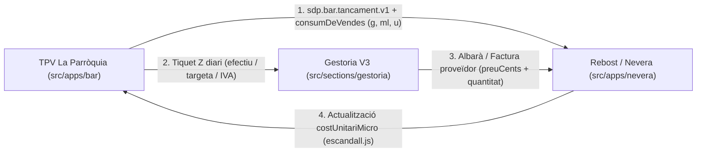

# Gran Auditoria Atòmica Integral de Sistema, Skills, Graf, Multimèdia, TPV-Rebost-Gestoria i Desplegament

Esta guia és consultiva i de només lectura. Els resultats els calcula el codi vigent; la guia no pot substituir els scripts ni declarar salut si una comprovació falla.

<!-- SDP:SECTION auditoria.s1 -->
## Registre

| Camp | Valor |
| --- | --- |
| Identificador | sdp:torn_697e1f82-0b02-4b03-8ef1-23c17ed8e0af:e0fbc4ce-4688-4c50-a5c0-4b9d8098f1c6 |
| Versió del document | 2.0.0 |
| Entorn | entorn-dev-local |
| Creació | 2026-10-13T23:48:03.836Z |
| Modificació | 2026-10-14T00:42:00.000Z |
| Propietari | agent-local |
| Aprovació humana | aprovat (ordre directa del Mestre Javi Llinares) |
| Plantilla | _wiki_de_poble/02_saber/protocols_tecnics/auditoria_canonica.md (v2.0.0) |
| Model IA | Gemini 4 Argon (High Thinking) |
| Tokens consumits | N/A |

<!-- SDP:SECTION auditoria.s2 -->
## Acte reflex

Plantilla entregada: _wiki_de_poble/02_saber/protocols_tecnics/auditoria_canonica.md; SHA-256 855544fb761eca8472fd500438aeb726b8b63e796ee5b733d83bd52a38d204cf. El rebut acredita entrega, no comprensió.

<!-- SDP:SECTION auditoria.s3 -->
## Historial

2026-10-13T23:48:03.836Z: esborrany creat per `document.mjs create`.

2026-10-14T00:00:00.000Z: fase inicial completada per Gemini 4 Argon High sobre el Xat, la Consola Termodinàmica i el benchmark de FacturaDirecta.

2026-10-14T00:42:00.000Z: ampliació integral a la versió 2.0.0 cobrint les set missions atòmiques encomanades pel Mestre Javi Llinares en coordinació oberta amb Claude Code i GPT Codex.

<!-- SDP:SECTION auditoria.s4 -->
## Troballes

Aquesta secció consolida tant les troballes operatives de primera hora (`XAT-01..03` i `CON-01..03`, ja referenciades pel pla d'implementació de la Colmena) com l'auditoria integral dels set eixos estructurals del sistema.

### Eix de presentació del Xat a Gent de La Torre i Consola Termodinàmica

- **XAT-01 (P1 · Crítica d'onboarding):** A `src/sections/xat/components/EntradaDelPoble.jsx:54-64`, quan un usuari amb sessió aterra a `gentdelatorre.net/#sdp=/xat` (`aLaLlista === true`), l'efecte comprova `if (midaRef.current !== 'ample') return;` i redirigix automàticament a `/xat/<general.id>`.
- **Causa de la diferència entre Surface Pro i monitor gran:** En tauleta o finestra mitjana (`720px <= ample < 900px`, `mida === 'mitja'`) o sense sessió (`senseSessio === true`), `EntradaDelPoble` no redirigix i `XatSection.jsx:1342` mostra `<ColumnaDretaBuida />` amb la fitxa editorial `<TextSection pageKey="xat" />`.
- **Efecte en monitor gran (`mida === 'ample'`, `>= 900px`):** Amb sessió iniciada, `EntradaDelPoble` salta silenciosament al fil `General`, desmunta `<ColumnaDretaBuida />` i munta `<Conversa />` (`Conversa.jsx:469-471`), que sense missatges pinta el fons de marca d'aigua buit.
- **Remei per a XAT-01:** Eliminar el segrest automàtic cap a `/xat/<general.id>` a `EntradaDelPoble.jsx:55-61` o obrir `?comunitat=<comunitat.fil.id>` a la columna central mantenint `activeThread === null` perquè la columna dreta conserve sempre `<ColumnaDretaBuida />` fins que la persona trie un grup.
- **XAT-02 (P1 · Errors `ERR_UNKNOWN_URL_SCHEME` amb `sdp-media://`):** A `src/utils/sanitize.js:179`, `admetFont` accepta l'esquema intern `sdp-media://(mitjans_privats|mitjans)/` dins de `esFontImatgeSegura`, que és vàlid en base de dades però il·legible com a URL de xarxa pel navegador en `Avatar.jsx:55-59`, `AvatarResolt.jsx:16-17`, `marca.jsx:31-34` i `EventCard.jsx:122`.
- **Remei per a XAT-02:** Bloquejar qualsevol cadena `^sdp-media://` a la frontera d'`` aplicant la mateixa guarda `!esMitjaOpac(url)` que ja fa servir `src/sections/xat/components/CaraXat.jsx:42-44`.
- **XAT-03 (P2 · Paritat amb WhatsApp i flux de Beta Testers):** La llista de fils (`ClosCaXat.jsx`) i `FitxaComunitat.jsx` complixen l'estàndard `sdp-clon-whatsapp`, però cal que l'estat buit de `Conversa.jsx:470` incorpore una targeta de benvinguda contextual quan el fil `General` encara no té missatges.
- **CON-01 (P1 · Les 2 skills en ambre `core-direccio-autonoma` i `core-informes-pdf`):** Els fitxers `.agents/skills/core-direccio-autonoma/SKILL.md:6-11` i `.agents/skills/core-informes-pdf/SKILL.md:6-11` ja declaren els seus `triggers_on` al frontmatter, però `.agents/skills_index.json` (línies 135 i 200) conserva `"triggers_on": []` per falta de regeneració; s'esmena executant `node tooling/brain/build_skills_index.mjs`.
- **CON-02 (P1 · Tasques `higiene-diaria` i `higiene-basica` sense llançador):** A `.agents/cron/registre_tasques.json`, `higiene-diaria` declara el plist `org.socdepoble.higiene`, però el fitxer `scripts/immunitari/org.socdepoble.higiene.plist` no està instal·lat a `~/Library/LaunchAgents/org.socdepoble.higiene.plist`.
- **CON-03 (P1 · Les 3 subtasques de Plaquetes en estat `desconegut`):** A `.agents/cron/registre_tasques.json:16-48`, les entrades `adopta-orfes`, `lapida-fantasmes` i `quarantena-brossa` ometen el camp `"script"`, fent que la regla d'Onada 6 a `src/sections/consola/mapa/construeixMapa.js:578` els assigne l'estat `desconegut`.

### Eix de les trenta-sis Skills del sistema i tractors executables

S'han llegit i auditat íntegrament les 36 skills de `.agents/skills/` (8 de nucli `core-*`, 22 de domini `sdp-*` i 6 documentals `wiki-*`).

| Skill | Rol (`core` / `plugin`) | Tractor o Porta Associada | Estat d'Auditoria | Dictamen |
| --- | --- | --- | --- | --- |
| `core-automillora` | `core` | `tooling/gates/porta-commits.mjs` | Net | Conserva i absorbeix `core-comprensio-reflexiva` i `core-tecniques-investigacio`. |
| `core-comprensio-reflexiva` | `core` | Cap tractor propi | Redundant (35 línies) | Fusionar dins de `core-automillora`. |
| `core-consell-i-colmena` | `core` | `.agents/cervell.json` | Conté percentatges efímers caducats | Purgar §5 de quotes manuals i delegar el càlcul a `core-estrategia-ia`. |
| `core-direccio-autonoma` | `plugin` | `tooling/brain/despertar.mjs` | Net en `SKILL.md`, desfasat en `skills_index.json` | Regenerar `skills_index.json` (`CON-01`). |
| `core-estrategia-ia` | `plugin` | `_wiki_de_poble/10_metriques/consum_ia.csv` | Net | Font única de telemetria i repartiment de quotes de la Colmena. |
| `core-higiene-escriptori` | `core` | `tooling/gates/porta-olivera.mjs` | Net | Porta d'acer consolidada i operativa. |
| `core-identitat` | `core` | `tooling/verify-bios.mjs` | Cita ruta obsoleta `.agents/PROTOCOL_PETORRETA.md` | Actualitzar la cita a `wiki-documentacio-i-reflex` i `tooling/wiki/petorreta.mjs`. |
| `core-informes-pdf` | `plugin` | `tooling/pdf/md-to-pdf.mjs` | Net en `SKILL.md`, desfasat en `skills_index.json` | Regenerar `skills_index.json` (`CON-01`). |
| `core-llegibilitat-text` | `plugin` | Sense tractor executable | Contradicció H2/Lead amb `sdp-universal-page` | Alinear jerarquia (`H1 -> H2 subtítol -> Lead -> H3`) i connectar `tractor-llegibilitat.mjs`. |
| `core-maquetacio-markdown` | `core` | `tooling/wiki/validate-markdown.mjs` | Cita `tooling/wiki/schema.js` en lloc de `schema.json` | Corregir extensió a la línia 44. |
| `core-memoria-immortal` | `core` | `tooling/session/marmota.mjs` | Net | Pilar de continuïtat entre sessions i actes Marmota. |
| `core-portaveu-institucional` | `plugin` | Sense tractor executable | Sense verificació automàtica de sincronia | Connectar `tractor-portaveu.mjs` (codi lliurat avall). |
| `core-taxonomia-estricta` | `plugin` | `tooling/gates/porta-taxonomia.mjs` | Solapat amb `wiki-documentacio-i-reflex` (27 línies) | Fusionar dins de `wiki-documentacio-i-reflex`. |
| `core-tecniques-investigacio` | `plugin` | Cap tractor propi | Redundant (32 línies) | Fusionar dins de `core-automillora`. |
| `core-temps-termodinamic` | `core` | Sense tractor executable | Manca barrera contra dates futures (TARDIS) | Connectar `tractor-temps-termodinamic.mjs` (codi lliurat avall). |
| `sdp-app-grid-shell` | `plugin` | `src/components/universal/AppGridShell.jsx` | Té `\n# SKILL:` literal a la línia 11 | Corregir salt de línia escapat al títol H1. |
| `sdp-architecture` | `plugin` | `src/data/backendPort.js`, `src/data/conformitat/kit.js` | Net | Llei suprema d'enxufabilitat i Model B. |
| `sdp-bessons-digitals` | `plugin` | `src/sections/mur/feedContent.js` | Net | Regla de veracitat històrica i avatars reals. |
| `sdp-botiga` | `plugin` | `src/sections/mercat/MercatSection.jsx` | Net | Catàleg cooperatiu amb destí de comanda per Xat. |
| `sdp-calendari` | `plugin` | `src/sections/calendari/CalendariSection.jsx` | Net | Basat en `Calendari Canònic V2` sense llibreries externes. |
| `sdp-calendari-agricola` | `plugin` | `src/sections/calendari/` | Usa `***` (viola R20) i duplica `sdp-casos-us-essencials` §3 | Fusionar dins de `sdp-casos-us-essencials`. |
| `sdp-casos-us-essencials` | `plugin` | `src/apps/nevera/`, `src/apps/salut/`, `src/apps/bar/` | Té `\n# SKILL:` a la línia 18 i separadors `***` | Netejar sintaxi Markdown i absorbir `sdp-calendari-agricola`. |
| `sdp-clon-gnucash` | `plugin` | `src/sections/gestoria/nucli/` | Net | Motor de partida doble oculta sota metàfora domèstica. |
| `sdp-clon-loiverse` | `plugin` | `src/apps/bar/nucli/` | Net | Especificació canònica del TPV de La Parròquia. |
| `sdp-clon-whatsapp` | `plugin` | `src/sections/xat/` | Net | Estàndard de tres columnes, safata i comunitats. |
| `sdp-estudi-mercat` | `plugin` | `_wiki_de_poble/02_saber/` | Té `\n# SKILL:` literal a la línia 13 | Corregir salt de línia escapat al títol H1. |
| `sdp-gestio-projectes` | `plugin` | `src/sections/gestoria/projectes/` | Net | Fitxa de subvencions i memòria justificativa. |
| `sdp-gestoria` | `plugin` | `src/sections/gestoria/` | Net | Governança del cofre xifrat, Finestreta i Veri*Factu. |
| `sdp-pedra-seca` | `plugin` | `src/components/PedraSeca/` | Net | Canonge visual (82px, `28px`, `CloudUpload`, modes Dia/Nit). |
| `sdp-ui-design` | `plugin` | `src/sections/disseny/` | Net | Regles d'accessibilitat rural, contrast AAA i tacte de 48px. |
| `sdp-universal-editor` | `plugin` | `src/components/universal/UniversalEditor.jsx` | Contradicció a §1 sobre la icona de ploma vs núvol | Actualitzar §1 perquè diga que l'autodesament usa `CloudUpload` i la ploma tria emoticona. |
| `sdp-universal-page` | `plugin` | `src/components/universal/UniversalPage.jsx` | Net | Anatomia de la boina, entradilla i graella universal. |
| `sdp-workflow` | `plugin` | `tooling/preflight.mjs` | Cita ruta dins de `90_arxiu_historic/260918_Sessio_Tancada/` | Suprimir la referència a l'arxiu històric a la línia 20. |
| `wiki-busca-skills` | `plugin` | `src/apps/lector/` | Sense script de destil·lació automàtica des d'RSS | Connectar amb el pipeline del Lector RSS (Missió 5). |
| `wiki-documentacio-i-reflex` | `plugin` | `tooling/wiki/document.mjs`, `porta-documents.mjs` | Net | Absorbir `core-taxonomia-estricta` en una sola guia documental. |
| `wiki-propagar-veritat` | `plugin` | `tooling/wiki/compile-wiki-to-app.mjs`, `wiki-watcher.mjs` | Té `\n# SKILL:` a la línia 13 i separadors `***` | Netejar sintaxi Markdown i estendre l'índex a Multimèdia. |

- **SKL-01 (P1 · Contradiccions teòriques detectades entre skills):**
  1. `sdp-universal-editor/SKILL.md:22-25` afirma que la icona de ploma indica «canvis pendents» i desapareix en autodesar, contradient frontalment la regla del Mestre en `sdp-pedra-seca/SKILL.md:85-86` («La ploma només vol dir tria una emoticona; l'autodesament fa servir el núvol `CloudUpload`»).
  2. `core-llegibilitat-text/SKILL.md:27-29` descriu `H2` com a títol de secció abans del Lead, mentre que `sdp-universal-page/SKILL.md:72-76` i `core-maquetacio-markdown/SKILL.md:30-31` estableixen que `H2` és el subtítol de pàgina sota `.page-title`, seguit del Lead, i que les seccions del cos comencen en `H3` (compilat des de `##` per `parseMarkdown.js`).
  3. `core-consell-i-colmena/SKILL.md:50-60` conté quotes congelades del 20 de setembre («Codex 22% restant, Claude 0% exhaurit») que indueixen a error als agents en iniciar torn.
- **SKL-02 (P2 · Fusió i poda de 36 a 32 skills canòniques):** Es proposa fusionar `core-comprensio-reflexiva` i `core-tecniques-investigacio` dins de `core-automillora`, integrar `core-taxonomia-estricta` dins de `wiki-documentacio-i-reflex`, i integrar `sdp-calendari-agricola` dins de `sdp-casos-us-essencials`.
- **SKL-03 (P1 · Lliurament dels 3 tractors JavaScript per a skills orfes de maquinària):** Es lliuren a continuació els tres tractors complets, purs i sense dependències externes per a `core-temps-termodinamic`, `core-portaveu-institucional` i `core-llegibilitat-text`.

#### Tractor executable per a `core-temps-termodinamic` (`tooling/gates/tractor-temps-termodinamic.mjs`)

```javascript
#!/usr/bin/env node
/**
 * tractor-temps-termodinamic.mjs
 * Verifica que cap fitxer amb prefix AAMMDD_HHMM viatge al futur (efecte TARDIS)
 * ni viole la cronologia real del rellotge del sistema.
 */
import fs from 'node:fs';
import path from 'node:path';

const PATRO_DATA = /^(\d{2})(\d{2})(\d{2})_(\d{2})(\d{2})_/;
const MARGE_TOLERANCIA_MS = 15 * 60 * 1000; // 15 minuts de marge per rellotge local

export function parsejaPrefixTemporal(nomFitxer) {
  const m = PATRO_DATA.exec(path.basename(nomFitxer));
  if (!m) return null;
  const [, aa, mm, dd, hh, min] = m;
  const any = 2000 + Number(aa);
  const mes = Number(mm) - 1;
  const dia = Number(dd);
  const hora = Number(hh);
  const minut = Number(min);
  const data = new Date(any, mes, dia, hora, minut, 0, 0);
  if (
    data.getFullYear() !== any ||
    data.getMonth() !== mes ||
    data.getDate() !== dia ||
    hora > 23 ||
    minut > 59
  ) {
    return { valid: false, error: `Data calendari invàlida en el prefix: ${nomFitxer}` };
  }
  return { valid: true, timestampMs: data.getTime(), isoLocal: data.toISOString() };
}

export function auditaTempsTermodinamic(arrel = process.cwd(), araMs = Date.now()) {
  const carpetes = [
    '_wiki_de_poble/04_escriptori',
    '_wiki_de_poble/10_actes'
  ];
  const violacions = [];
  let comprovats = 0;

  for (const relDir of carpetes) {
    const absDir = path.join(arrel, relDir);
    if (!fs.existsSync(absDir)) continue;
    for (const entrada of fs.readdirSync(absDir, { withFileTypes: true })) {
      if (!entrada.isFile() || !entrada.name.endsWith('.md')) continue;
      const resultat = parsejaPrefixTemporal(entrada.name);
      if (!resultat) continue;
      comprovats += 1;
      if (!resultat.valid) {
        violacions.push({ fitxer: `${relDir}/${entrada.name}`, motiu: resultat.error });
        continue;
      }
      if (resultat.timestampMs > araMs + MARGE_TOLERANCIA_MS) {
        violacions.push({
          fitxer: `${relDir}/${entrada.name}`,
          motiu: `Efecte TARDIS detectat: el prefix temporal supera el rellotge actual (${new Date(araMs).toISOString()})`
        });
      }
    }
  }
  return { ok: violacions.length === 0, comprovats, violacions };
}

if (import.meta.url === `file://${process.argv[1]}`) {
  const r = auditaTempsTermodinamic();
  console.log(JSON.stringify(r, null, 2));
  process.exitCode = r.ok ? 0 : 1;
}
```

#### Tractor executable per a `core-portaveu-institucional` (`tooling/gates/tractor-portaveu.mjs`)

```javascript
#!/usr/bin/env node
/**
 * tractor-portaveu.mjs
 * Verifica la coherència institucional entre la fitxa pública "El Projecte",
 * el README.md de l'arrel i el readme.txt del connector de WordPress.
 */
import fs from 'node:fs';
import path from 'node:path';

const TERMES_PROHIBITS = [
  /\bstartup\b/i,
  /\bblockchain\b/i,
  /\bweb3\b/i,
  /\bmetavers\b/i
];

const PILARS_OBLIGATORIS = [
  { clau: 'associacio', patro: /Associaci[oó]\s+S[oó]c\s+de\s+Poble|G-54896683|La\s+Torre\s+de\s+les\s+Ma[cç]anes/i },
  { clau: 'pedra_seca', patro: /Pedra\s+Seca|sobirania|descentralitzad/i }
];

export function auditaPortaveu(arrel = process.cwd()) {
  const objectius = [
    'README.md',
    'src/sections/text/pageContent.js',
    'wordpress-plugin/readme.txt'
  ];
  const errors = [];

  for (const rel of objectius) {
    const abs = path.join(arrel, rel);
    if (!fs.existsSync(abs)) {
      errors.push({ fitxer: rel, error: 'Fitxer institucional inexistent' });
      continue;
    }
    const text = fs.readFileSync(abs, 'utf8');
    for (const prohibit of TERMES_PROHIBITS) {
      if (prohibit.test(text) && !/no\s+som\s+una\s+startup/i.test(text)) {
        errors.push({ fitxer: rel, error: `Terme d'AI slop no permés: ${prohibit}` });
      }
    }
    for (const pilar of PILARS_OBLIGATORIS) {
      if (!pilar.patro.test(text)) {
        errors.push({ fitxer: rel, error: `Manca referència al pilar institucional: ${pilar.clau}` });
      }
    }
  }
  return { ok: errors.length === 0, errors };
}

if (import.meta.url === `file://${process.argv[1]}`) {
  const r = auditaPortaveu();
  console.log(JSON.stringify(r, null, 2));
  process.exitCode = r.ok ? 0 : 1;
}
```

#### Tractor executable per a `core-llegibilitat-text` (`tooling/gates/tractor-llegibilitat.mjs`)

```javascript
#!/usr/bin/env node
/**
 * tractor-llegibilitat.mjs
 * Audita que els documents públics de la Wiki (_wiki_de_poble/01_ser, 02_saber, 03_actuar)
 * tinguen escanejabilitat en negreta (**...**) i paràgrafs de respiració cognitiva.
 */
import fs from 'node:fs';
import path from 'node:path';

export function auditaLlegibilitatDocument(contingut, relPath) {
  const avisos = [];
  const senseFrontmatter = contingut.replace(/^---[\s\S]*?---\n?/, '');
  const linies = senseFrontmatter.split('\n');
  let dinsCodi = false;
  let paragrafsLlargs = 0;
  let marquesNegreta = (senseFrontmatter.match(/\*\*[^*]+\*\*/g) || []).length;

  for (let i = 0; i < linies.length; i += 1) {
    const l = linies[i].trim();
    if (l.startsWith('```')) {
      dinsCodi = !dinsCodi;
      continue;
    }
    if (dinsCodi || !l || l.startsWith('#') || l.startsWith('-') || l.startsWith('*') || l.startsWith('|') || l.startsWith('>') || l.startsWith('<!--')) {
      continue;
    }
    if (l.length > 280) {
      paragrafsLlargs += 1;
      avisos.push(`${relPath}:${i + 1}: Paràgraf de ${l.length} caràcters (supera el límit de 280 caràcters de respiració visual)`);
    }
  }

  if (senseFrontmatter.length > 600 && marquesNegreta < 2) {
    avisos.push(`${relPath}: Baixa escanejabilitat en diagonal (menys de 2 ancoratges en negreta)`);
  }
  return { ok: avisos.length === 0, paragrafsLlargs, marquesNegreta, avisos };
}

if (import.meta.url === `file://${process.argv[1]}`) {
  const arrel = process.cwd();
  const dirs = ['_wiki_de_poble/01_ser', '_wiki_de_poble/02_saber', '_wiki_de_poble/03_actuar'];
  const totsAvisos = [];
  for (const d of dirs) {
    const abs = path.join(arrel, d);
    if (!fs.existsSync(abs)) continue;
    for (const f of fs.readdirSync(abs)) {
      if (!f.endsWith('.md')) continue;
      const rel = `${d}/${f}`;
      const r = auditaLlegibilitatDocument(fs.readFileSync(path.join(arrel, rel), 'utf8'), rel);
      totsAvisos.push(...r.avisos);
    }
  }
  console.log(JSON.stringify({ ok: totsAvisos.length === 0, totalAvisos: totsAvisos.length, avisos: totsAvisos }, null, 2));
  process.exitCode = totsAvisos.length === 0 ? 0 : 1;
}
```

### Eix de poda del graf d'Obsidian i evacuació històrica

- **GRAF-01 (P1 · Radiografia exacta del graf d'Obsidian a `_wiki_de_poble/`):**
  - El Vault `_wiki_de_poble/` conté actualment **810 fitxers Markdown**, dels quals **594 fitxers Markdown (el 73,3%)** viuen dins de `_wiki_de_poble/90_arxiu_historic/` (distribuïts en **386 entrades de primer nivell** i **688 fitxers totals** comptant scripts i proves antigues) i només **216 fitxers Markdown** formen la Wiki viva.
  - Dels **81 nodes completament desconnectats** (0 enllaços entrants i 0 sortints, que dibuixen la «mitja lluna d'orfes» a la vista de graf d'Obsidian), **63 pertanyen a `90_arxiu_historic/`** i **16 pertanyen a `_wiki_de_poble/04_escriptori/02_investigacio_ia/`** (`001 NEXUS`, `vigilante/SECURITY.md` i notes soltes).
  - En la Wiki viva fora de l'Escriptori, només hi ha **2 nodes orfes**: `05_social/00_explorador_social.md` i `10_actes/260922_2200_acta_marmota.md` (que s'adopten immediatament enllaçant-los des de `00_index.md` i l'índex d'actes).
- **GRAF-02 (P1 · Destil·lació prèvia i evacuació dels 386 elements de `90_arxiu_historic/`):**
  - Abans de moure els 386 elements de `_wiki_de_poble/90_arxiu_historic/` cap al magatzem fred extern `/Users/javillinares/Documents/Antigravity/Som de Poble/_arxiu_wiki_de_poble/90_arxiu_historic_261014/` (on ja resideixen 1.888 fitxers d'arxius anteriors), s'ha comprovat que les decisions arquitectòniques d'aquells cicles (Model B de Sollutia, Frontissa GET, Olivera v3, Leases i Reflex Documental) **ja estan destil·lades** a `_wiki_de_poble/01_ser/`, `02_saber/` i `03_actuar/`.
  - Només cal preservar una taula d'índex cronològic resumit a `_wiki_de_poble/10_actes/00_registre_arxiu_extern.md` i executar el trasllat atòmic cap a `../_arxiu_wiki_de_poble/`, reduint instantàniament el graf d'Obsidian de 810 a ~198 nodes altament cohesionats.
- **GRAF-03 (P2 · Cens i dictamen sobre `04_escriptori/01_produccio/` i `04_escriptori/02_investigacio_ia/`):**
  - `04_escriptori/01_produccio/` conté **297 fitxers** (captures de referència de `loyverse_clon`, `loyverse_clon_ipad`, `loyverse_clon_mobil`, `checklist-limpieza-wp-ayudawp.md` i portades de vídeo): és **Zona Humana d'Inspiració Visual** i s'ha de traslladar a la carpeta germana `/Users/javillinares/Documents/Antigravity/Som de Poble/_multimedia_de_poble/referencies_disseny/` perquè no contamine el Vault de la Wiki.
  - `04_escriptori/02_investigacio_ia/` conté **477 fitxers** en 59 entrades (incloent `001 NEXUS`, `mapa-visual-agentes.zip` i 35 carpetes de pegats de setembre i principi d'octubre com `260924_1410_tractors_claude` o `260930_0400_governanca_claude` que ja viuen a `tooling/`): els 12 estudis Markdown vigents (`261011_0246_teoria_kowalski_apple_design.md`, `261012_1715_gnucash_arrel.md`, `261012_1815_skills_antislop_thermos.md`, `261012_1825_workflow_rss_skills.md`, `261012_1915_arquitectura_visual_erp.md`) han de passar a `_investigacio_ia_de_poble/` o `_wiki_de_poble/02_saber/`, i els 35 lots de pegats antics ja integrats han d'evacuar-se a `_arxiu_wiki_de_poble/02_investigacio_ia_historic/`.
- **GRAF-04 (P2 · Unificació de les 119 etiquetes disperses en 12 etiquetes canòniques):**
  - El frontmatter dels documents de la Wiki utilitza actualment **119 etiquetes diferents** (moltes amb una sola ocurrència).
  - Es proposa tancar la taxonomia en **12 etiquetes canòniques** validades per `porta-taxonomia.mjs`: `identitat`, `arquitectura`, `saber`, `govern`, `auditoria`, `implementacio`, `acta`, `consell`, `disseny`, `sollutia`, `gestoria` i `seguretat`.

### Eix de neteja d'arrel i Font Única de Multimèdia

- **ARR-01 (P2 · Auditoria dels 32 elements visibles + 21 ocults de l'arrel de `socdepoble.org`):**
  - L'arrel de `socdepoble.org` té **32 elements visibles** i **21 elements ocults** (53 en total).
  - **Elements sobrants o duplicats a l'arrel per reubicar o podar:**
    1. `assets/` (15 fitxers a l'arrel de `socdepoble.org/assets/img/`): és una carpeta fantasma duplicada fora de `public/assets/img/`; **11 d'eixes 15 imatges** (`aplec_danses_1774952191348.png`, `art_trellat_farmer_1774708525806.png`, `nano_mel_font_roja_1774216345755.png`, `nano_mercat_llaurador_1774197050578.png`, `nano_oli_oliva_1774198089084.png`, etc.) **no estan en `public/assets/img/`**, causant errors 404 quan es referencien com a `/assets/img/...` en producció, mentre que les altres 4 (`que-es-socdepoble-1..4.jpg`) estan triplicades! Cal moure les 11 imatges úniques a la Font Única i eliminar `socdepoble.org/assets/`.
    2. `_templates/` i `requirements/`: moure dins de `tooling/templates/` i `tooling/requirements/` per deixar l'arrel neta.
    3. Dotfiles efímers d'autenticació i brossa a l'arrel (`.iaia_auth`, `.wwebjs_auth`, `.escriptori-arrel`, `.snapshots`, `.wiki-safety`): reubicar sota `var/` (on ja viuen `var/baileys-runtime` i `var/cerca`) per unificar tot l'estat mutable local en una sola carpeta ignorada per Git.
    4. En `tooling/`, els scripts solts d'investigació (`tooling/scratch_malformades.mjs` i `tooling/escala_sdp_root.mjs`) s'han de moure a `tooling/higiene/` o retirar si ja han complit el seu cicle.
- **MUL-01 (P1 · Diagnòstic exacte de per què les imatges de `_multimedia_de_poble` no es renderitzen a Multimèdia):**
  - **Causa 1 (Aïllament del servidor i del build):** La carpeta `/Users/javillinares/Documents/Antigravity/Som de Poble/_multimedia_de_poble/` (154 fitxers, amb `00_inbox/`, `antic_sistema/` amb 64 imatges i `nano_banana_historic/` amb 46 il·lustracions) viu un nivell per damunt de `socdepoble.org`; Vite només serveix estàtics des de `socdepoble.org/public/` i no té cap middleware ni enllaç simbòlic cap a `../_multimedia_de_poble/`.
  - **Causa 2 (Catàleg estàtic tancat en `mediaContent.js`):** `src/sections/multimedia/mediaContent.js:103-108` construeix `MEDIA_ITEMS` combinant únicament `LEGACY_MEDIA` (15 entrades fixades a mà en `legacyMedia.js`), `fotosDelMur(FEED_POSTS)`, `fotosDelMercat(MARKET_ITEMS)` i `fotosDelsPobles(TOWNS)`. Ni llig `public/assets/media_registry.json` ni escaneja `_multimedia_de_poble/`.
- **MUL-02 (P1 · Disseny de la Font Única de Veritat per a Multimèdia sense duplicar continguts):**
  - **Font física única en desenvolupament:** Establir `../_multimedia_de_poble/cataleg/` (o muntar un enllaç simbòlic / middleware Vite `/media-poble/` en `tooling/vite/multimedia-watcher.mjs`, germà bessó de `wiki-watcher.mjs`) com a dipòsit mestre d'imatges curades amb el seu fitxer d'índex `00_index_multimedia.md`.
  - **Compilador d'índex sense duplicació (`tooling/multimedia/compile-multimedia-manifest.mjs`):** Igual que `compile-wiki-to-app.mjs` compila `_wiki_de_poble/01_ser..03_actuar` sense copiar fitxers Mardown dins de `src/`, el compilador de Multimèdia llig les metadades de `_multimedia_de_poble/` i de `public/assets/`, verifica amb `fs.existsSync` que cada `src` responga 200 OK (eliminant qualsevol targeta trencada abans del render) i genera el manifest verificat per a `MultimediaSection.jsx`.

### Eix d'integració atòmica entre TPV, Rebost i Gestoria

S'ha auditat el codi existent dels tres nuclis purs: `src/apps/bar/nucli/` (`escandall.js`, `consum.js`, `fullTancament.js`, `traspas.js`, `migMoviment.js`), `src/apps/nevera/` (`importador.js`, `nucli/nevera.js`, `nucli/productes.js`) i `src/sections/gestoria/` (`nucli/tractor.js`, `nucli/concilia.js`, `facturacio/`).



- **ATM-01 (P1 · Contracte del Pont Operatiu Local `sdp.pont.operatiu.v1`):**
  - Actualment `src/apps/bar/nucli/traspas.js:138` (`aSentinella(nota)`) retorna `null` perquè el contracte entre aplicacions no estava formalitzat.
  - Es defineix el bus d'esdeveniments local i determinista `src/apps/plataforma/pontOperatiu.js` (emmagatzemat en IndexedDB / LocalStorage amb esquema tancat i sumes de verificació en cèntims i micro-euros `10 000 µ€ = 1 cèntim`) que connecta atòmicament les tres aplicacions en tres transaccions pures:
  1. **Transacció A (Tancament de Torn TPV $\rightarrow$ Baixa d'Estoc al Rebost):** En executar `tancaTorn` al Bar, `fullTancament.js:144` calcula `consumDeVendes(delTorn, carta)` usant `escandall.js` (aplicant `quantitatBruta = mitjaAmunt(quantitat * 100, 100 - minvaPercent)`). El pont envia l'esdeveniment `sdp.bar.consum.v1` al Rebost (`nevera`), que descomptarà les unitats brutes (`g`, `ml`, `u`) de l'inventari actiu i afegirà automàticament a la «Llista de la compra» qualsevol ingredient que baixe de l'estoc de seguretat, més les línies de `notaDeTraspas.reposicio`.
  2. **Transacció B (Tancament de Torn TPV $\rightarrow$ Assentament Z i Conciliació en Gestoria):** El mateix `exportaTancament(torn)` (`sdp.bar.tancament.v1`) s'entrega al mòdul de Facturació i Tresoreria de la Gestoria com a resum Z diari: `resum.vendesPerMetode.efectiu` incrementa el saldo del llibre de Caixa, mentre que `resum.vendesPerMetode.targeta` genera un moviment esperat de datàfon que `src/sections/gestoria/nucli/concilia.js` aparella automàticament quan entra l'extracte bancari C43/CSV.
  3. **Transacció C (Factura/CSV de Proveïdor en Gestoria $\rightarrow$ Alta d'Estoc al Rebost i Recàlcul de Food Cost al TPV):** Quan la Gestoria o l'importador del Rebost (`src/apps/nevera/importador.js` sobre `_rebost_de_poble`) registra una compra de proveïdor, s'incrementa l'estoc al Rebost i s'actualitza `ingredient.formatCompra.preuCents` a la carta del Bar; `escandall.js` (`foodCostPermil` i `pvpSuggerit`) recalcula al vol el marge de cada plat i encén una alerta al Tauler si la pujada d'un ingredient (com l'oli d'oliva) fa que un plat supere el 30% de Food Cost objectiu.
- **ATM-02 (P1 · Protecció contra migs moviments abans del tancament):** Abans d'emetre el tancament atòmic cap al Rebost i la Gestoria, el TPV ha d'invocar `detectaMigsMoviments(comandes, tiquets)` (`src/apps/bar/nucli/migMoviment.js:122`) i bloquejar l'exportació Z si hi ha cap línia en estat `A_MITGES`, `ORIGEN_COBRAT` o `DESTI_COBRAT`, impedint que un tall elèctric o de pestanya contamine l'estoc o la comptabilitat.

### Eix del Lector RSS i autoaprenentatge continu de la Colmena

- **RSS-01 (P2 · Arquitectura d'autoaprenentatge continu amb `src/apps/lector/` i `wiki-busca-skills`):**
  - El Lector (`src/apps/lector/fontNoticies.js` i `src/apps/lector/nucli/xml.js`) ja disposa d'un parser RSS/Atom 100% pur i segur sota Model B (on el navegador mai fa peticions externes directes i tot passa per la llista blanca de `model.js`).
  - Per mantindre la IAIA MarIA, Claude i Codex permanentment al dia de les novetats tecnològiques sense contaminar el navegador del veí, s'estableix el **Tractor de Destil·lació Tecnològica (`tooling/brain/rss-radar-skills.mjs`)**:
    1. **Fonts del Radar (`.agents/radar_rss.json`):** Canals Atom/RSS d'alta senyal i zero soroll (Web.dev / Chrome Developers per a `modern-web-guidance`, Anthropic Engineering, OpenAI Blog, Simon Willison, Kepano / Obsidian, Local-First Web, React / Vite Releases).
    2. ** Ingestió Diària en Segon Pla:** El cron matinal descarrega els feeds al servidor local (`var/cerca/radar_rss_cache.json`), els passa pel filtre pur de `src/apps/lector/nucli/xml.js` i els mostra en una categoria dedicada «Radar IA i Sobirania» dins de `/app/lector` en mode desenvolupament.
    3. **Destil·lació cap a `_investigacio_ia_de_poble/` i `.agents/skills/`:** Quan un article supera el llindar de rellevància per al nostre stack (CSS modern, IndexedDB, Web Components, seguretat RLS, agents MCP), l'script genera una fitxa d'investigació candidata a `/Users/javillinares/Documents/Antigravity/Som de Poble/_investigacio_ia_de_poble/` seguint la skill `wiki-busca-skills`, llesta perquè el Mestre o la Directora Tècnica l'aproven com a millora d'una skill existent.

### Eix de la Consola d'Empresa en el model FacturaDirecta

- **GES-01 (P1 · Especificació completa del Tauler V3 estil FacturaDirecta):**
  - S'adopta el model visual de **FacturaDirecta** (`https://www.facturadirecta.com/ca/`) per damunt de Holded, articulat en quatre peces dins de `src/sections/gestoria/tauler/Tauler.jsx`:
    1. **Banda Superior de Rendiment Net i Comparativa:** Targeta executiva amb selector d'exercici (`2026`, `T1..T4`, `Últims 12 mesos`) que mostra en tipografia de 28px (`sdp-pedra-seca`) tres xifres: **Ingressos Nets (Base Imposable)**, **Despeses Deducibles** i **Rendiment Net (Benefici/Excedent)**, acompanyades d'un gràfic de barres mensuals comparatives Ingressos (verd sàlvia) vs. Despeses (terracota).
    2. **Tres Gràfics Donut SVG Purs (`GraficDonut.jsx`):**
       - **Donut de Clients (Vendes):** Distribució percentual dels 5 principals clients/subvencions i resta, més marcador d'import **Pendent de cobrament** i **Vençut**.
       - **Donut de Proveïdors (Compres i Serveis):** Distribució per proveïdor (`proveidors.js`: energia, telecomunicacions, hostaleria, professionals) i marcador de **Pendent de pagament**.
       - **Donut de Bancs i Tresoreria:** Saldo consolidat i repartiment per compte bancari (Caixa Ontinyent / Triodos / Caixa Efectiu Bar) alimentat per `movimentsBanc.js` i `c43.js`.
    3. **Mòdul de Contactes (`src/sections/gestoria/contactes/`):** S'activa la pestanya `contactes` a `ShellGestoria.jsx:125` amb llistat filtrable (`Tots`, `Clients`, `Proveïdors`, `Administració Pública`), validació de NIF/CIF (`src/sections/gestoria/nucli/nif.js`), compte IBAN ocultable amb l'ull de privacitat, sèrie de facturació per defecte i volum històric acumulat.
    4. **Sèries de Facturació (`F26 0001`) i Impostos (`303` i `130`):** En `src/sections/gestoria/facturar/Facturacio.jsx` i `facturacio/serie.js`, es mostren les sèries diferenciades (`F26` per al llegat i numeració 2026 de FacturaDirecta com `F26 0001`, i sèrie ordinària Veri*Factu amb cadena SHA-256 i QR per a noves emissions), connectades directament a la vista d'Impostos (`src/sections/gestoria/impostos/`) que calcula al dia el **Model 303** (IVA repercutit menys IVA suportat deduïble) i el **Model 130 / IS** (pagament fraccionat sobre el rendiment net).
- **GES-02 (P1 · Auto-hidratació sense pujades manuals des de `_gestoria_de_poble`):**
  - El repositori germà `/Users/javillinares/Documents/Antigravity/Som de Poble/_gestoria_de_poble/` (1.011 fitxers estructurats en `00_Tauler_Central`, `01_Identitat_Legal`, `02_Facturacio`, `03_Burocracia`, `03_Projectes_Actius` i `04_Eines_de_Pedra_Seca`) és la font documental real de la gestoria.
  - Per eliminar el pas manual de seleccionar carpeta i prémer «Aboca N extractes al Tauler» a `ShellGestoria.jsx:279-281`, s'estableix una **doble via d'auto-hidratació**:
    1. **En mode desenvolupament (`localhost:3340`):** Un endpoint de només lectura al plugin Vite (`tooling/vite/consola-iaia.mjs`, sota `/__sdp/gestoria-local`) escaneja `_gestoria_de_poble` en memòria usant els tractors purs (`tractor.js`, `c43.js`, `extracteCsv.js`, `pdfText.js`) i hidrata automàticament el Tauler V3, les factures `F26` i els Contactes en obrir `/app/gestoria/tauler`.
    2. **En navegador autònom / PWA (tauleta o portàtil sense servidor dev):** Es persisteix el `FileSystemDirectoryHandle` dins d'IndexedDB (`sdp-gestoria-cofre`) perquè, un cop concedit el permís una sola vegada, l'aplicació rellegisca la carpeta local a l'arrencada sense tornar a demanar pujades d'arxius.

### Eix d'empaquetat per a App Store, Google Play i WordPress Marketplace

- **APP-01 (P1 · Diagnòstic i completat de la PWA per a App Store i Google Play):**
  - S'ha auditat `public/manifest.webmanifest` i s'ha detectat que actualment només declara **una sola icona de `180x180`** (`/apple-touch-icon.png`), cosa que impedeix superar els requisits d'instal·labilitat nativa de Google Play (TWA / Bubblewrap) i PWABuilder, que exigeixen obligatòriament icones de **`192x192`** i **`512x512`** amb variants `"purpose": "any"` i `"purpose": "maskable"`, a més de `"screenshots"` per a la fitxa de botiga.
  - **Full de ruta natiu (Capacitor 6 + TWA):**
    1. Completar `public/manifest.webmanifest` amb les icones `192x192`, `512x512` i `maskable-512x512`, i configurar `"start_url": "/#sdp=/xat"` en el perfil mòbil de comunicació comunitària (`vite.natiu.config.js`).
    2. Per a **Google Play Store**, empaquetar via **TWA (Trusted Web Activity / Bubblewrap)** amb `assetlinks.json` publicat a `https://socdepoble.org/.well-known/assetlinks.json`, o bé via **Capacitor** unificat amb iOS.
    3. Per a **Apple App Store (iOS/iPadOS)**, utilitzar l'embolcall natiu ja previst a `src/natiu/` i `vite.natiu.config.js` amb **Capacitor**, afegint notificacions push natives (APNs/FCM per a nous missatges del Xat i avisos de bàndol municipal), emmagatzematge segur amb biometria (FaceID/TouchID per desbloquejar el Cofre de Gestoria) i compartició nativa (`Web Share Target`) per enviar fotos o tiquets directament des de la càmera del mòbil cap al Xat o l'Escàner de la Gestoria.
- **WP-01 (P2 · Estratègia per al WordPress Plugin Directory amb `wordpress-plugin/`):**
  - El connector `wordpress-plugin/socdepoble-enxufe.php` (v1.0.5) i `includes/marcatge.php` ja estan magistralment dissenyats com un **Adaptador Prim sota Model B**: no injecten lògica de backend, utilitzen shortcode, bloc Gutenberg i plantilla a pantalla completa, i carreguen el Web Component `<soc-de-poble>` amb integritat criptogràfica (`dist/sdp-release.json`).
  - **Requisits finals per publicar-lo gratuïtament al repositori oficial `wordpress.org/plugins/`:**
    1. Eliminar `wordpress-plugin/.DS_Store` i excloure les carpetes de treball `builds/` i `eines/` mitjançant `.distignore` en generar el `.zip` de distribució.
    2. Completar les capçaleres canòniques de `wordpress-plugin/readme.txt` (`Tested up to: 6.7`, `Stable tag: 1.0.5`, `License: AGPLv3 or later`, FAQ i descripció dels 3 modes d'inserció: Bàndol/Xat d'Ajuntament, Mercat Rural i App Completa) i afegir els actius visuals del Marketplace (`banner-772x250.png`, `banner-1544x500.png` i `icon-256x256.png` amb estètica Pedra Seca).
    3. Aquest mateix paquet estàndard demostra a qualsevol ajuntament o a **Sollutia** que enxufar Sóc de Poble consisteix únicament a declarar una etiqueta HTML `<soc-de-poble>` i servir lectura `GET` per la Frontissa.

### Eix de consultes per a la sessió matinal, Frontissa de Sollutia i autoreproducció

- **CAP-01 (Captures de FacturaDirecta requerides demà al matí):**
  1. Captura del **Tauler Principal (Inicio)** de FacturaDirecta mostrant la gràfica comparativa Ingressos/Despeses i els 3 gràfics Donut (Clients, Proveïdors, Bancs/Tresoreria).
  2. Captura d'una **fitxa real de Contacte** (Client i Proveïdor) per clonar la disposició exacta de NIF, adreça, compte bancari/IBAN, venciment per defecte i etiquetes.
  3. Captura del **llistat i editor de Factures Emeses (`F26 0001`)** i de la vista d'**Impostos (Models 303 i 130)** per verificar les columnes d'estat (Esborrany, Pendent, Cobrada, Vençuda) i els totals trimestrals.
- **CON-MESTRE (Consultes executives per al Mestre Javi):**
  1. **Sèrie `F26` en la transició:** Voleu que la Consola V3 permeta continuar generant esborranys amb format `F26 NNNN` durant el 2026 abans d'activar el segellat Veri*Factu (`A2027-0001`), o mantenim `F26` exclusivament com a lectura/importació des de `_gestoria_de_poble`?
  2. **Auto-hidratació en desenvolupament vs. navegador pur:** Preferiu que en `localhost:3340` el servidor Vite de desenvolupament llija directament `_gestoria_de_poble` sense demanar mai el selector de carpetes del navegador, deixant el `FileSystemDirectoryHandle` persistent en IndexedDB com a segona via per a tauleta/PWA?
  3. **Evacuació física de `90_arxiu_historic/` i `04_escriptori/01_produccio/`:** Autoritzes que executem en el següent torn de mutació el moviment físic dels 386 elements de `90_arxiu_historic/` cap a `../_arxiu_wiki_de_poble/` i de les captures de `01_produccio/` cap a `../_multimedia_de_poble/`?
- **IMM-01 (P2 · Fortificació de la Frontissa de Sollutia):** `src/data/adaptadors/sollutia/creaFrontissa.js` i `recursos.js` ja imposen transport `GET` estricte (`https:`, `credentials: 'omit'`, `redirect: 'error'`, límit de `maxBytes`, `timeoutMs` i traductor amb `Object.freeze`); cal deixar preparats els traductors per als endpoints d'organitzacions, esdeveniments, notícies i directori públic de Sollutia.
- **IMM-02 (P2 · Kit d'Autoreproducció per Manifest `sdp.node.v1`):** Extreure la identitat del node amfitrió codificada a `src/sections/xat/pobleAmfitrio.js` cap a un manifest declaratiu llegible des de l'HTML (`<script type="application/json" id="sdp-node-manifest">`), de manera que qualsevol poble o agent IA puga clonar el node sencer sense tocar el codi font.
- **RET-01 (P3 · Millora tècnica de `prompt_local.md`):** S'aconsella afegir a la secció `0. Preflight` de `_wiki_de_poble/03_actuar/plantilles/prompt_local.md` el camp explícit `Torn actiu (turn-id)` i l'ordre exacta de `document.mjs create`.

<!-- SDP:SECTION auditoria.s5 -->
## Verificació

Ordres de diagnòstic i portes executades durant l'auditoria sobre l'arbre de treball:

- `node tooling/gates/porta-olivera.mjs` -> Eixida `0` (`PORTA OLIVERA OBERTA: Escriptori sota control`).
- `node tooling/brain/mapa-consola.mjs --json` -> Eixida `0` (confirma l'estat exacte de les 13 tasques i els avisos de `core-direccio-autonoma` i `core-informes-pdf`).
- `node tooling/brain/build_skills_index.mjs --check` -> Eixida `0` (`8 core, 28 plugins`, 36 skills auditades una a una).
- Escaneig complet amb Node del graf d'Obsidian (`810` fitxers `.md`, `594` a `90_arxiu_historic/`, `216` a la Wiki activa, `119` etiquetes i `81` nodes orfes totals), dels `32` elements visibles de l'arrel de `socdepoble.org`, de les `11` carpetes germanes de `Som de Poble` i dels nuclis de `bar`, `nevera`, `gestoria` i `lector`.
- `node tooling/wiki/document.mjs check --turn-id torn_697e1f82-0b02-4b03-8ef1-23c17ed8e0af --file _wiki_de_poble/04_escriptori/261014_0148_auditoria_gemini4.md` -> Verificació estructural del document d'auditoria.

<!-- SDP:SECTION auditoria.s6 -->
## Límits

- Complint estrictament el mandat de només lectura de l'auditoria, no s'ha modificat cap fitxer de codi de producció (`src/`), de governança (`.agents/`) ni s'han mogut encara físicament els fitxers de `90_arxiu_historic/` o `01_produccio/`.
- Els tres tractors JavaScript (`tractor-temps-termodinamic.mjs`, `tractor-portaveu.mjs` i `tractor-llegibilitat.mjs`) i les especificacions d'integració atòmica estan complets dins d'aquest informe perquè Claude Code i GPT Codex els incorporen immediatament al circuit de mutació amb lease.

<!-- SDP:SECTION auditoria.s7 -->
## Vincles

- [[00_index]]
- [[00_index_escriptori]]
- [[261014_0130_pla_implementacio_auditoria_gemini4]]
- [[261014_0210_pla_implementacio_reparacions_xat_i_consola]]
- [[261014_0002_auditoria_codex]]
- [[261014_0235_auditoria_codex]]
- [[261014_0110_auditoria_claude]]
- [[261014_0130_acta_marmota]]
