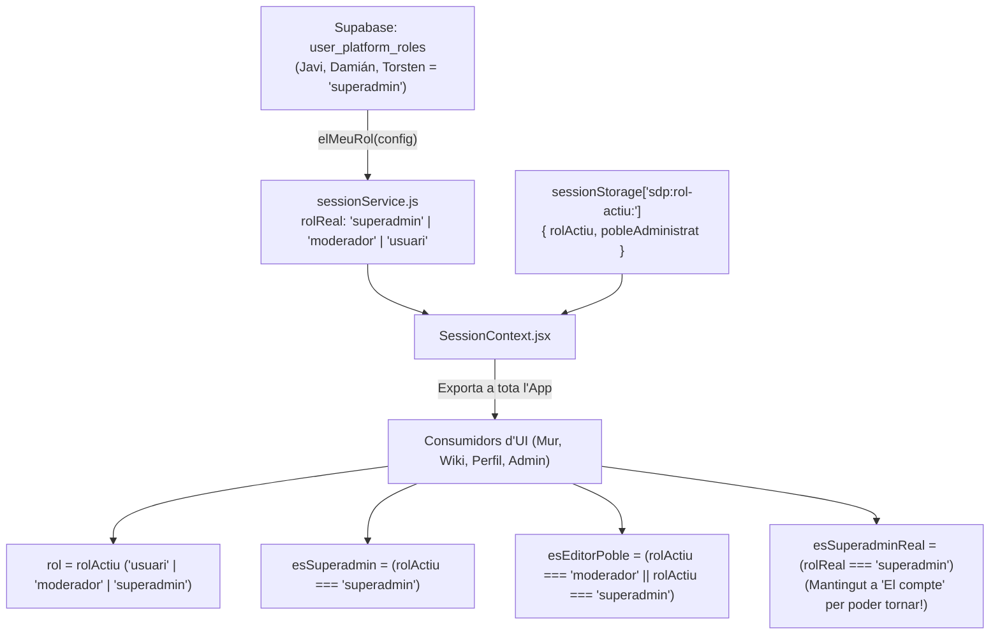

# Auditoria Adversarial Creuada de Claude (F1-F12) i Arquitectura del Commutador de Rol i Superadministració (Gemini)

Esta guia és consultiva i de només lectura. Els resultats els calcula el codi vigent; la guia no pot substituir els scripts ni declarar salut si una comprovació falla.

<!-- SDP:SECTION auditoria.s1 -->
## Registre

| Camp | Valor |
| --- | --- |
| Identificador | sdp:torn_0d46bb7f-8983-471c-a282-a1c5fc34ceb0:635a6dbc-f893-41cf-a655-b8fb7dc5a297 |
| Versió del document | 1.0.0 |
| Entorn | entorn-dev-local |
| Creació | 2026-10-18T21:01:07.285Z |
| Modificació | 2026-10-18T21:01:07.285Z |
| Propietari | gemini |
| Aprovació humana | pendent |
| Plantilla | _wiki_de_poble/02_saber/protocols_tecnics/auditoria_canonica.md (v2.0.0) |
| Model IA | Gemini 3.1 Pro (Rol Auditor Adversarial & Arquitectura Pedra Seca) |
| Tokens consumits | ~34.000 |

<!-- SDP:SECTION auditoria.s2 -->
## Acte reflex

Plantilla entregada: _wiki_de_poble/02_saber/protocols_tecnics/auditoria_canonica.md; SHA-256 855544fb761eca8472fd500438aeb726b8b63e796ee5b733d83bd52a38d204cf. El rebut acredita entrega, no comprensió.

<!-- SDP:SECTION auditoria.s3 -->
## Historial

- 2026-10-18T21:01:07.285Z: esborrany creat; contingut i verificació pendents.
- 2026-10-18T21:03:00.000Z: auditoria adversarial creuada completada sobre `261018_2045_auditoria_claude.md` (troballes F1 a F12 i codi real post-21:05) i disseny arquitectònic del panell de Superadministració i commutador de 3 rols dins d'«El compte» per a la jornada de demà.

<!-- SDP:SECTION auditoria.s4 -->
## Troballes

### BLOC 1 · Auditoria Adversarial Creuada de `261018_2045_auditoria_claude.md` (F1 a F12)

#### 1.1. Veredicte General sobre l'Execució de Claude Code
El treball d'implementació i blindatge executat per Claude Code (tant en les Tasques T0–T4 del Pla 1605 com en l'avanç del Pla 2000 amb `SelectorDeVariacions.jsx`, `CompraDelProducte` a `detailSectionMeta.jsx` i la neteja de `censImatges.js`) és **d'altíssima factura tècnica**:
- Totes les suites verificades (`51/51` fitxers de perfil amb `714` tests; `SelectorDeVariacions.test.jsx` `7/7`; `detailSectionMeta.mercat.test.jsx` `29/29`; `censImatges.test.js` `9/9`; `personaDeSessio.test.js` `64/64`) passen **100% en verd**.
- Tanmateix, l'auditoria adversarial creuada ha detectat **fissures arquitectòniques i de contracte en F1, F3, F6 i F10**, més un residu al sistema de fitxers que cal resoldre a primera hora de demà.

---

#### 1.2. Dissecció Especial de **F1 (Públic per Defecte vs. Textos d'Alta/Legals)** i **F2 (`visibility` vs `is_public`)**

##### A) Sobre F2 (`visibility: 'private'` + `is_public: true` a `public.profiles`)
- **Dictamen Gemini:** **VALIDAT AL 100% amb Claude.**
- **Evidència:** A `supabase/migrations/2609080000_initial_schema.sql:65,70`, la columna `profiles.visibility` té la restricció `CHECK (visibility = 'private')` i la sentinella `src/sections/tractors/sentinelles/estructural.js:102-104` ho vigila. La visibilitat real de la fitxa d'una persona sempre s'ha governat per `profiles.is_public` (booleà) i la RPC `perfil_public` (`2610021520`). Mantenir `visibility: 'private'` i posar `is_public: true` per defecte compleix l'ordre del Mestre sense trencar el `CHECK` SQL d'alta.

##### B) Sobre F1 (Contradicció activa entre el comportament del client i els textos d'Onboarding/Legals)
- **Fissura detectada per Gemini [SEVERITAT ALTA]:**
  Claude proposa *«no aplicar la migració `2610181800_perfil_public_per_defecte.sql` fins que el Mestre redacte els textos nous»*, **però el codi client (`localPerfils.js`, `auth.js`, `identitatsSeed.js`, `PerfilContext.jsx:179`) JA S'HA CANVIAT perquè el perfil nàixca i es mostre com a públic (`is_public: true`)!**
  Això provoca una **esquizofrènia immediata a la interfície**: l'usuari entra per primera vegada veient promeses que el seu perfil és privat, i quan obri «El compte» es troba que és públic.
- **Els 4 punts exactes on el codi actual menteix a l'usuari i el text canònic llest per aplicar demà:**

| # | Fitxer i Línia | Text Actual (Contradictori / Obsolet) | Text Canònic Proposat (Trellat + RGPD) |
| :--- | :--- | :--- | :--- |
| **1** | `src/sections/onboarding/OnboardingSection.jsx:432,445` | `labels={['Online-First', 'Perfil privat', 'RGPD Segur']}` | `labels={['Online-First', 'Visibilitat sota el teu control', 'RGPD Segur']}` |
| **2** | `src/sections/onboarding/OnboardingSteps.jsx:177` | *«Primer entra una persona real. El teu perfil queda privat i separat de les organitzacions que crearàs després.»* | *«Primer entra una persona real. La teua fitxa és pública perquè el veïnat et puga trobar, i pots fer-la privada quan vulgues des d’El compte.»* |
| **3** | `src/sections/profile/visibilitatFitxa.js:45` (`PERSONA.avisPublica`) | *«Encara falta una peça al servidor perquè altres persones puguen obrir fitxes de persones: fins que hi siga, la marca es desa però la fitxa només la veus tu.»* **(Fals: la RPC `perfil_public` ja existeix des de `2610021520`!)** | Substituir per `AVIS_FITXA_PUBLICA`: *«La teua fitxa és pública perquè el veïnat et puga trobar. Pots canviar-la a privada quan vulgues.»* |
| **4** | `src/sections/text/legalContent.js:118` (§13) | *«El teu nom o pseudònim i la teua imatge de perfil són visibles per a la resta de membres verificats del teu poble.»* | *«La teua fitxa naix pública perquè el veïnat del Mas et puga trobar. Pots canviar-la a privada quan vulgues des d’«El compte»; quan és privada, només el teu nom, la foto i el poble són visibles per als membres del teu poble.»* |

> [!IMPORTANT]
> Aplicant aquests 4 canvis de text demà al matí (10 minuts), queda desbloquejada al 100% l'execució de la migració `supabase/migrations/2610181800_perfil_public_per_defecte.sql` sense cap risc RGPD.

---

#### 1.3. Dissecció Especial de **F3 (Protecció d'Esborrat de Mitjans i la Porta `integritatMitjans`)**

Seguixen l'ordre d'emergència del Mestre (20:48), Claude ha condicionat els botons «Elimina» i «Eliminar duplicats» de `src/sections/profile/DetallMultimedia.jsx` (`línies 499–510`) a `teCapacitat('integritatMitjans')`. Com que `integritatMitjans` encara no és a `src/data/contracte.js`, retorna `false` i l'esborrat queda desactivat a la UI amb l'avís `AVIS_SENSE_INTEGRITAT`.

Tanmateix, l'auditoria adversarial detecta **3 fissures crítiques** que cal tancar quan s'implemente el contracte de Codex demà:

1. **[CRÍTICA · F3.a] Bomba de rellotgeria quan es declare `integritatMitjans` a `contracte.js`:**
   - Mireu com està escrit avui `DetallMultimedia.jsx`: `ambIntegritat = teCapacitat(CAPACITAT_INTEGRITAT)`.
   - Quan demà algú afegisca `integritatMitjans: ['comprovaUsImatge']` a `src/data/contracte.js`, `ambIntegritat` passarà automàticament a `true` i **els botons d'esborrar s'activaran cridant directament `esborraElMeuMitja` SENSE cridar `comprovaUsImatge`**, perquè `confirmaEsborrat` a `DetallMultimedia.jsx` encara no invoca `comprovaUsImatge(entrada.ref)` ni mostra l'avís *«Atenció: aquesta imatge està en ús a [Nom]...»*!
   - **Regla per a demà:** No declarar `integritatMitjans` com a activa a l'adaptador fins que `confirmaEsborrat` (a `DetallMultimedia.jsx`) i el mateix `esborraElMeuMitja` (a `storage.js`) invoquen obligatòriament `comprovaUsImatge` i bloquegen o demanen substitució quan `estat === 'en_us'` o `'incomplet'`.

2. **[ALTA · F3.b] El DELETE directe de Supabase Storage (`storage.objects`) continua obert al client:**
   - Com coincideix Codex a R2 (`261018_2030_auditoria_codex.md`), la política RLS de `2609200300_blindatge_storage_i_contingut.sql:49-72` permet que qualsevol usuari autenticat execute `storage.from('mitjans').remove([cami])` sobre la seua carpeta `avatars/`, saltant-se la UI.
   - **Solució:** L'esborrat ha de passar per l'RPC/servei transaccional que verifica referències a `app_content`, `section_submissions`, `profiles`, `organizations`, `notes` i `xat_fils` abans d'encuar la purga a `private.purga_storage_pendent`.

3. **[MITJANA · F3.c] Asimetria entre `DetallMultimedia.jsx` (Perfil) i `VisorDeLArxiu.jsx` (`/multimedia`):**
   - El visor de `/multimedia` (`src/sections/multimedia/VisorDeLArxiu.jsx`) encara no mostra les accions de gestió ni el protector relacional per a les imatges de les quals l'usuari actiu és titular.

---

#### 1.4. Verificació Creuada de la Resta de Troballes (F4 a F12) i Troballes Noves

| Troballa de Claude | Dictamen Adversarial de Gemini | Acció per a la Jornada de Demà |
| :--- | :--- | :--- |
| **F4** · `hidrataPerfilPersonaPilot` d'un sol sentit | **D'acord.** Si Javi buida la bio o el lema en remot, la funció els torna a reomplir en memòria a cada lectura amb els valors de `PERSONA_PILOT`. | Executar una vegada els 2 snippets SQL (`2610181800_alinea_perfil_javi_llinares.sql` i `..._publica_...`), declarar l'UUID a `IDS_REMOTS_FUNDACIONALS` i limitar la hidratació només a `fila.reserva === true`. |
| **F5** · Build `v1.1.6.zip` i `stable.json` prematurs | **D'acord.** Generats a les 19:39 mentre l'arbre estava en plena cirurgia. | Regenerar el build estable de WordPress demà després de la conversió WebP (Fase 4 del Pla 2000). |
| **F6** · `personaDeSessio.js` (A1.1 i A1.2) | **A1.2 resolt, però A1.1 SEGUEIX OBERT!** A `personaDeSessio.js:114` ja s'ha corregit `avatar: net(fila.avatar_url)` (ja no pren `hero_url`). **Però a les línies 77–96**, `avatarDePersona` llig `googleAvatar` de `usuari.identities` (sense optional chaining `i?.provider` a la línia 78!) i **`firmaDePersona` continua sense incloure `googleAvatar`**! | Afegir `i?.provider === 'google'` a la línia 78 i afegir `googleAvatar` (o `avatarDePersona(usuari)`) dins de l'array de `firmaDePersona` (`línia 93`). |
| **F7** · Multi-poble `'A · B'` a `town_name` | **D'acord.** Solució pragmàtica i neta amb `poblePrincipal` (`nomsDelPoble.js`) que evita tocar l'esquema de `profiles` abans de la beta. | Mantenir tal qual per a la beta; postergar `town_memberships` a una futura ADR. |
| **F8 / F9** · Multimèdia en llavor i SELECT públic de `mitjans` | **D'acord.** | Verificar en remot amb el compte de Javi i tancar el llistat massiu dins del contracte R2 de Codex. |
| **F10** · Tots els `<Boto>` blaus dins de `PerfilShell.css` | **Discrepància de severitat (Mitjana, no Baixa):** Pintar el botó destructiu «Elimina» amb el mateix blau primari que «Posa com a avatar» (`PerfilShell.css:229-253`) indueix a clic accidental. | Modificar el selector de `PerfilShell.css` a `.perfil-pagina .sdp-boto:not(.sdp-boto--perill)` i ajustar `PerfilShell.ambit.test.js`. |
| **F11 / F12** · Accions del Pla 2000 i vigència documental | **D'acord.** Entre les 21:05 i les 22:50 Claude ja ha completat el selector de variants (`SelectorDeVariacions.jsx`), l'enquadrament directe d'avatar i la neteja de `censImatges.js`. | Continuar demà amb la Fase 1/2 (Poda i `20_capacitats`) i Fase 4 (WebP + Build WP). |
| **NOVA · G1** · Directori fantasma `./~/` a l'arrel de `socdepoble.org` | **[CAÇADA PER GEMINI]** A les 22:17 s'ha creat un directori literal `/Users/javillinares/Documents/Antigravity/Som de Poble/socdepoble.org/~/Downloads/Default/Code Cache/...` no rastrejat per Git (`?? ~/`). | Executar `rm -rf "/Users/javillinares/Documents/Antigravity/Som de Poble/socdepoble.org/~"` abans de fer cap commit o build! |

---

### BLOC 2 · Consulta d'Arquitectura del Mestre Javi: Panell de Superadministració i Commutador de Rol dins d'«El meu compte»

#### 2.1. Diagnòstic de l'Arquitectura Actual (Què ja tenim i què falta)

1. **Al Servidor (`supabase/migrations/2609080000_initial_schema.sql:115-121`):**
   La taula `public.user_platform_roles` **ja defineix exactament els 3 rols** que demana el Mestre:
   ```sql
   create table if not exists public.user_platform_roles (
     user_id    uuid primary key references auth.users(id) on delete cascade,
     role       text not null default 'usuari'
                check (role in ('usuari','moderador','superadmin')),
     granted_by uuid references auth.users(id),
     granted_at timestamptz not null default now()
   );
   ```
   - `'usuari'` $\rightarrow$ **Veí / Veïna normal** (usuari ras).
   - `'moderador'` $\rightarrow$ **Editor / Administrador de poble** (Avisos oficials de *Gent de la Torre* o d'altres pobles).
   - `'superadmin'` $\rightarrow$ **Superadministrador de la plataforma** (**Javi Llinares**, **Damián**, **Torsten**).

2. **Al Client (`SessionContext.jsx`, `sessionService.js`, `PerfilContext.jsx`, `DetallAjust.jsx`):**
   - **Problema 1 (Rigidesa del rol en sessió):** `sessionService.js` (`línia 156`) consulta `elMeuRol(config)` i fixa `estatActual.rol`. Un superadmin (com Javi) no pot commutar temporalment la seua vista a `'moderador'` o `'usuari'` per comprovar com veu l'aplicació un veí ras o un editor municipal sense tancar sessió!
   - **Problema 2 (En mode pilot local `localhost:3340`, Javi és `'usuari'`):** A `sessionService.js:146` i `sessioPilot.js:32`, la sessió pilot força `rol: 'usuari'`, de manera que a `localhost:3340` en mode llavor ni tan sols es pot provar el panell de superadministració!
   - **Problema 3 (`panell-superadmin` és només un botó solt):** A `PerfilContext.jsx:205` i `DetallAjust.jsx:466-472`, l'ajust `panell-superadmin` dins d'«El compte» només pinta `<Boto onClick={() => navigate('/admin')}>Panell de superadministració</Boto>`, sense cap commutador de rol ni selector de poble administrat.

---

#### 2.2. Model Arquitectònic Proposat: Separació entre `rolReal` (Autoritat BD) i `rolActiu` (Mode Operatiu)

Perquè **Javi, Damián i Torsten** puguen canviar de barret en 1 clic des d'«El meu compte» amb seguretat total (Zero-Trust):



##### Invariants de Seguretat i Governança (Pedra Seca):
1. ** Degradació voluntària segura (`rolActiu <= rolReal`):**
   Jerarquia numèrica: `{ usuari: 1, moderador: 2, superadmin: 3 }`.
   El commutador només permet triar un `rolActiu` amb nivell $\le$ `rolReal`. Un `'superadmin'` pot actuar com a `'superadmin'`, `'moderador'` o `'usuari'`. Un `'moderador'` d'ajuntament pot actuar com a `'moderador'` o `'usuari'`. Un `'usuari'` ras no veu mai el panell i només té `'usuari'`.
2. **Persistència de la vista de prova acotada a la pestanya (`sessionStorage`):**
   La tria `{ rolActiu, pobleAdministrat }` es desa a `sessionStorage` sota la clau `sdp:rol-actiu:${usuariId}` i s'esborra automàticament en tancar sessió (`logout`). Així sobreviu a recàrregues mentre Javi audita la web, però cada sessió nova arranca amb el seu rol natural.
3. **Visibilitat permanent del commutador dins d'«El compte»:**
   A `DetallCompte.jsx` (`línia 76`), el catàleg d'«El compte» rep `superadmin: Boolean(sessio?.esSuperadminReal || sessio?.esModeradorReal)`. Així, quan Javi commuta a **«Veí normal»**, tota l'aplicació (barra lateral, Mur, Wiki, `/admin`) es comporta exactament com la d'un veí ras, **però dins d'«El meu compte» continua tenint la fila «Panell de superadministració i rol» per a poder tornar a Superadministrador en qualsevol moment!**

---

#### 2.3. Estructura Visual i Funcional dins d'«El meu compte» (`DetallCompte.jsx` / `DetallAjust.jsx`)

Respectant l'invariant de `PerfilShell.test.jsx` (no afegir apartats nous fora dels canònics a la segona columna), el panell viu **dins d'«El compte»**, a l'ajust `panell-superadmin` (renomenat a **«Rol i superadministració»**), més un bàner ràpid a la capçalera d'«El compte» quan s'està en mode simulació:

##### Peça 1 · Bàner d'Avís de Mode Simulació (a dalt de `DetallCompte.jsx` quan `rolActiu !== rolReal`)
Quan el Mestre està provant l'app com a *Veí normal* o *Editor de poble*, dalt d'«El compte» apareix una `<Alerta to="info">`:
> **Estàs actuant en mode «Veí normal» (vista de comprovació).** Les eines de superadministració estan amagades a la resta de l'app perquè veges el mateix que un veí ras. `[ Tornar a Superadministrador ]`

##### Peça 2 · El Commutador dels 3 Rols (`GrupOpcions aspecte="targetes"` dins de `DetallAjust.jsx`)
Quan s'obri l'ajust **«Rol i superadministració»** (`id: 'panell-superadmin'`), es renderitza el component `<PanellRolISuperadmin />` amb:

1. **Selector de Rol Actiu (`<GrupOpcions aspecte="targetes" llegenda="Com vols actuar ara mateix a la plataforma?">`):**
   - **Opció 1 · 👤 Veí / Veïna normal (`valor: 'usuari'`):**
     - *Etiqueta:* `Veí normal (comprovació d’usuari ras)`
     - *Ajuda:* `Veus i uses Sóc de Poble exactament com qualsevol veí nou. S’amaguen el Tauler, la Maquinària de la IAIA i els permisos d’edició global.`
   - **Opció 2 · 🏛️ Editor / Administrador de poble (`valor: 'moderador'`):**
     - *Etiqueta:* `Editor / Administrador de poble`
     - *Ajuda:* `Activa la publicació i gestió d’avisos oficials, agenda i comunicats comunitaris (com Gent de la Torre o altres pobles del Mas), sense exposar les eines crítiques de plataforma.`
   - **Opció 3 · ⚡ Superadministrador de la plataforma (`valor: 'superadmin'`, només si `rolReal === 'superadmin'`):**
     - *Etiqueta:* `Superadministrador de la plataforma`
     - *Ajuda:* `Control total del Mas (Javi Llinares, Damián i Torsten): Tauler de Superadministració, Maquinària de la IAIA, taxonomia, tokens d’estil i mètriques.`

2. **Selector Contextual de Poble Administrat (visible quan `rolActiu` és `'moderador'` o `'superadmin'`):**
   - Un `<Camp etiqueta="Poble o comunitat que administres ara:">` amb `<Selector>` de Pedra Seca alimentat per `towns` (amb `'La Torre de les Maçanes'` — *Gent de la Torre* — per defecte, més *Penàguila*, *Sella*, *Benifallim*, *Relleu*, etc.).
   - Indica sobre quin poble s'emeten els **Avisos Oficials** i la moderació comunitària.

3. **Estat del Segon Factor (`aal2`) i Botons d'Acció Directa:**
   - Si `rolActiu === 'superadmin'` i `calSegonFactor === true` (`nivell !== 'aal2'`), mostra l'`<Alerta to="avis">` recordant que per escriure al servidor com a superadmin cal confirmar el segon factor a la fila «Segon factor».
   - Accions al peu:
     - `<Boto varietat="primari" disabled={rolActiu !== 'superadmin'} onClick={() => navigate('/admin')}>Obrir el Tauler de Superadministració</Boto>`

---

#### 2.4. Esquema d'Implementació Llest per a Demà (3 Fitxers + 1 Snippet SQL)

##### A) Snippet SQL per a donar d'alta els 3 Superadministradors a Supabase (`supabase/snippets/2610190900_superadmins_fundacionals.sql`)
Perquè Javi, Damián i Torsten tinguen el rol `'superadmin'` a `public.user_platform_roles`:
```sql
-- Alta idempotent dels 3 Superadministradors de la plataforma (Javi, Damián, Torsten)
insert into public.user_platform_roles (user_id, role, granted_at)
select u.id, 'superadmin', now()
  from auth.users u
 where lower(u.email) in (
   'socdepoblecom@gmail.com'
   -- Afegir ací els correus autenticats de Damián i Torsten a Supabase Auth
 )
   and u.email_confirmed_at is not null
on conflict (user_id) do update
   set role = 'superadmin';
```

##### B) Extensió de `src/app/contexts/SessionContext.jsx` (i `sessionService.js`)
- A `sessionService.js:146`: En mode pilot local (`esSessioPilot()`), retornar `rol: 'superadmin'` per a `PERSONA_PILOT` (Javi Llinares) en lloc de `'usuari'`, de manera que a `localhost:3340` es puga provar i demostrar tot el flux de Superadministració i el commutador de rols!
- A `SessionContext.jsx`:
  ```js
  const NIVELL_ROL = Object.freeze({ usuari: 1, moderador: 2, superadmin: 3 });

  function validaRolActiu(rolReal, candidat) {
    if (!NIVELL_ROL[rolReal] || !NIVELL_ROL[candidat]) return rolReal || 'usuari';
    return NIVELL_ROL[candidat] <= NIVELL_ROL[rolReal] ? candidat : rolReal;
  }
  ```
  Exposar al context:
  - `rolReal`: el rol de servidor (`'usuari' | 'moderador' | 'superadmin'`).
  - `rol`: el `rolActiu` validat (`validaRolActiu(rolReal, rolSimulat)`).
  - `esSuperadmin`: `rol === 'superadmin'`.
  - `esEditorDePoble`: `rol === 'moderador' || rol === 'superadmin'`.
  - `esSuperadminReal`: `rolReal === 'superadmin'`.
  - `pobleAdministrat`: nom del poble seleccionat per a avisos oficials (per defecte `'La Torre de les Maçanes'`).
  - `canviaRolActiu(nouRol, nouPoble)`: actualitza l'estat i `sessionStorage`.

##### C) Component `<PanellRolISuperadmin />` dins de `src/sections/profile/DetallAjust.jsx`
Quan `ajust.accio === 'obrir-admin'`, en lloc de pintar només el botó solt, renderitza el `GrupOpcions` amb les 3 targetes (`usuari`, `moderador`, `superadmin`), el `<Selector>` de poble administrat i el botó cap a `RUTA_ADMIN` (`/admin`).

---

<!-- SDP:SECTION auditoria.s5 -->
## Verificació

- **Lectura i contrast complet dels informes del Trio d'IAs i l'Acta Marmota:**
  - `_wiki_de_poble/04_escriptori/261018_2045_auditoria_claude.md` (línies 1–208).
  - `_wiki_de_poble/04_escriptori/261018_2030_auditoria_codex.md` (línies 1–369).
  - `_wiki_de_poble/04_escriptori/261018_2030_auditoria_gemini.md` (línies 1–390).
  - `_wiki_de_poble/10_actes/261018_2105_acta_marmota_auditoria_trio_i_relleu_implementacio.md` (línies 1–107).
- **Verificació d'execució de tests sobre l'arbre actual (`22:58`):**
  - `npx vitest run src/sections/multimedia/censImatges.test.js src/app/contexts/personaDeSessio.test.js src/sections/mercat/SelectorDeVariacions.test.jsx src/sections/detail/detailSectionMeta.mercat.test.jsx` $\rightarrow$ **4/4 fitxers passats, 109/109 tests en verd**.
- **Inspecció de les superfícies de Rol i Superadministració:**
  - `supabase/migrations/2609080000_initial_schema.sql:62-122` (`profiles.visibility` i `user_platform_roles`).
  - `supabase/migrations/2610061448_superadmin_aal2.sql` i `2610101900_personalitzacio_superadmin.sql` (`private.es_superadmin()`).
  - `src/app/contexts/SessionContext.jsx`, `src/data/sessionService.js`, `src/data/sessioPilot.js`, `src/hooks/useSuperadminEstable.js`.
  - `src/sections/profile/DetallCompte.jsx`, `src/sections/profile/PerfilContext.jsx`, `src/sections/profile/DetallAjust.jsx` i `src/sections/admin/AdminSection.jsx`.

<!-- SDP:SECTION auditoria.s6 -->
## Límits

- Aquest informe és consultiu i de disseny arquitectònic per al relleu de demà al matí; no modifica fitxers de `src/` ni de `supabase/` durant la nit per mantenir l'arbre estable després del tancament de Claude Code.
- Per activar el rol `'superadmin'` remot de Damián i Torsten a `public.user_platform_roles`, caldrà indicar els seus correus d'autenticació exactes al fragment SQL `2610190900_superadmins_fundacionals.sql`.

<!-- SDP:SECTION auditoria.s7 -->
## Vincles

- [[00_index]]
- [[00_index_escriptori]]
- [[261018_2045_auditoria_claude]]
- [[261018_2030_auditoria_codex]]
- [[261018_2030_auditoria_gemini]]
- [[261018_2105_acta_marmota_auditoria_trio_i_relleu_implementacio]]

