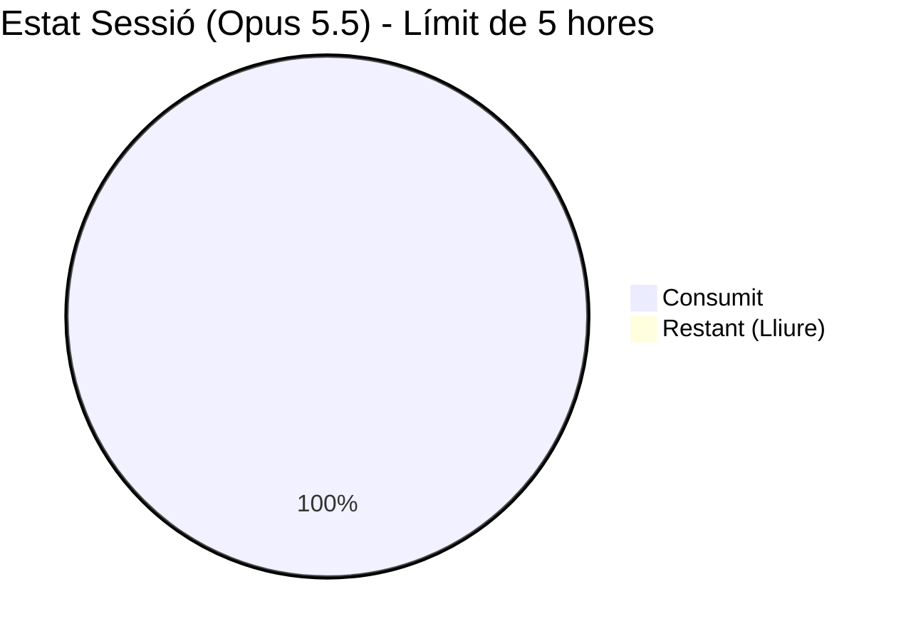
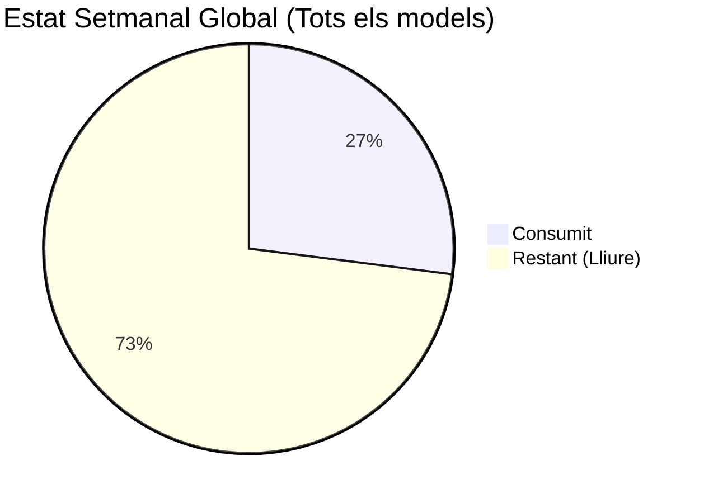
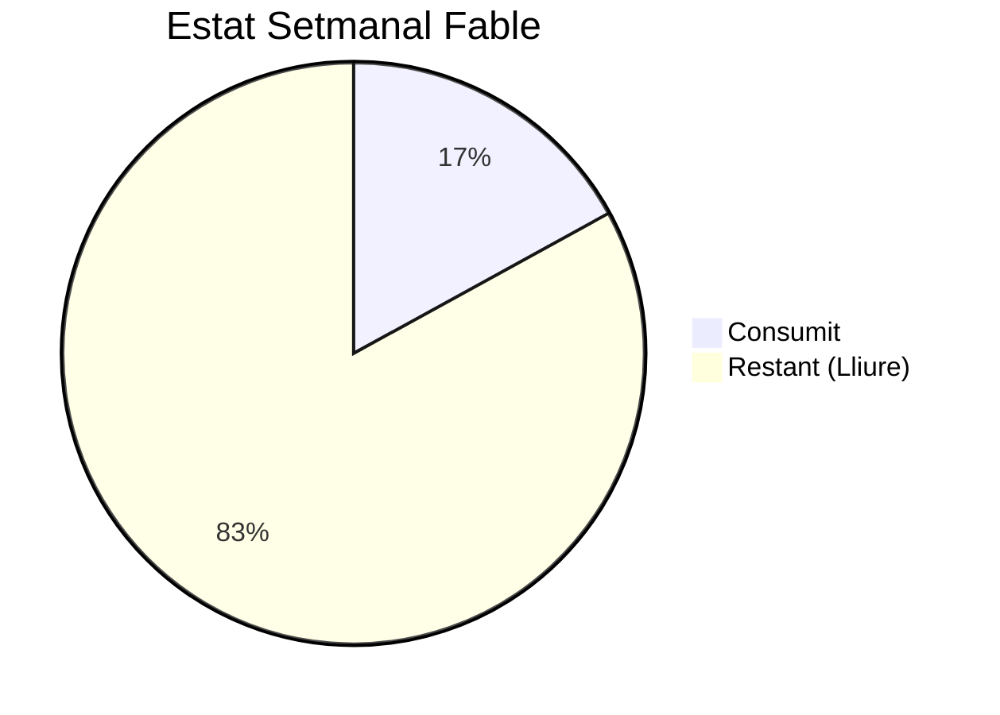
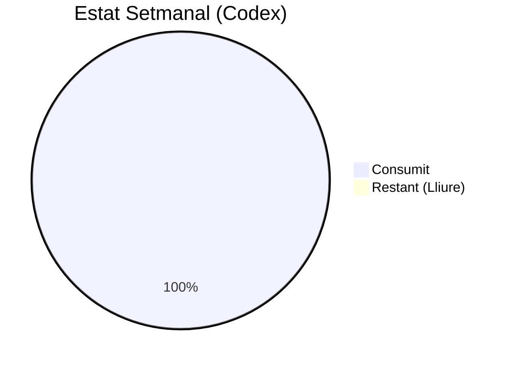
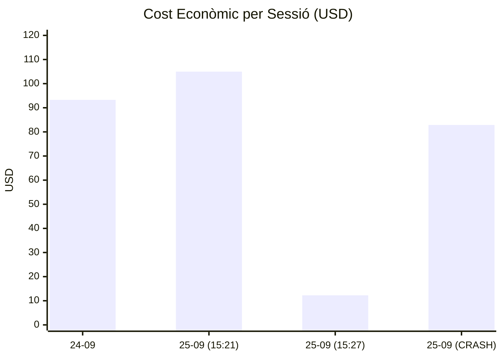

# Panell Visual de Consum IA

Aquest document reflecteix visualment l'estat de les nostres capacitats cognitives (quotes) basant-se en les dades recollides a `consum_ia.csv`.

## Estat de Claude (Darrera Captura: 25-09-2026 15:34)

## Estat de Codex / ChatGPT (Darrera Captura: 25-09-2026 17:36)

- **Límit Setmanal (GPT-6):** 100% consumit (0% restant, es restableix en 4 dies i 6 hores).
- **Saldo de crèdits:** 1.758 crèdits restants (Recàrrega automàtica: Desactivada).

## Evolució dels Costos

## Vincles

- [[00_index]]
