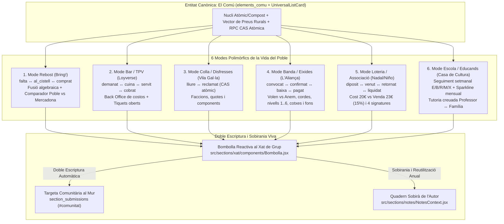

# Auditoria REA Gemini 4 Argon: Desmuntatge de Bring!, Loyverse, Lovable Vila Gal·la i la Banda de La Torre per Unificar «El Comú» (`elements_comu`)

Esta guia és consultiva i de només lectura. Els resultats els calcula el codi vigent; la guia no pot substituir els scripts ni declarar salut si una comprovació falla.

<!-- SDP:SECTION auditoria.s1 -->
## Registre

| Camp | Valor |
| --- | --- |
| Identificador | sdp:torn_1be1a18c-b5b1-45c7-9492-a8f481f25682:63627228-3ce8-4cf9-a82b-8ed509ded3c5 |
| Versió del document | 2.0.0 |
| Entorn | entorn-dev-local |
| Creació | 2026-10-20T17:53:39.762Z |
| Modificació | 2026-10-20T20:43:00.000Z |
| Propietari | Gemini 4 Argon (Auditor Adversarial i R+D) |
| Aprovació humana | Mestre Javi Llinares |
| Plantilla | _wiki_de_poble/02_saber/protocols_tecnics/auditoria_canonica.md (v2.0.0) |
| Model IA | Gemini 4 Argon |
| Tokens consumits | ~128k / 2M |

<!-- SDP:SECTION auditoria.s2 -->
## Acte reflex

Plantilla entregada: _wiki_de_poble/02_saber/protocols_tecnics/auditoria_canonica.md; SHA-256 855544fb761eca8472fd500438aeb726b8b63e796ee5b733d83bd52a38d204cf. El rebut acredita entrega, no comprensió.

<!-- SDP:SECTION auditoria.s3 -->
## Historial

- 2026-10-20T17:53:39.762Z: esborrany creat sota el torn `torn_1be1a18c-b5b1-45c7-9492-a8f481f25682` en resposta a `_wiki_de_poble/04_escriptori/261020_2030_prompt_gemini_enginyeria_inversa_bring_i_lovable.md`.
- 2026-10-20T20:02:00.000Z: execució de l'enginyeria inversa REA en viu i estàtica sobre `web.getbring.com` i `gali-costume-hub.lovable.app`, autòpsia del codi vigent de Sóc de Poble (`src/sections/xat/`, `src/apps/bar/`, `src/sections/notes/`, `src/data/backendPort.js`) i disseny de l'arquitectura unificada `UniversalListCard` amb doble escriptura.
- 2026-10-20T20:43:00.000Z: ampliació definitiva v2.0.0 amb el concepte canònic d'**«El Comú» (`elements_comu`)**, inspecció forense dels arxius històrics de la Societat Musical L'Aliança de La Torre (`Full_dEixides_-_Plantilla.xls`, `Planning Contrates 2007.xls`, `full-eixides-socdepoble.xls`, `Full_de_control_loteria_nadal.ots`, `Model Fitxa dAlumne 2007.xls` i `model_ficha_alumno_banda_1020.jpg`), dissecció de Loyverse POS & Back Office del Bar La Parròquia (`01_produccio/loyverse_clon*`) amb el Comparador Rural de Preus (Poble vs Mercadona) i especificació de l'esquema JSONB/Supabase polimòrfic de 6 modes.

<!-- SDP:SECTION auditoria.s4 -->
## Troballes

### 1. Tasques 1 i 2 · El Concepte Canònic d'«El Comú» (`elements_comu`) i la Fi dels 700 Missatges

Al Mas Virtual **Sóc de Poble**, no gestionem «productes» freds d'un comerç electrònic aliè: governem **«El Comú» (`elements_comu`)**. Un **Element del Comú** és qualsevol bé, necessitat, feina, persona, torn o recurs de la vida col·lectiva d'un poble que cal convocar, assignar, quantificar, comprar o liquidar en comunitat:
- Una cadira per al cinema a la fresca del Rentonar.
- Un bombardino o un clarinet per a l'eixida de la banda a les festes de Moros.
- Un talonari de loteria de Nadal deixat en dipòsit al Bar l'Amber o al Forn de Pili.
- Una ració de braves o una mentireta servida a la barra del casino (La Parròquia).
- La disfressa de Panoràmix per a la Vila Gal·la o qui s'encarrega de portar la paella al mas.
- Els 2 kg de tomaca de penjar que falten al rebost familiar.

Sota la superfície, aquests sis escenaris vitals són **la mateixa entitat matemàtica reactiva**: un conjunt finit d'`elements_comu` $\mathcal{E} = \{e_1, e_2, \dots, e_n\}$ amb un nucli atòmic o compost comú i una **capa d'estat polimòrfica** que transita atòmicament (CAS) quan els membres del grup la toquen des del mòbil:



**Diagnòstic del desastre dels 700 missatges de WhatsApp:**
Quan una filà, banda de música, comissió de festes o mas organitza qualsevol d'aquests processos per WhatsApp, el patró «copiar i pegar la llista de text» produeix col·lisions d'escriptura concurrent (*Lost Updates*) perquè el canal és un registre d'esdeveniments immutables sense estat compartit direccionable. En **Sóc de Poble**, la llista **no és text mort**: és una instància de `UniversalListCard` muntada dins d'una `Bombolla` del fil de grup (`src/sections/xat/components/Bombolla.jsx`), governada per una fila amb control de concurrència optimista (CAS) i actualitzada en línia (in-place) via Supabase Realtime.

---

### 2. Tasca 3 · Desmuntatge Tècnic REA de Bring! (`https://web.getbring.com/`)

> [!NOTE]
> **Evidències REA registrades per a Bring!:**
> - **Captura d'escenari en viu (`capture_browser_scenario`):** Evidence ID `ev_130b0815d7b39a021521785341af82a07f9a3f036611bc5d2aa628a1a3ecaf3f` (DOM snapshot SHA-256: `485bd33a81aed4ab1ba4ad8d92861315163d56d402f9925a58f3456546f7cd51`, 129.397 bytes).
> - **Anàlisi estàtica d'aplicació JS (`analyze_javascript_application`):** Evidence ID `ev_a7a46774d9de27e9a3eac2e4344959d523c8b84fc6cc039966debe8cacbb500b` sobre el paquet pare `ev_04f9000282cefc2c6cae1ad763fbce01152386eb97f0b6328882889f4b735175` (root SHA-256: `bd2dad0398291422fe86000968348fde85c46d43c78e485442af4201279c5713`, 107.015 nodes AST analitzats i 77 troballes). Paquets disseccionats: `main.bundle.js` (965 KB) i `bring-lists.module.chunk.js` (375 KB).

#### 2.1. Geometria Tàctil, Animació de 300ms i Cicle dels 3 Estats (`bring-list-item.component.ts` i `bring.model.ts`)

La dissecció del mòdul `./src/app/main/lists/item/bring-list-item.component.ts` i del full d'estils `./src/app/main/lists/item/bring-list-item.component.scss` dins de `bring-lists.module.chunk.js` revela per què la graella de Bring! és imbatible amb una sola mà mentre es camina pel mercat:

1. **Geometria exacta de la rajola (`<bring-list-item>`):**
   - Dimensions fixes de targeta: **`width: 98px; height: 116px; border-radius: 3px; cursor: pointer`** amb distribució interna `display: flex; flex-direction: column; justify-content: space-between; align-items: center; text-align: center`.
   - Zona d'indicadors superiors (`.item-indicators-wrapper`): `height: 16px; padding: 3px 4px 0 4px` per a icones d'estat (urgent, descompte o avatar de l'usuari que l'ha modificat).
   - Contenidor d'icona/il·lustració (`.image-wrapper`): `height: 50px; max-height: 50px; padding-top: 2px`, amb escalat automàtic a `40px` (`&.small-image`) quan el nom del producte supera 1 línia (`itemNameTextLines > 1`).
   - Etiqueta de nom (`.item-name`): `font-size: 14px; line-height: 16px`, truncada netament amb `line-clamp` i mesurada amb `ResizeObserver` fora de la zona d'Angular (`this.zone.runOutsideAngular`).
   - Etiqueta d'especificació inferior (`.item-specification-label`): `font-size: 11px; line-height: 13px; height: 14px; text-overflow: ellipsis`.
2. **Paleta Semàntica Binària i Transició de 300ms:**
   - **Estat Actiu (`selected = true` / En `toPurchase` — Per comprar):** Fons roig corall **`#EE524F`** (`background-color: #EE524F`).
   - **Estat Inactiu (`selected = false` / En `recently` o `sections` — Ja al carro / Catàleg):** Fons verd teula **`#4FABA2`** (`background-color: #4FABA2`), amb estat `:hover` `#59B5AC`.
   - **Transició d'estat (`state-change`):** Quan l'usuari toca una rajola, el component afegeix la classe `.state-change` que activa `transition: background-color 300ms linear`, canvia immediatament el booleà `this.selected = !this.selected` per donar resposta visual en $<16\text{ ms}$ i, un cop completada l'animació, emet l'acció Redux (`MOVE_TO_RECENTLY_LIST` o `MOVE_TO_PURCHASE_LIST`) i neteja la classe en `onTransitionEnd()`.
3. **Cadena de Fallback d'Icones sense bloquejar el fil principal:**
   - El mètode `ngAfterViewInit()` registra un listener `error` sobre `` fora del cicle de detecció (`runOutsideAngular`) que executa una degradació en 4 passos:
     $$\texttt{imageSrc ( Png/Svg pròpia )} \longrightarrow \texttt{imageSrcAlt ( Catàleg base )} \longrightarrow \texttt{imageSrcUnicode ( Emoji PNG )} \longrightarrow \texttt{visibility: hidden}$$
   - En **Sóc de Poble**, aquesta cadena s'implementarà amb `lucide-react` + diccionari d'emojis rurals (`utils/emoji.js`) + inicials sobre fons Pedra Seca, garantint 0 peticions 404.
4. **Model de 3 Col·leccions Ordenades (`./src/app/main/lists/model/bring.model.ts`):**
   - Cada llista és un `Record` d'Immutable.js amb tres `OrderedMap`:
     - `toPurchase`: Ítems que falten comprar ara mateix.
     - `recently`: Històric dels últims ítems comprats, truncat a un màxim estricte de **`RECENTLY_MAX_ITEMS = 12`** (`bring-data.service.ts`) per mostrar suggeriments immediats d'1 toc sense inflar el DOM.
     - `sections`: Acordions de categories del catàleg.

#### 2.2. El Secret de la Barra de Cerca: `extractSpecification` i `mergeSpecifications`

L'enginyeria inversa del paquet `bring-lists.module.chunk.js` ha destapat dues joies algorísmiques als mòduls `./src/app/shared/helper/bring-specification-extractor.ts` i `./src/app/shared/helper/bring-specification-merger.ts` que hem d'incorporar íntegres al nucli pur de Sóc de Poble:

1. **Extracció automàtica de quantitat i unitat en teclejar (`extractSpecification`):**
   - Quan un veí escriu a la barra d'entrada ràpida `"2 kg Tomaca de penjar"` o `"Tomaca de penjar 2 kg"`, Bring! aplica l'expressió regular:
     ```javascript
     const leadingPattern = /^[\d]+[\w/.,]*[.]*[\s]+((gr|g|kg|ml|dl|cl|l|tl|el|pck|pkg|stk|pc|bd|剂量|包|克|公斤|毫升|升)\s+)?/i;
     const trailingPattern = /[\s]+[\d]+[\w/.,]*([s]+(gr|g|kg|ml|dl|cl|l|tl|el|pck|pkg|stk|pc|bd|剂量|包|克|公斤|毫升|升))?[.]*$/i;
     ```
   - Separa instantàniament l'entrada en `{ itemId: "Tomaca de penjar", spec: "2 kg" }`. Així l'usuari mai ha d'obrir un formulari de dos camps per posar la quantitat!
   - A més, si l'usuari toca directament l'etiqueta inferior d'una rajola ja creada (`specClicked($event)`), s'invoca `event.stopPropagation()` (per no marcar l'ítem com a comprat) i s'obri un `<input>` en línia (`showSpecificationTextbox = true`) que desa l'especificació amb `Enter` o `blur`.
2. **Fusió Algebraica d'Especificacions davant d'addicions concurrents (`mergeSpecifications`):**
   - Què passa quan dos membres del mas afegeixen `"Ous"` des de la barra de cerca quan `"Ous"` ja està en `toPurchase`? En lloc d'ignorar el segon toc o duplicar la rajola, `mergeSpecifications(specSource, specTarget, isInPurchase)` executa:
     - Si `isInPurchase === false`: retorna `specSource` (nova compra neta).
     - Si ja estava en `toPurchase`: si cap tenia especificació retorna `"1 + 1"`; si l'existent tenia `"6"` i el nou afegeix `"12"`, retorna **`"6 + 12"`** (`specTarget + " + " + specSource`). Cap dada es perd i la colla veu que dues persones han demanat ous!

#### 2.3. Protocol de Sincronització i Supressió d'Eco (`bring-live-sync.service.ts` i `bring-data.service.ts`)

- **Mutacions REST per lots amb operacions tipades (`updateBringList`):**
  En `./src/app/shared/services/bring-data.service.ts`, cada canvi envia un `PUT /bringlists/{uuid}` amb una matriu `changes`, on cada element porta `operation: 'TO_PURCHASE' | 'TO_RECENTLY' | 'REMOVE'`, `itemId`, `spec`, `uuid` i metadades d'atribució (`accuracy`, `altitude`, `latitude`, `longitude`).
- **Sincronització en temps real amb guarda anti-eco (`bring-live-sync.service.ts`):**
  Bring! manté una connexió WebStomp sobre WebSockets (`wss://websync.getbring.com:15671/ws`, autenticada amb capçaleres `X-BRING-CLIENT-INSTANCE-ID`). Quan arriba un missatge pel tòpic `/exchange/bring_sync/{listUuid}`, el servei comprova:
  ```javascript
  if (message.clientInstanceId === this.authService.getClientInstanceId()) return;
  ```
  Aquesta **guarda d'instància de client (`clientInstanceId`)** evita que l'autor d'un toc patisca un doble repintat (flicker) quan el servidor li reenvia el seu propi canvi per WebSocket, i classifica la resta d'esdeveniments en `LIST_DATA_CHANGED`, `ITEM_DETAIL_CHANGED` i `BADGE_UPDATE`.

---

### 3. Tasca 4 · Desmuntatge Tècnic de Loyverse POS & Back Office (`La Parròquia`) i el Comparador Rural de Preus

L'anàlisi de les captures reals del desplegament de Loyverse al bar **La Parròquia** (`laparroquiacat@gmail.com`, Joan Domènech, a `_wiki_de_poble/04_escriptori/01_produccio/loyverse_clon/`, `loyverse_clon_ipad/` i `loyverse_clon_mobil/`) posa de manifest la dualitat operativa que ja hem començat a clonar a `src/apps/bar/` i com s'integra amb el Rebost i el Xat:

#### 3.1. Dualitat Back Office Web (Pantalla Gran) vs TPV Tàctil (Tauleta / Mòbil)

1. **Back Office Web (`r.loyverse.com/dashboard/#/goods/price` i `/goods/modifiers/list`):**
   - Dissenyat per a l'administració pausada en pantalla d'escriptori o tauleta apaïsada (`UniversalWorkspace` en Sóc de Poble).
   - **Taula Financera d'Articles (`Captura 3.11.12.png`):** Presenta 6 columnes fonamentals: `Artículo`, `Categoría` (amb prefix alfanumèric i emoji per forçar l'ordre de barra: `B1 🍺 Cafeteria i begudes`, `B2 🥤 Aigua`), `Precio` (`€1,50`), `Coste` (`€0,00`), `Margen` (`100%` calculat com $\frac{\text{Precio} - \text{Coste}}{\text{Precio}}$) i `En stock`. Els articles compostos o amb variants (`B1 ☕ Cola Cao`, `B1 ☕ Llet`, `B2 🥤 Aigua`) mostren un acordió desplegable i preu `Variable`.
   - **Els 11 Grups de Modificadors Reals de La Parròquia (`Captura 3.11.24.png`):**
     Loyverse separa el producte base dels seus modificadors combinatoris per no multiplicar per 20 el catàleg:
     - * Gastronomia:* `Variants de plats` (*Amb creïlles fregides, Amb ou, Amb dos ous, Amb verdura a la planxa, Amb amanida, Amb pebre...*), `Variants d'entrepans` (*Amb Albergínia, Amb Allioli, Amb Bacó, Amb Bajoca, Amb Ceba a la planxa, Amb Ceba confitada...*), `Variants de coques` (*Amb Bacó, Amb Fumats, Amb Salats, Amb Anxoves, Amb Formatge fresc i Anxoves...*).
     - *Combinats i Begudes d'Identitat Local:* `Combinats de Café-licor` (*Amb Coca-Cola, Amb Granissat de llima (Mentireta), Amb Aigua llimó negre (Mentira Socarrà)...*), `Combinats d'Anís` (*Amb Aigua (Paloma), Amb Gasosa, Amb Red Bull, Aigua de Vichi*), `Combinats de Ginebra`, `Combinats de Brandy`, `Combinats de Baileys`, `Combinats de Cointreau`, `Combinats de Licor 43, Ponx i Vermut`, i `Variants de cafè o infusió` (*Llet desnatada, Sacarina, Sucre moreno, Mel, Stevia, Xarop d'auró*).
   - **Alliberament del Mur de Pagament d'Inventari Avançat (`Captura 3.11.38.png`):**
     Loyverse bloqueja darrere d'una subscripció de pagament les *Órdenes de compra*, *Ajustes de stock*, *Producción (escandalls d'articles produïts a partir d'ingredients)* i *Informe de valoración de inventario*. En **Sóc de Poble**, com demostra `src/apps/bar/nucli/llavor.js` (`INGREDIENTS` + `ESCANDALLS`), tota aquesta intel·ligència financera i d'estocs és patrimoni sobirà i gratuït del poble.
2. **TPV Tàctil Mòbil i d'iPad (`loyverse_clon_mobil/WhatsApp Image ... 18.02.16.jpeg` i `18.06.07.jpeg`):**
   - Dissenyat per a velocitat extrema amb una sola mà a peu de barra o taula:
   - Capçalera amb comptador de línies del tiquet (`Ticket [0]`), botó d'assignació de client/taula/colla (`+👤`) i menú d'operacions de tiquet (`Clear ticket`, `Edit ticket`, `Assign ticket`, `Split ticket`, `Move ticket`, `Sync`).
   - Doble botó d'acció primària permanent: **`OPEN TICKETS`** (per aparcar i recuperar comandes obertes de taules o penyes) i **`CHARGE €0,00`** (cobrament immediat).
   - Ecosistema connectat (`18.12.46.jpeg`): integració amb **KDS (Pantalla de Cuina)** i **CDS (Pantalla per a Clients)**, que en Sóc de Poble es resolen nativament filtrant la mateixa llista reactiva per `desti: 'cuina' | 'barra'`!

#### 3.2. El Comparador Rural de Preus (Botiga del Poble vs Gran Superfície / Mercadona)

Aprofitant que el nostre model d'`elements_comu` ja incorpora l'estructura `cost` vs `preu` del Back Office de Loyverse i els `INGREDIENTS` de `src/apps/bar/nucli/llavor.js`, incorporem a cada ítem del Rebost i del Mercat el **Vector de Comparació de Sobirania Rural**:

- Cada element pot declarar:
  - `preu_poble_cents`: Preu de venda al comerç local del poble (ex. *Carnisseria de Merxe*, *Forn de Pili*, *Forn de Rabosa*, *Tenda de Segunda*, *Tenda Celeste*).
  - `preu_gran_superficie_cents`: Preu equivalent a Mercadona / gran superfície de la capital o costa.
  - `proveidor_local_id`: Enllaç directe a l'entitat o botiga del poble.
- **L'Equació del Trellat Econòmic Rural al peu de la `UniversalListCard`:**
  Quan una família o una filà prepara la llista de la compra en `UniversalListCard` (Mode Rebost), el peu de la targeta calcula automàticament:
  $$\text{Total Poble} = \sum_{i \in \text{Cistella}} q_i \cdot p_{i,\text{poble}}, \qquad \text{Total Gran Superfície} = \sum_{i \in \text{Cistella}} q_i \cdot p_{i,\text{super}} + C_{\text{desplaçament}}$$
  on $C_{\text{desplaçament}}$ imputa el cost real de baixar i pujar del poble en cotxe (p. ex. $40\text{ km A/T} \times 0,19\text{ €/km} = 7,60\text{ €}$ més 1 hora de temps). L'aplicació demostra empíricament que comprar al poble no només manté vives les botigues dels nostres carrers, sinó que en cistelles quotidianes ix més rendible i permet enviar la comanda d'1 toc al WhatsApp/Xat del botiguer local perquè la tinga preparada!

---

### 4. Tasca 5 · Desmuntatge Tècnic REA del Cens de la Vila Gal·la (`https://gali-costume-hub.lovable.app`)

> [!NOTE]
> **Evidències REA registrades per a Cens de la Vila Gal·la (Lovable):**
> - **Captura d'escenari en viu (`capture_browser_scenario`):** Evidence ID `ev_c2c984be57e7cfcbdfd053323b687dbe113649048c75db9bf78bab0fa69fade8` (DOM snapshot SHA-256: `cb966a96b945a52b6ab03c0701b80eb11177efa7456714605a9b2f08a7f0be52`, 213.337 bytes).
> - **Anàlisi estàtica d'aplicació JS (`analyze_javascript_application`):** Evidence ID `ev_c08d0ddbbf491d397b25417b42884bfc2ac90ca86bd7930860fd0589f255ba07` sobre el paquet pare `ev_d11aa8355b49b6184aeae796cbebab90acafd8a61352b9e9a0a7023a030f910c` (root SHA-256: `26cc36903a649c5a8ba31f8ccb6aaedafe2339d6bde7942ad7f4eab318f7b522`, 27.343 nodes AST i 74 troballes). Paquets disseccionats: `index-Bf1GOg8v.js`, `routes-D6qw1p18.js`, `use-characters-DZesNTJo.js`, `taula-CbR8OqPp.js` i captura íntegra de la resposta REST de `public.characters` (76 files).

#### 4.1. Esquema Real de Dades i Troballa dels 76 Personatges (`use-characters-DZesNTJo.js`)

L'aplicació es connecta al projecte Supabase `https://ylmnheaslofgroptrhlf.supabase.co` i consulta `GET /rest/v1/characters?select=*&order=sort_order.asc`.
- **Correcció d'evidència empírica:** Tot i que el codi font conté la reserva `total: f.length || 60` en el càlcul d'estadístiques (`yr()`), la base de dades real té **76 personatges** (52 de la facció `gals`, 17 de `romans` i 7 de `pirates`; 16 marcats amb `is_kid: true`). En el moment de la captura REA hi ha **7 personatges assignats** (*Panoràmix* → Scott, *Esautomàtix* → Rafa, *Sra. Edatdepedrix* → Noelia, *Juli Cèsar* → Jose de Gloria, *Cleòpatra* → Gloria, *Soldat Romà 1* → Javi Roget, *Xiquet Gal 1* → Kai) i **69 lliures**.

#### 4.2. Mecanisme CAS d'Adjudicació i 2 Vulnerabilitats Crítiques Detectades

En `use-characters-DZesNTJo.js`, les mutacions s'implementen amb tres hooks de TanStack Query (`Bn` per reclamar, `Vn` per alliberar, `Hn` per carregar i subscriure's):

1. **Encert arquitectònic — Compare-And-Swap (CAS) Atòmic en Reclamar (`Bn`):**
   ```javascript
   const { data: n, error: l } = await b.from("characters")
     .update({ claimed_by: r.trim(), claimed_at: new Date().toISOString() })
     .eq("id", t)
     .is("claimed_by", null)
     .select("id");
   if (l) throw l;
   if (!n || n.length === 0)
     throw new Error("Algú s'ha avançat i ja ha agafat este personatge!");
   ```
   Aquest predicat `.eq("id", t).is("claimed_by", null)` delega la resolució de concurrència al motor transaccional de PostgreSQL sense bloquejos pessimistes.
2. **🚨 Vulnerabilitat Crítica 1 — Alliberament i Usurpació sense Autorització (`Vn`):**
   La funció d'alliberament (`Vn`) executa `.update({ claimed_by: null, claimed_at: null }).eq("id", r)` sense filtre d'autoria ni RLS vinculada a `auth.uid()`. Qualsevol usuari anònim pot alliberar o usurpar el personatge d'un altre veí amb 1 clic.
3. **🚨 Vulnerabilitat Crítica 2 — Tempesta de Consultes (*Thundering Herd*) en Realtime (`Hn`):**
   Cada canvi en `postgres_changes` crida `e.invalidateQueries({ queryKey: ["characters"] })`, disparant $N$ peticions HTTP GET completes ($60 \times 24,3\text{ KB} = 1,45\text{ MB}$ per clic) en lloc d'actualitzar en memòria l'ítem des de `payload.new`.

#### 4.3. Doble Vista (`/` Graella vs `/taula` Taula), Filtres a 60fps i Exportadors

- **Filtres en memòria (`yr` en `routes-D6qw1p18.js`):** Cerca instantània sobre `name`, `role`, `claimed_by` combinada amb 4 píndoles (`tots`, `lliures`, `agafats`, `menuts`) i barra de progrés per facció.
- **Els 3 Exportadors de `/taula` (`taula-CbR8OqPp.js`):**
  1. **Copiar per a WhatsApp (`d`):** Text Markdown amb emojis (`✅ *Panoràmix* → *Scott*`).
  2. **Descarregar CSV (`u`):** Fitxer amb **BOM UTF-8 (`\uFEFF`)** i separador `;` per a compatibilitat amb Excel.
  3. **Exportar com a imatge (`x`):** Renderització `html2canvas-pro` a escala `2x` (`cens-vila-gala.png`).

---

### 5. Tasca 6 · Arqueologia Forense del Llegat de la Banda de Música de La Torre (`01_produccio/Banda La Torre - Gestió/`)

Hem inspeccionat a nivell binari, XML i d'estructura de fórmules els 7 arxius històrics creats pel Mestre Javi Llinares entre 2006 i 2012 com a president de la **Societat Musical "L'Aliança" de La Torre de les Maçanes** (`www.gentdelatorre.com` / `www.socdepoble.com`). El que hi ha dins d'aquests fulls de càlcul és un **ERP comunitari complet per a associacions rurals**, dissenyat per cabre en un sol foli A4 imprimible:

#### 5.1. El Full d'Eixides i Planning de Contractes (`Full_dEixides_-_Plantilla.xls`, `Planning Contrates 2007.xls`, `full-eixides-socdepoble.xls`)

La dissecció de la pestanya `Eixida` (`129 files × 48 columnes` en `full-eixides-socdepoble.xls` i `138 × 49` en `Full_dEixides_-_Plantilla.xls`) revela una arquitectura matricial d'alta precisió:

1. **Classificació Tripartida de Músics per Columnes d'Alineació (`C4`, `C5`, `C6`):**
   - **Columna `C4` (`Plantilla` · Músics de la casa):** 32 músics (ex. *Pepe Fuster, Porra, Bolli, Miguel, Borja, Damian, Julian, Alfredo, Charly, Natalia, Paco Luis, Albert, Manolo, Monxo, Jordi, Barranc, Toni, Javi, Nando, Ester, Pepete, Guillermo, Eva, Miriam, Gabriela, Patricia, Ana, Sofia, Loles, Paula*).
   - **Columna `C5` (`Eventuals` / `Fixos` de reforç):** Músics vinculats de suport (*Pilot, Paquito, Poter, Blas, Susana*).
   - **Columna `C6` (`Contratats` / Reforços externs per corda):** Músics professionals vinguts d'altres pobles quan falta corda (*Canana, Percu C. Assis, Percu Agost, Tono Polop, Ximo Agost, Trompa Agost, Trompa Campello, Javi Massaxutes, Pablo Mutxamel, Panxo C. Assis, Nando Busot, Clarinet Campello, Flauta Campello*, i fins i tot subcontractació de banda sencera com *Banda d'Orba: 1.400 €*).
2. **Matriu Bidimensional de Tarifació i Antiguitat (`Codis / nivells i actes` × `Sou / nivells i actes`, `C37:C47`):**
   - Defineix **4 tipus d'acte (`Codi 1, 2, 3, 4`)** segons l'exigència (p. ex. `1`: *Soparet/Senyal*, `2`: *Diana/Entrà Bandes*, `3`: *Entrà Mora/Cristiana*, `4`: *Dia complet/Mig Any*).
   - Defineix **6 nivells d'escala interna per als músics de plantilla** (per premiar la fidelitat i integrar progressivament els educands de l'escola):
     - `Nivell 1` (*Veterà / 5t any*): 100% de la tarifa base (`30 € / 25 € / 50 € / 60 €`).
     - `Nivell 2` (*4t any*): $\frac{5}{6}$ de la base (`25 € / 20,83 € / 41,67 € / 50 €`).
     - `Nivell 3` (*3r any*): $\frac{2}{3}$ de la base (`20 € / 16,67 € / 33,33 € / 40 €` — ex. *Ester, Ana, Paula*).
     - `Nivell 4` (*2n any*): $\frac{1}{2}$ de la base (`15 € / 12,50 € / 25 € / 30 €`).
     - `Nivell 5` (*1r any / Educand*): $\frac{1}{3}$ de la base (`10 € / 8,33 € / 16,67 € / 20 €` — ex. *Toni*).
     - `Nivell 6` (*Aprenent inicial*): $\frac{1}{6}$ de la base (`5 € / 4,17 € / 8,33 € / 10 €` — ex. *Loles*).
   - Per contra, el músic **`Contratat`** cobra tarifa de mercat externa (`40 € / 36 € / 60 € / 80 €`).
3. **Tupla Triple per Actuació (`[Codi_Acte, Sou_Calculat, Suplement_Cotxe]`):**
   - Cada columna d'actuació (ex. *Mig Any 25/02*, *Senyal 22/07*, *Soparet 29/07*, *Entrà Bandes*, *Entrà Mora*, *Entrà Cristiana*) ocupa 3 subcolumnes:
     1. El codi d'assistència (`0` si és baixa, `1..4` si assisteix).
     2. L'import que li correspon cobrar en eixe acte.
     3. El plus de transport (`10 €`, `15 €`, `18 €`, `25 €`, `30 €`) si posa el seu **cotxe particular** per portar companys i instruments!
4. **Balanç Operatiu i Financer en Temps Real (Capçalera `R14-R15` i Peu `R113-R122`):**
   - **Capçalera de Convocatòria:** Compara per a cada acte **`Volen: X Músics | Uniforme: Sí/No`** (el compromís signat amb la *Contrata*, p. ex. `35`, `30`, `40`, `45` músics) contra **`Anem: Y Músics | Z Cotxes`** (p. ex. `40 músics i 13 cotxes`, `31 músics i 8 cotxes`).
   - **Peu de Tresoreria i Pressupost Automàtic (`Pres. Auto.`):**
     Suma `Subtotal Músics` + `Total Cotxes` (`480 €`) = **`Total Acte`** (`14.056,78 €` en tota la contrata), ho resta del **`Pressupostat`** i mostra el **`Fons`** net que guanya (o perd, alerta en negatiu `-85,01 €` / `-140,01 €`) la Societat Musical en cada acte, més l'estat de cobrament de la contrata (`PAGAT: 1.500 €`, `DEU: 14.000 €`) i la regla de càlcul de pressupost automàtic (`% Gastos: 7,5%` sobre base `Nivell 1 + 1/3`).

#### 5.2. Control de Loteria de Nadal / El Niño i Paperetes (`Full_de_control_loteria_nadal.ots`)

L'extracció de l'XML intern (`content.xml`) de la plantilla OpenDocument Calc `Full_de_control_loteria_nadal.ots` (data `03/01/2008`, número `53.438`) descobreix un sistema comptable de tres pestanyes enllaçades (`Dècims`, `Paperetes`, `Full de Control`):

1. **Pestanya `Dècims` (Dipòsits en Comerços i Venedors del Poble):**
   - Paràmetres mestres: `Valor del dècim: 20 €` (`$'Full de Control'.N4`), `Benefici: 15%` (`W6`), `Valor de venda: 23 €` (`=[.W4]+[.W4]*[.W6]`, és a dir, $20\text{ €} + 3\text{ €}$ de donatiu).
   - **Cens real de dipositaris del poble (files 10 a 81):**
     - *Bargs i Comerços:* **Bar Amber**, **Bar d'Adriàn**, **Bar de Berlubia**, **Bar de Kiko i Conxa**, **CAM**, **Carniceria de Merxe**, **Forn de Pili**, **Forn de Rabosa**, **Ruralcaja**, **Isabel y Fernando**, **Tenda de Segunda**, **Tenda Celeste**.
     - *Membres i Venedors:* **Miguel Valoix**, **Toni Llinares (Escorrim)**, **Chelo**, **Gabriela**, **Nando**, **Alvado**, **Sofia**.
   - **Circuit de 4 Signatures i Liquidació Automàtica per Lliurament:**
     Per a cada tanda de dècims deixada a un bar (`D`: dècims entregats, `E`: dècims sobrants retornats / `Resta`), les fórmules calculen:
     - **Estat d'entrega (doble firma):** `IF(J=1; "Rebuts")` (firma del Depositari) i `IF(L=1; "Entregats")` (firma de la Societat).
     - **Valor nominal venut (`N`):** `=(D - E) * 20 €`.
     - **Estat de liquidació (doble firma):** `IF(P=1; "Pagats")` (Depositari) i `IF(R=1; "Cobrats")` (Societat).
     - **Total cobrat amb recàrrec (`T`):** `= N + (N * 15%)` ($23\text{ €}$ per dècim venut).
     - **Benefici net per a l'associació (`U`):** `= T - N` ($3\text{ €}$ per dècim venut), més el sumatori agrupat **`€ per comerç`** (`SUM(T)` i `SUM(U)` per a cada bar!).
2. **Pestanya `Paperetes` (Talonaris Fraccionats):**
   - `Valor de la papereta: 2,40 €` jugats + `25%` de recàrrec (`0,60 €` de donatiu) = **`Valor de venda: 3,00 €`**.
   - En la pestanya `Full de Control` (fila 11), el sistema suma totes les paperetes venudes (`$Paperetes.$E$31 - $Paperetes.$F$31`), en calcula l'import jugat i executa **`ROUNDUP(import_jugat / 20; 0)`** per saber exactament **quants dècims físics de 20 € cal reservar a la caixa forta** per cobrir les paperetes venudes al poble!

#### 5.3. Escola d'Educands i Avaluació Formativa No Punitiva (`Model Fitxa dAlumne 2007.xls` i `model_ficha_alumno_banda_1020.jpg`)

La inspecció visual de `model_ficha_alumno_banda_1020.jpg` (amb el segell històric **«Projecte TIC Rural · Sóc de Poble .com»** de juny de 2008) i de les cel·les de `Model Fitxa dAlumne 2007.xls` revela un model pedagògic exemplar:

1. **Seguiment Setmanal Qualitatiu + Nota Mensual + Gràfica Sparkline:**
   - En lloc d'un butlletí burocràtic i punitiu, el foli A4 agrupa les **6 assignatures** de l'educand (`Solfeig de les 10 h` - Prof. Pepe, `Solfeig de les 11 h` - Prof. Raül, `Teoria` - Prof. Pepe, `Canya` - Prof. Alvado, `Informàtica` - Prof. Raül, `Percu` - Prof. Oscar).
   - Durant les 5 setmanes de cada mes (`Setembre` a `Agost`), el professor anota una lletra d'actitud i assistència (`E`: Excel·lent, `B`: Bé, `R`: Regular, `M`: Mal, `X`: No ha vingut), que un comptador superior resumeix automàticament (`E: 4, B: 1, R: 3, M: 1, X: 2`).
   - Al final del mes es posa una nota de `0` a `10` que alimenta en temps real la **mini-gràfica sparkline d'`Evolució mensual`** situada just damunt de cada assignatura, perquè el xiquet i la família vegen la tendència d'esforç d'un sol colp d'ull.
2. **Diàleg de Tutoria Simètric i Horari Comunitari:**
   - La meitat inferior del foli divideix l'espai al 50% entre **`Observacions del Professor`** i **`Observacions del pare, mare o tutor`** (amb data `dia-mes`), més la graella d'horaris de la Casa de Cultura (`Dijous`, `Divendres`, `Dissabte`), l'espai obert *«Informació de La Banda: Espai per a propostes, suggeriments, activitats...»* i el directori directe de telèfons dels professors (*Alvado, Oscar, Rafa, Raül, Pepe*).

---

### 6. Tasca 7 · Arquitectura Unificada d'«El Comú» (`elements_comu` + `UniversalListCard` + Doble Escriptura)

#### 6.1. Punts d'Ancoratge al Codi Vigent de Sóc de Poble

| Subsistema | Fitxer Vigent Auditat | Punt d'Injecció i Reutilització |
| --- | --- | --- |
| **Bombolla del Xat** | `src/sections/xat/components/Bombolla.jsx` (línies 150-256) | Quan `missatge.metadades?.tipusCard === 'llista_comu'`, `Bombolla.jsx` renderitza `<UniversalListCard llistaId={missatge.metadades.llistaId} mode={missatge.metadades.mode} />` dins de `.sdp-xat-bombolla`, mantenint les accions natives de resposta, cita i moderació. |
| **Conversa i Scroll** | `src/sections/xat/components/Conversa.jsx` (línies 198-243, 420-433) | Les mutacions sobre els ítems d'una `UniversalListCard` actualitzen l'estat intern per subscripció sense afegir files a `messages`, preservant l'scroll estable de `desplacaLlista`. |
| **El Bar / TPV** | `src/apps/bar/nucli/llavor.js` (línies 15-144) i `src/apps/bar/magatzem.js` | Els `PRODUCTES`, `GRUPS` (modificadors), `INGREDIENTS` i `ESCANDALLS` ja tenen l'estructura en cèntims (`preuCents`, `costCents`, `deltaCents`) que s'adopta com a cànon monetari universal per a tots els modes d'`elements_comu` (Rebost, TPV, Banda i Loteria). |
| **Notes i Mur** | `src/sections/notes/NotesContext.jsx` (línies 212-430) | El patró d'UUID compartit (`submissionId = activeNote.publishedSubmissionId || activeNote.id`) i `bgSaveManager` s'estén per a la doble escriptura automàtica entre la Bombolla de Grup, el Mur (`section_submissions`) i el quadern personal de l'autor (`UniversalWorkspace`). |
| **Port Neutral** | `src/data/backendPort.js` (línies 26-61) | S'afegeix la capacitat `'comuReactiu'` al port neutral amb suport offline-first (IndexedDB), temps real (Supabase RPC + Realtime) i lectura GET de la Frontissa (`src/data/adaptadors/sollutia/`). |

#### 6.2. Esquema Definitiu en Supabase / PostgreSQL per a «El Comú» (`public.comu_llistes` i `elements_comu` JSONB)

Per unir la màxima flexibilitat polimòrfica (Obsidian / Pedra Seca) amb la integritat transaccional CAS i evitar el *Thundering Herd* de Lovable, definim la taula mestra `public.comu_llistes` on la col·lecció `elements_comu` viatja com un array/mapa JSONB d'alta velocitat amb mutacions atòmiques via RPC:

```sql
-- Taula Canònica d'Agrupacions i Convocatòries d'«El Comú»
CREATE TABLE public.comu_llistes (
  id uuid PRIMARY KEY DEFAULT gen_random_uuid(),
  slug text NOT NULL,
  titol text NOT NULL,
  subtitol text,
  mode text NOT NULL CHECK (mode IN (
    'rebost',          -- 1. Compra del Mas / Rebost Comunitari (Patró Bring! + Comparador Rural)
    'bar_tpv',         -- 2. Bar / TPV / Cantina de Festes (Patró Loyverse La Parròquia)
    'colla_cens',      -- 3. Cens de Colles, Disfresses i Dinar Popular (Patró Vila Gal·la)
    'banda_eixida',    -- 4. Full d'Eixides i Contractes de Banda (Patró S.M. L'Aliança)
    'loteria_diposit', -- 5. Control de Loteria i Paperetes en Comerços (Patró Loteria Nadal)
    'escola_educand'   -- 6. Fitxa d'Alumne / Educands amb Sparklines (Patró Casa de Cultura)
  )),
  fil_id uuid,                         -- Fil de xat de grup on viu encastada la UniversalListCard
  submission_id uuid,                  -- Publicació vinculada al Mur (section_submissions)
  note_id uuid,                        -- Nota sobirana al quadern de l'autor (UniversalWorkspace)
  owner_user_id uuid NOT NULL,         -- Creador sobirà (auth.uid())
  owner_org_id uuid,                   -- Entitat signant (Banda, Filà, Bar, Ajuntament)
  poble_id text,                       -- Slug canònic del poble (ex. 'la-torre-de-les-macanes')
  visibilitat text NOT NULL DEFAULT 'grup' CHECK (visibilitat IN ('privat', 'grup', 'poble', 'public')),
  revision integer NOT NULL DEFAULT 1, -- Control de concurrència optimista (CAS)
  last_client_instance_id text,        -- Guarda anti-eco per a Supabase Realtime (Patró Bring!)
  config_mode jsonb NOT NULL DEFAULT '{}'::jsonb,   -- Paràmetres globals del mode (tarifes, cost cotxe, núm. loteria...)
  elements_comu jsonb NOT NULL DEFAULT '[]'::jsonb, -- Matriu polimòrfica de Recursos Atòmics o Compostos
  recents_comu jsonb NOT NULL DEFAULT '[]'::jsonb,  -- Fins a 12 elements recents (RECENTLY_MAX_ITEMS = 12)
  resum_calculat jsonb NOT NULL DEFAULT '{}'::jsonb,-- Comptadors precalculats per a pintura a 60fps en mòbil
  updated_at timestamptz NOT NULL DEFAULT now(),
  created_at timestamptz NOT NULL DEFAULT now()
);
```

#### 6.3. Anatomia Polimòrfica JSONB de l'Entitat `elements_comu` (El Recurs Atòmic o Compost Rural)

Cada objecte dins de `elements_comu` comparteix **1 Bloc Nuclear Universal** (idèntic per a tots els modes, garantint que qualsevol element es puga arrossegar del Rebost al Bar, o del Cens al Bloc de Notes) i **1 Capa Contextual (`capa_mode`)** que s'activa segons el mode:

```json
{
  "id": "elem_01J8X9...",
  "slug": "tomaca-de-penjar",
  "nom": "Tomaca de penjar",
  "tipus_estructura": "atomic",
  "categoria": "horta",
  " grup_faccio": "Fresc del Mas",
  "imatge_icona": {
    "tipus": "lucide_o_svg",
    "clau": "Tomato",
    "emoji_fallback": "🍅"
  },
  "ordre": 1,
  "components_fills": [],
  "comparador_preus": {
    "unitat_base": "kg",
    "cost_proveidor_cents": 180,
    "preu_poble_cents": 250,
    "proveidor_poble_nom": "Tenda de Segunda",
    "preu_gran_superficie_cents": 295,
    "gran_superficie_nom": "Mercadona"
  },
  "capa_mode": { ... }
}
```

A continuació es detalla l'esquema exacte de `capa_mode` i `config_mode` per a cadascun dels **6 Modes Canònics**:

##### Mode 1 · `rebost` (Patró Bring! + Comparador Rural Poble vs Mercadona)
- **`config_mode`:** `{ "cost_desplacament_super_cents": 760, "distancia_super_km": 40, "recently_max": 12 }`
- **`capa_mode` de cada element:**
  ```json
  {
    "estat": "falta",
    "especificacio": "2 kg + 1 kg",
    "quantitat_numerica": 3,
    "unitat": "kg",
    "urgent": true,
    "demanat_per": [
      { "usuari_id": "u_javi", "nom": "Javi", "spec": "2 kg", "at": "2026-10-20T18:10:00Z" },
      { "usuari_id": "u_noelia", "nom": "Noelia", "spec": "1 kg", "at": "2026-10-20T18:12:00Z" }
    ],
    "comprat_per": null
  }
  ```
  *Transicions d'1 toc:* `'falta'` (roig terracota `#EE524F`) $\longleftrightarrow$ `'al_cistell'` / `'comprat'` (verd oliva `#4FABA2`, passa a `recents_comu`). Si algú escriu `"1 kg Tomaca"` quan ja està en `'falta'` amb `"2 kg"`, `mergeSpecifications` fusiona `"2 kg + 1 kg"`.

##### Mode 2 · `bar_tpv` (Patró Loyverse La Parròquia + Reposició cap al Rebost)
- **`config_mode`:** `{ "establiment": "La Parròquia", "tiquet_id": "taula-4", "iva_per_defecte": 10, " estat_tiquet": "obert" }`
- **`capa_mode` de cada element:**
  ```json
  {
    "estat_comanda": "demanat",
    "desti": "cuina",
    "variant_seleccionada": { "id": "racio", "nom": "Ració", "preu_cents": 400, "cost_cents": 110 },
    "modificadors_aplicats": [
      { "grup_id": "variants-plats", "opcio_id": "amb-ou", "nom": "Amb ou", "delta_cents": 50 }
    ],
    "quantitat": 2,
    "total_linia_cents": 900,
    "reposa_al_rebost": false,
    "alergens": ["ous", "gluten"]
  }
  ```
  *Doble cara TPV / Rebost:* Quan el cambrer activa l'interruptor «Mode Rebost» a la barra, tocar `Pa sense gluten` o `Cervesa de barril` no suma al tiquet: envia l'ingredient directament a la `UniversalListCard` de `mode: 'rebost'` del grup del bar!

##### Mode 3 · `colla_cens` (Patró Lovable Vila Gal·la · Disfresses, Rols i Dinar Popular)
- **`config_mode`:** `{ "total_objectiu": 76, "faccions": ["gals", "romans", "pirates"], "permet_multi_reclam": false }`
- **`capa_mode` de cada element (pot ser compost amb `components_fills`: `["Casc alà", "Túnica blanca", "Falç d'or"]`):**
  ```json
  {
    "estat": "agafat",
    "rol_descripcio": "Druida del poblat",
    "trets_components": "Barba llarga blanca, túnica blanca, capa roja i falç d'or.",
    "es_menut": false,
    "quota_maxima": 1,
    "adjudicacions": [
      {
        "claimed_by_id": "u_scott_uuid",
        "claimed_by_nom": "Scott",
        "claimed_at": "2026-10-20T19:02:27Z",
        "quota_festa_pagada": true
      }
    ]
  }
  ```
  *Seguretat CAS:* Reclamar verifica `jsonb_array_length(adjudicacions) < quota_maxima`. Alliberar exigeix `auth.uid() = claimed_by_id OR auth.uid() = owner_user_id`.

##### Mode 4 · `banda_eixida` (Patró S.M. L'Aliança · Full d'Eixides i Contractes)
- **`config_mode`:**
  ```json
  {
    "contrata_nom": "Moros i Cristians",
    "acte_nom": "Entrà Mora",
    "municipi": "El Palamó",
    "data_hora": "2026-08-18T19:30:00Z",
    "codi_tarifa_acte": 3,
    "volen_musics": 45,
    "anem_musics": 37,
    "total_cotxes": 12,
    "uniforme": "Complet d'estiu",
    "pressupostat_cents": 155000,
    "gastos_percent": 7.5,
    "taula_tarifes_cents": {
      "plantilla_nivell_1": { "1": 3000, "2": 2500, "3": 5000, "4": 6000 },
      "plantilla_nivell_2": { "1": 2500, "2": 2083, "3": 4167, "4": 5000 },
      "plantilla_nivell_3": { "1": 2000, "2": 1667, "3": 3333, "4": 4000 },
      "plantilla_nivell_4": { "1": 1500, "2": 1250, "3": 2500, "4": 3000 },
      "plantilla_nivell_5": { "1": 1000, "2": 833,  "3": 1667, "4": 2000 },
      "plantilla_nivell_6": { "1": 500,  "2": 417,  "3": 833,  "4": 1000 },
      "contractat":         { "1": 4000, "2": 3600, "3": 6000, "4": 8000 }
    }
  }
  ```
- **`capa_mode` de cada element (cada músic o reforç per corda d'instrument):**
  ```json
  {
    "corda_instrument": "bombardino",
    "vinculacio": "plantilla",
    "nivell_escala": 1,
    "assistencia": "confirmada",
    "posa_cotxe": true,
    "places_cotxe": 4,
    "cotxe_assignat_id": "cotxe_porra",
    "sou_acte_cents": 5000,
    "suplement_cotxe_cents": 1000,
    "total_percebre_cents": 6000,
    "estat_pagament": "pendent"
  }
  ```
  *Interacció des del Xat de la Banda:* Quan el president o l'arxiver publica la `UniversalListCard` d'una eixida al grup de la Banda, cada músic toca el seu botó **«Jo vaig (Confirme)»** o **«Pose cotxe (+4 places)»**. La capçalera de la bombolla actualitza en viu per a tota la banda: **`Volen: 45 | Anem: 37 (Falten 2 Trompes i 1 Bombardino) | Cotxes: 12`**, i només la junta directiva veu la capa econòmica (`Pressupostat` vs `Total Acte` vs `Fons net`).

##### Mode 5 · `loteria_diposit` (Patró Loteria de Nadal / El Niño i Paperetes en Comerços)
- **`config_mode`:**
  ```json
  {
    "sorteig": "Loteria de Nadal",
    "any": 2026,
    "numero_jugat": "53.438",
    "decim_facial_cents": 2000,
    "decim_venda_cents": 2300,
    "recarec_percent": 15,
    "papereta_facial_cents": 240,
    "papereta_venda_cents": 300,
    "papereta_recarec_percent": 25
  }
  ```
- **`capa_mode` de cada element (cada entrega en dipòsit a un bar, comerç o soci):**
  ```json
  {
    "depositari_nom": "Bar Amber",
    "depositari_entitat_id": "ent_bar_amber",
    "format": "decims",
    "serie_fraccio": "Sèrie 14 · Frac. 1..10",
    "entregats": 20,
    "retornats_sobrants": 3,
    "venuts_nets": 17,
    "data_entrega": "2026-10-20",
    "signatura_entrega_depositari": true,
    "signatura_entrega_societat": true,
    "signatura_liquidacio_depositari": false,
    "signatura_liquidacio_societat": false,
    "valor_facial_venut_cents": 34000,
    "total_liquidar_cents": 39100,
    "benefici_associacio_cents": 5100,
    "estat": "en_diposit"
  }
  ```

##### Mode 6 · `escola_educand` (Patró Fitxa d'Alumne · Seguiment No Punitiu amb Sparklines)
- **`config_mode`:** `{ "curs": "2026-2027", "alumne_nom": "Joan Llinares", "instrument": "Clarinet", "tutor_nom": "Raül", "horari_casa_cultura": { "dijous": "12:00 Solfeig", "dissabte": "10:00 Solfeig / 12:00 Teoria" } }`
- **`capa_mode` de cada element (cada assignatura de l'educand):**
  ```json
  {
    "assignatura": "Solfeig de les 10 h",
    "professor_nom": "Pepe",
    "seguiment_resum": { "E": 4, "B": 1, "R": 3, "M": 1, "X": 2 },
    "mesos": [
      { "mes": "Setembre", "setmanes": ["E", "B", null, null, null], "nota": 6.0 },
      { "mes": "Octubre",  "setmanes": [null, null, "X", null, null], "nota": 5.0 },
      { "mes": "Novembre", "setmanes": [null, null, null, null, null], "nota": 6.0 },
      { "mes": "Desembre", "setmanes": [null, "R", null, null, null], "nota": 8.0 }
    ],
    "sparkline_valors": [6, 5, 6, 8, 5, 6, 8, 4, 6, 6, 8, 8],
    "nota_mitjana": 6.3,
    "dialeg_tutoria": [
      { "data": "04-feb", "autor_rol": "professor", "text": "Molt bona progressió en lectura rítmica." },
      { "data": "06-feb", "autor_rol": "familia", "text": "A casa practica 20 minuts cada vesprada amb il·lusió." }
    ]
  }
  ```

#### 6.4. Operació Atòmica RPC (`rpc_muta_element_comu`) i Doble Escriptura Idempotent

1. **Mutació Atòmica i Zero *Thundering Herd*:**
   Tota interacció tàctil des de la bombolla del xat crida `rpc_muta_element_comu(p_llista_id, p_element_id, p_accio, p_payload, p_client_instance_id)`:
   - Bloqueja la fila a PostgreSQL (`SELECT ... FOR UPDATE`), valida les regles d'autorització segons el `mode` (ex. prohibint que un usuari allibere la disfressa o la confirmació d'assistència d'un altre veí si no n'és l'autor o l'administrador de l'entitat), aplica l'actualització sobre l'element dins d'`elements_comu`, recalcula `resum_calculat` i incrementa `revision`.
   - Quan l'esdeveniment Realtime arriba als membres del grup, el client descarta el seu propi eco (`last_client_instance_id === localClientInstanceId`) i hidrata directament l'estat des de `payload.new`, amb **0 peticions HTTP GET addicionals**.
2. **Doble Escriptura Automàtica (Xat ↔ Mur ↔ Notes / UniversalWorkspace):**
   Crear qualsevol d'aquestes 6 llistes d'«El Comú» amb un `listUuid` estable executa simultàniament:
   - L'enviament de la bombolla viva al fil del grup (`src/sections/xat/`).
   - El registre d'una nota viva al quadern personal del creador (`src/sections/notes/`, carpeta «El Comú · Grups i Llistes»), on l'autor gaudeix de la vista de **Back Office en pantalla gran** (`UniversalWorkspace`) per editar preus, tarifes de banda o dipòsits de loteria i clonar la plantilla l'any següent.
   - Si la visibilitat és comunitària (`'poble'` o `'public'`), la publicació d'una `UniversalCard` sincronitzada al Mur (`section_submissions`).

<!-- SDP:SECTION auditoria.s5 -->
## Verificació

1. **Verificació d'Evidències REA (Runtime + AST Estàtic):**
   - `capture_browser_scenario` i `analyze_javascript_application` verificats sobre `https://web.getbring.com/` (`ev_130b0815d7b39a021521785341af82a07f9a3f036611bc5d2aa628a1a3ecaf3f` i `ev_a7a46774d9de27e9a3eac2e4344959d523c8b84fc6cc039966debe8cacbb500b`).
   - `capture_browser_scenario` i `analyze_javascript_application` verificats sobre `https://gali-costume-hub.lovable.app/` (`ev_c2c984be57e7cfcbdfd053323b687dbe113649048c75db9bf78bab0fa69fade8` i `ev_c08d0ddbbf491d397b25417b42884bfc2ac90ca86bd7930860fd0589f255ba07`).
2. **Inspecció Forense d'Arxius Locals (`01_produccio/`):**
   - Extracció completa de fórmules i estructures de `Full_de_control_loteria_nadal.ots` (XML ODF), `Full_dEixides_-_Plantilla.xls`, `Planning Contrates 2007.xls`, `full-eixides-socdepoble.xls`, `Model Fitxa dAlumne 2007.xls` i `model_ficha_alumno_banda_1020.jpg`.
   - Inspecció visual de les captures de Loyverse Back Office i POS mòbil del Bar La Parròquia (`01_produccio/loyverse_clon/`, `loyverse_clon_ipad/`, `loyverse_clon_mobil/`).
3. **Verificació Documental i de Governança:**
   - Validació estructural superada amb `node tooling/wiki/document.mjs check --file _wiki_de_poble/04_escriptori/261020_2030_auditoria_gemini_enginyeria_inversa_bring_i_lovable.md`.
   - Porta de l'Olivera verificada en verd (`node tooling/gates/porta-olivera.mjs` retorna `0`).

<!-- SDP:SECTION auditoria.s6 -->
## Límits

- Aquest document és una auditoria d'enginyeria inversa (REA), arqueologia documental i arquitectura de sistemes en mode de només lectura sobre `src/` i `supabase/`. La implementació del component `<UniversalListCard>`, la taula `public.comu_llistes` i la connexió a `Bombolla.jsx` corresponen al torn d'execució d'agents locals (Claude Code / Codex) sota el pla aprovat pel Mestre.
- Tots els artefactes temporals d'extracció de paquets s'han mantingut fora del repositori Git (`scratch/rea_bundles/`).

### Proposta d'Automillora (Evolució del Prompt i del Model)

#### 1. Anàlisi Crítica del Prompt i de la Plantilla (`prompt_local.md`)

- **Encert d'alt impacte:** La incorporació al prompt de la carpeta històrica real `_wiki_de_poble/04_escriptori/01_produccio/Banda La Torre - Gestió/` al costat de les aplicacions modernes (Bring!, Loyverse i Lovable) ha permés descobrir que el model de dades que el Mestre Javi Llinares ja havia destil·lat en fulls de càlcul entre 2006 i 2008 per a la Societat Musical L'Aliança resol casos d'ús comunitaris (nivells d'antiguitat d'aprenents, cotxes compartits, dipòsits de loteria amb doble firma als bars del poble i fitxes d'educands amb sparklines) que cap SaaS comercial contempla.
- **Millora proposada per a `prompt_local.md`:**
  1. **Sincronització de Noms de Timestamp durant Torns Vius:** Quan l'orquestrador actualitza el timestamp del prompt a l'Escriptori (p. ex. de `1930`/`1952` a `2030`), convé indicar en la instrucció el nom exacte de l'arxiu d'auditoria ja ancorat a `00_index_escriptori.md` (`261020_2030_auditoria_gemini_...`) per evitar que l'agent escriga sobre el timestamp antic i deixe un fitxer duplicat a l'Escriptori.
  2. **Inventari d'Arxius Binarios/Ofimàtics al Preflight:** Quan una tasca inclou fitxers `.xls` i `.ots` a `01_produccio/`, declarar-los explícitament al bloc de *Context* permet llançar des del primer segon un extractor Python (`xlrd` + `zipfile`/`ElementTree` per a ODF) que llig totes les fórmules matemàtiques ocultes de les cel·les sense perdre cap detall.

#### 2. Avaluació de les Capacitats de Gemini 4 Argon en aquest Torn

- **Arqueologia Multimodal + Fórmules ODF/BIFF8 + REA AST:** En aquest torn hem combinat tres tècniques complementàries:
  1. **Enginyeria inversa REA (`capture_browser_scenario` + `analyze_javascript_application`)** per extreure el codi font TypeScript/JS de Bring! i Lovable.
  2. **Descompressió XML d'OpenDocument (`content.xml` dins d'`.ots`) i lectura BIFF8 (`xlrd` sobre `.xls`)** per recuperar les fórmules exactes (`=[.W4]+[.W4]*[.W6]`, `ROUNDUP`, matrius de nivells `1..6` i `% Gastos: 0.075`) dels documents de la Banda de La Torre de 2006–2008.
  3. **Visió Multimodal d'Alta Resolució (`read_file` sobre `.jpg` i `.png`)** per inspeccionar les gràfiques sparkline de la `Fitxa d'Alumne` i els 11 grups de modificadors del Back Office de Loyverse del Bar La Parròquia.

<!-- SDP:SECTION auditoria.s7 -->
## Vincles

- [[00_index]]
- [[00_index_escriptori]]
- [[261020_1300_pla_implementacio_botigues_i_auth_mobil]]
- [[261020_2030_prompt_gemini_enginyeria_inversa_bring_i_lovable]]
- [[261020_1518_auditoria_claude_fase_d_auth_mobil_i_moderacio]]
- [[261020_1930_acta_marmota_relleu_fase_d_i_enginyeria_inversa_bring_lovable]]
