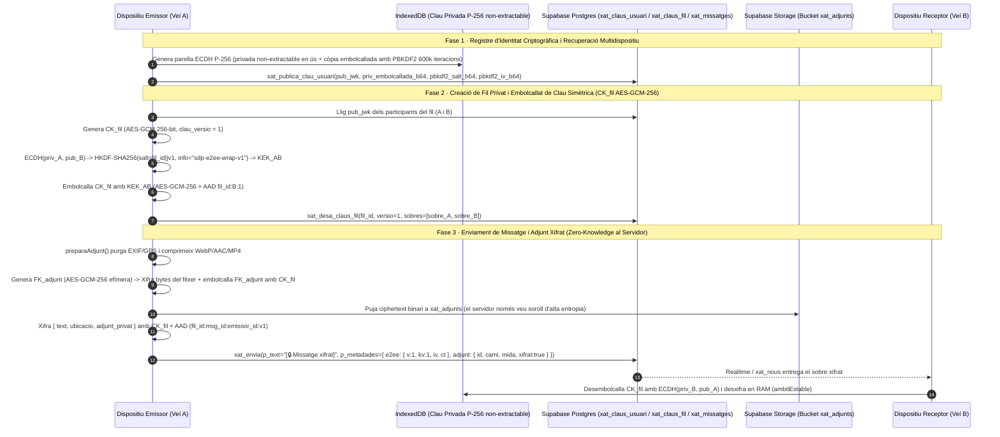

# Auditoria Arquitectònica, Pedra Seca, Editorial, Emowe i Gauntlet Onada 2 (Gemini) · Pla 261028_1526

Esta guia és consultiva i de només lectura. Els resultats els calcula el codi vigent; la guia no pot substituir els scripts ni declarar salut si una comprovació falla.

<!-- SDP:SECTION auditoria.s1 -->
## Registre

| Camp | Valor |
| --- | --- |
| Identificador | sdp:torn_7f2605ac-fd9c-4eff-b5fd-d5f622279464:e22c8927-48b2-44a8-ba85-66e6a619d1ff |
| Versió del document | 3.0.0 |
| Entorn | entorn-dev-local |
| Creació | 2026-10-28T15:14:40.667Z |
| Modificació | 2026-10-29T00:28:00.000Z |
| Propietari | agent-local |
| Aprovació humana | pendent |
| Plantilla | _wiki_de_poble/02_saber/protocols_tecnics/auditoria_canonica.md (v2.0.0) |
| Model IA | Gemini 3.1 Pro (Finestra d'Auditoria Arquitectònica, Pedra Seca, Gauntlet Onada 2, Arquitectura E2EE `P1-12` i Certificació Final `e36606db2` + `IDEA-48`) |
| Tokens consumits | ~148.000 tokens (Onada 1 `3dbdecb16` + Onada 2 `cd3b5b56c` + Addenda E2EE `P1-12` + Ronda Final Gauntlet sobre `e36606db2` i `IDEA-48` + Butlletí NIST CSF 2.0) |

<!-- SDP:SECTION auditoria.s2 -->
## Acte reflex

Plantilla entregada: _wiki_de_poble/02_saber/protocols_tecnics/auditoria_canonica.md; SHA-256 855544fb761eca8472fd500438aeb726b8b63e796ee5b733d83bd52a38d204cf. El rebut acredita entrega, no comprensió.

<!-- SDP:SECTION auditoria.s3 -->
## Historial

- **2026-10-28T15:14:40.667Z:** Esborrany creat amb acte reflex `sdp:torn_7f2605ac-fd9c-4eff-b5fd-d5f622279464:e22c8927-48b2-44a8-ba85-66e6a619d1ff`.
- **2026-10-28T15:16:00.000Z (v1.0.0 · Onada 1):** Completada l'auditoria quirúrgica en mode read-only sobre l'arbre viu (`HEAD` `3dbdecb16`), contrastant els **Blocs A, B, C, D, E, F i G** del Pla `261028_1526`, l'enginyeria inversa de `plantilla-mapa.html` v3 i `001 NEXUS` d'**Emowe**, i la revisió dels últims articles d'`https://emowe.com/rss.xml`.
- **2026-10-28T20:23:00.000Z (v2.0.0 · Onada 2 · `T8 · Bloc H`):** Executat el **Gauntlet Adversarial Extrem** sobre els **223 fitxers del commit `cd3b5b56c`** (`+16.906 / -769`) i l'informe `261028_1620_auditoria_claude.md`, l'auditoria de seguretat del connector `wordpress-plugin/` (`socdepoble-enxufe` v1.1.9) davant l'**alerta crítica de PHP d'INCIBE / Kit Digital (`CVE-2026-109618` i `CVE-2026-109619`)**, i l'especificació arquitectònica i de DOM per al **Bloc H (`P1-66`, `P1-67`, `P1-68`, `P1-69`, `IDEA-40`, `IDEA-32`, `IDEA-33`, `IDEA-41`)**.
- **2026-10-28T21:18:00.000Z (v2.1.0 · Addenda `GM2-09` · Arquitectura Exacta d'Implementació de `P1-12` / `IDEA-19` E2EE):** Dissenyat en mode 100% read-only el plànol tècnic executable per al **Xifratge d'Extrem a Extrem (E2EE)** de xats personals (`directe`) i grups privats (`grup`) amb **Web Crypto API (`crypto.subtle` ECDH P-256 + HKDF-SHA256 + AES-GCM 256-bit)**, clau simètrica de fil embolcallada per participant (`xat_claus_fil`), recuperació multidispositiu amb **PBKDF2 (`600.000` iteracions)** i xifratge d'adjunts privats a `xat_adjunts`.
- **2026-10-29T00:28:00.000Z (v3.0.0 · Ronda Final Gauntlet sobre `e36606db2` + Síntesi E2EE `IDEA-48` i Butlletí de Qualificacions NIST CSF 2.0):** Certificació final en mode 100% read-only de l'entrega completa de **Claude Code** (`e36606db2` · Bloc H · 99 fitxers sobre `cd3b5b56c` · Blocs A–G · 223 fitxers), verificació empírica de `247/247` tests Vitest del Bloc H, `58/58` tests Node SEO i `15/15` claus de Frontissa en verd, auditoria de la síntesi definitiva de **`P1-12` + `IDEA-48` (Recuperació Social per Cercle Obert Shamir $k=3$ sobre $\text{GF}(2^8)$)** i emissió del **Butlletí de Qualificacions (0,0 a 10,0)** a través de les 10 dimensions del sistema.

<!-- SDP:SECTION auditoria.s4 -->
## Troballes

Aquest dictamen unificat recull tant l'**Onada 2 (`T8 · Bloc H`, Gauntlet Adversarial sobre el commit `cd3b5b56c` i especificació de Bloc H)** com el registre íntegre de l'**Onada 1 (`3dbdecb16` i I+D d'Emowe)**, operant en estricte **mode read-only sobre `src/`, `tooling/`, `tests/`, `supabase/` i `wordpress-plugin/`** per garantir **zero col·lisions d'escriptura** amb **Claude Code**.

### Matriu Executiva del Gauntlet d'Onada 2 sobre el Commit `cd3b5b56c` (`223 fitxers`)

| Àmbit Auditat (`cd3b5b56c` + Bloc H) | Veredicte sobre `cd3b5b56c` | Troballes Adversarials / Deute Residual per a `T8.2 · Bloc H` | Severitat |
| --- | --- | --- | --- |
| **OpenGraph Estàtic (`P1-61` Fase 2 i `OG-7`)** | **VERIFICAT SÒLID:** 111 rutes + 8 àlies i `/wikidepoble/<id>` amb `confined()`, `wx` i `sniffImage`. | **`GM2-01`:** En `/wikidepoble/<id>/index.html`, `og:url` apunta a `/wikidepoble/<id>` mentre `<link rel="canonical">` apunta a `/wikidepoble?item=<id>`; 7 imatges socials superen els `600 KB` d'avís per a WhatsApp. | **P3** |
| **Purga EXIF GPS (`P1-64` Privacitat)** | **VERIFICAT BLINDAT:** 10/10 fotos personals sense GPS + allowlist explícita de 8 fotos patrimonials de La Torre. | Doble verificador independent (`llegixCapcalera` + `lecturaIndependent` TIFF/PNG/XMP) a `fotosPubliques.senseGps.seguretat.test.js:173-224`. Cap regressió. | **VERD** |
| **Mapa Fotogràfic EXIF (`P1-64` Leaflet)** | **VERIFICAT SÒLID:** Zero crides OSM fins a prémer «Vore mapa», ocult en app nativa, Complete-Link + Lance-Williams. | **`GM2-02` (`Emowe M1/M2`):** En `puntsDelMapa.js:131`, separar `origen` (`'exif' \| 'manual' \| 'poble' \| null`) d'`inferencia` (`'directa' \| 'estimada_temporal' \| 'fallback_poble'`) i arrodonir coordenades a `1e-4°` abans d'agrupar quan la precisió és reduïda. | **P2** |
| **Reforma Editorial `62/62` (`P1-60`, `P1-63`)** | **VERIFICAT 100% VERD:** `check-editorial-copy.mjs` retorna `valid: true, errors: []` (`20+5+26+11 = 62`). | Enllaç bilateral `/projecte` ↔ `/wikidepoble?item=el_projecte` actiu i compila sense trencar l'invariant dels 39 enllaços de domini. | **VERD** |
| **Geometria DOM `despresAutoria` (`P1-58`)** | **VERIFICAT SÒLID:** `PageFrame.jsx:1026` entre `<BarraTaronja>` i `<header class="page-title">`; ordre `Capçalera → Avatar → Logotip`. | **`GM2-03`:** Quan un botó d'edició enfoca un camp intern (`scrollIntoView` de `DESTINS_FOCUS`), cal `scroll-margin-block-start: var(--sdp-alcada-barra, 3rem)` en `.sdp-edicio-avancada__cos` perquè `.barra-taronja` (`sticky`) no el tape en `375px`/`820px`/`1280px`. | **P2** |
| **Share Target, Edge i SQL (`P1-31..34`, `P1-13`, `P1-18`)** | **VERIFICAT SÒLID:** Epoca de sessió, `textFitat` + `ambTopall` a `compte-apple`, i `pg_advisory_xact_lock` a SQL. | **`GM2-04` (`C28-02` i `C28-07`):** Pendent a `HEAD` passar `AbortSignal` a `llegix(url)` en `src/natiu/compartirNatiu.js:89` i moure `mimeDe`/`nomVisible` dins d'`ambTermini()` a `CompartirNatiuPlugin.java:274,405`. | **P1 / P2** |
| **Alerta PHP INCIBE (`CVE-2026-109618` / `109619`)** | **PLUGIN IMMUNE:** Zero `unserialize`, `extract`, `eval`, `proc_open`, `curl` directe o wrappers remots a `wordpress-plugin/`. | **`GM2-05`:** El risc rau al motor PHP del servidor d'allotjament (Kit Digital / host municipal). Es recomana pujar `Requires PHP` i afegir diagnosi de branca PHP EOL/vulnerable a `wordpress-plugin/includes/salut.php`. | **P2** |
| **Bloc H (`P1-66`, `P1-67`, `P1-68`, `P1-69`, Idees)** | **EN EXECUCIÓ (`T8.2`):** Encara no presents a `cd3b5b56c` (auditats en viu sobre `HEAD`). | **`GM2-06`..`GM2-08`:** Especificació quirúrgica de `Compositor.jsx` (Barra Única), `modules.css` (`16px` + `SemiCondensed 87.5%`), `auth.js` (`@username` + sincronització atòmica de poble) i `PageDetailSection.jsx` (botó PWA a `/page/descarregues`). | **P1** |
| **Xifratge d'Extrem a Extrem E2EE (`P1-12` / `IDEA-19`)** | **ARQUITECTURA LLESTA (`GM2-09`):** Dissenyada sobre els contractes reals de `xat.js`, `xatMultimedia.js`, `adjuntLocal.js` i `XatContext.jsx`. | **`GM2-09`:** `ECDH P-256` + `HKDF-SHA256` + `AES-GCM 256-bit`, sobres per participant a `xat_claus_fil`, backup multidispositiu amb `PBKDF2` (`600.000` iteracions) i adjunts privats xifrats amb clau efímera `FK_adjunt` a `xat_adjunts`. | **P1** |

---

### Onada 2 · Gauntlet Adversarial sobre el Commit `cd3b5b56c` i Seguretat PHP INCIBE

#### `GM2-01` · Divergència intencional `og:url` vs `link[rel="canonical"]` en `/wikidepoble/<id>` i 7 imatges socials per damunt de `600 KB` (`P1-61` Fase 2)
- **Fitxers i línies afectats:** `tooling/seo/prerender-social.mjs:115-169`, `tooling/seo/build-social-manifest.mjs:185-234`, `public/social-manifest.json` i `firebase.json:63`.
- **Evidència reproduïble:**
  1. A `tooling/seo/prerender-social.mjs:39-48`, l'escriptura en `dist/` està blindada contra *path traversal* i *symlink escape* mitjançant `confined(root, target)` (`fs.lstatSync` a cada segment + `path.relative`) i `fs.writeFileSync(fullTarget, content, { flag: 'wx' })` (línia 256).
  2. A `tooling/seo/build-social-manifest.mjs:218-221`, per a cada document públic de la Wiki es genera una entrada `/wikidepoble/<slug>` on `entry.url` (`og:url`) és `https://socdepoble.org/wikidepoble/<slug>` mentre que `entry.canonical` (`<link rel="canonical">`) és `https://socdepoble.org/wikidepoble?item=<slug>`. Aquesta dualitat és **necessària i correcta** perquè si `og:url` apuntara a `/wikidepoble?item=<slug>`, els crawlers de Meta/WhatsApp/LinkedIn farien una segona petició sense o amb query string que cauria en `/wikidepoble/index.html` (la portada genèrica de la Wiki), perdent la làmina específica com ara `og-llibre-d-or-1200x630.png`.
  3. Tanmateix, `build-social-manifest.mjs:103` defineix `WARN_IMAGE_BYTES = 600 * 1024` (600 KB, llindar pràctic de WhatsApp en xarxes mòbils 3G/4G rurals) però actualment no emet ni registra les 7 imatges que superen els `600 KB` (sense arribar als `5 MiB` de `MAX_IMAGE_BYTES`).
- **Severitat:** **P3 (Baixa · Optimització de Pes per a Compartició WhatsApp en Xarxa Rural)**.
- **Font de veritat amb què entra en conflicte:** Pla `261028_1526` (§Bloc A.1) i bones pràctiques de previsualització de WhatsApp (`< 300–600 KB`).
- **Proposta conservadora:** Conservar intacta la dualitat `og:url` (`/wikidepoble/<id>`) vs `canonical` (`/wikidepoble?item=<id>`), documentar-la amb un comentari explícit a `build-social-manifest.mjs:218`, i exposar al resum de `build-social-manifest.mjs` el comptador d'imatges que superen `WARN_IMAGE_BYTES` (`600 KB`) per anar-les comprimint progressivament sense bloquejar el build.
- **`requires_human_decision`:** `false`.

---

#### `GM2-02` · Separació semàntica `origen` vs `inferencia` (`Emowe M1`) i quantització de privacitat abans del dendrograma (`Emowe M2`) en el Mapa Fotogràfic (`P1-64`)
- **Fitxers i línies afectats:** `src/sections/mur/puntsDelMapa.js:126-184`, `src/sections/mur/mapaFotografic.js:230-355` i `src/sections/mur/MapaFotografic.jsx:195-330`.
- **Evidència reproduïble:**
  1. **Verificació de zero crides externes per defecte:** A `MapaFotografic.jsx:200`, `const [fons, setFons] = useState(false);` manté les tessel·les d'OpenStreetMap desactivades de sèrie, i si `esAppNativa()` és cert, la capa i el botó «Vore mapa» no es munten mai (zero tràfic cap a `tile.openstreetmap.org` tret d'acció explícita de l'usuari en web).
  2. **Algorisme Complete-Link i Lance-Williams (`mapaFotografic.js:280-355`):** El dendrograma jeràrquic calcula la matriu de distàncies Haversine una sola vegada i la talla en $O(n)$ quan l'usuari mou el control lliscant (`RADIS_AGRUPACIO_KM = [Infinity, 100, 60, 30, 15, 6, 2, 0.8, 0.2, 0]`), amb pre-agregació per graella (`PASSOS_DE_RETALL`) quan hi ha més de `600` punts.
  3. **Bretxa semàntica `M1` (`puntsDelMapa.js:131-147`):** Quan una foto secundària de `fotos_geo` no porta `origen` explícit, la línia 131 li assigna `origen = 'exif'`, i quan una foto sense coordenada hereta la posició per proximitat temporal (`inferitsPerTemps`, línia 150) o pel centroide del poble (línia 161), es sobreescriu el mateix camp `origen` amb `'estimada'`. Separar `origen` (`'exif' | 'manual' | 'poble' | null`) d'`inferencia` (`'directa' | 'estimada_temporal' | 'fallback_poble'`) evita confondre una coordenada triada manualment o pel poble amb una d'inferida per temps.
  4. **Bretxa de privacitat `M2` (`puntsDelMapa.js:116-125`):** Si una entrada arriba amb `precisio_m > 1` (p. ex. `100m` o `1000m`) però per qualsevol camí de migració o importació les coordenades `lat`/`lng` conserven més de 4 decimals, arrodonir-les explícitament a `1e-4°` ($\approx 11\text{ m}$) o a la graella de `precisio_m` **abans** d'entrar a `arbreDAgrupacio` garanteix que la posició del marcador i les línies guia mai revelen sub-precisió residual.
- **Severitat:** **P2 (Mitjana · Honestedat Epistèmica i Privacitat Geomètrica del Mapa)**.
- **Font de veritat amb què entra en conflicte:** Pla `261028_1526` (§Bloc G `P1-64` i §Bloc H.5 `Emowe M1/M2`).
- **Proposta conservadora:** A `src/sections/mur/puntsDelMapa.js`, exposar explícitament `{ origen: 'exif' | 'manual' | 'poble' | null, inferencia: 'directa' | 'estimada_temporal' | 'fallback_poble', estimada: boolean }` en cada punt retornat per `puntsDelMapa`, i quantitzar `lat`/`lng` segons `precisio_m` abans de construir l'arbre d'agrupació.
- **`requires_human_decision`:** `false`.

---

#### `GM2-03` · Solapament d'`scrollIntoView` sota la `<BarraTaronja>` sticky en enfocar controls dins d'«Edició avançada» (`P1-58` a `375px`, `820px` i `1280px`)
- **Fitxers i línies afectats:** `src/components/universal/PageFrame.jsx:990-1030`, `src/components/universal/UniversalEditorShell.jsx:535-625` i `src/components/universal/PageFrame.css`.
- **Evidència reproduïble:**
  1. En `cd3b5b56c`, `PageFrame.jsx:1026` ja col·loca `{despresAutoria ? <div className="sdp-pagina-despres-autoria">{despresAutoria}</div> : null}` exactament entre `<BarraTaronja>` i `<header className="page-title">`, i `UniversalEditorShell.jsx:544-555` ja ordena `.sdp-edicio-avancada__cos` com a **`1. Capçalera → 2. Avatar → 3. Logotip → 4. Classificació`**.
  2. Tanmateix, quan l'usuari fa clic en un dels botons d'edició del cabeçal que invoca `obreEdicioAvancada(desti)` (`UniversalEditorShell.jsx:588-615`), el callback del `requestAnimationFrame` executa `node.scrollIntoView?.({ block: 'nearest' })` i ` Desti.focus()`. Com que `.barra-taronja` té `position: sticky; top: 0; z-index: 20` (`3rem` / `48px` d'alt), en viewports de `375px` i `820px` (quan el panell ja ha fet scroll cap avall i l'usuari prem un botó que salta al primer bloc `.sdp-edicio-avancada__capcalera`), `scrollIntoView({ block: 'nearest' })` alinea la vora superior del bloc amb la vora superior del contenidor d'scroll, quedant els primers `48px` del control parcialment ocults darrere de la `<BarraTaronja>` sticky.
- **Severitat:** **P2 (Mitjana · Ergonomia Visual Pedra Seca en `375px`, `820px` i `1280px`)**.
- **Font de veritat amb què entra en conflicte:** Pla `261028_1526` (§Bloc C `P1-58` i instrucció de verificació visual a `375px`, `820px` i `1280px`).
- **Proposta conservadora:** Afegir a `.sdp-pagina-despres-autoria` i als fills enfocables de `.sdp-edicio-avancada__cos` (`[data-edicio-avancada-focus]`, `.sdp-edicio-avancada__capcalera`, `.sdp-edicio-avancada__identitat`, `.sdp-edicio-avancada__logotip`) la propietat CSS `scroll-margin-block-start: calc(var(--sdp-alcada-barra, 3rem) + 0.75rem);`.
- **`requires_human_decision`:** `false`.

---

#### `GM2-04` · Residus pendents en Share Target (`C28-02` `AbortSignal` i `C28-07` `mimeDe`/`nomVisible` fora d'`ambTermini`)
- **Fitxers i línies afectats:** `src/natiu/compartirNatiu.js:83-94` i `android/app/src/main/java/org/socdepoble/app/CompartirNatiuPlugin.java:274` i `:405`.
- **Evidència reproduïble:**
  1. **`C28-02` (`src/natiu/compartirNatiu.js:89`):** En `descodificaFitxer(cru, llegix = fetch)`, tot i que `consumeix Pendent()` captura `epoca = epocaSessio` a la línia 105 i descarta el resultat si `epoca !== epocaSessio` a la línia 117, la crida `const resposta = await llegix(url);` i `await resposta.arrayBuffer()` (línies 89–92) **no rep cap `AbortSignal`** lligat a `tallaSessioCompartida()`. Si un fitxer de 50 MiB s'està llegint pel bridge quan es tanca la sessió, els bytes continuen fluint en segon pla fins acabar.
  2. **`C28-07` (`CompartirNatiuPlugin.java:274, 405`):** Dins de `copiaUri()`, `String mime = mimeDe(resolver, uri, tipusIntent);` (`resolver.getType(uri)`, línia 274) i `String nom = nomVisible(resolver, uri);` (`resolver.query(...)`, línia 405) s'executen en el fil del worker **abans** d'entrar al bloc `ambTermini(() -> ...)` de la línia 298. Si un `ContentProvider` maliciós o penjat bloqueja `getType()` o `query()`, el fil d'`executor` queda bloquejat sense que el `vigilant` de 20 s el puga interrompre.
- **Severitat:** **P1 / P2 (Alta · Aïllament de Sessió i Prevenció de Bloqueig de Fil en Android)**.
- **Font de veritat amb què entra en conflicte:** Pla `261028_1526` (§Bloc D `P1-31`..`P1-33` i §Bloc H.5 `C28-02` / `C28-07`).
- **Proposta conservadora:**
  1. A `src/natiu/compartirNatiu.js`, mantenir un `AbortController` d'època que s'avorte dins de `tallaSessioCompartida()`, i passar `{ signal: controladorEpoca.signal }` a `llegix(url, { signal })`.
  2. A `CompartirNatiuPlugin.java`, moure les crides `mimeDe(resolver, uri, tipusIntent)` i `nomVisible(resolver, uri)` **dins** del callable d'`ambTermini(...)` perquè qualsevol bloqueig d'IPC de `ContentResolver` siga tallat als `20_000 ms`.
- **`requires_human_decision`:** `false`.

---

#### `GM2-05` · Dictamen de Seguretat sobre `wordpress-plugin/` (`socdepoble-enxufe` v1.1.9) davant l'Alerta Crítica de PHP d'INCIBE / Kit Digital (`CVE-2026-109618` i `CVE-2026-109619`)
- **Fitxers i línies auditats:**
  - `wordpress-plugin/socdepoble-enxufe.php:1-162`
  - `wordpress-plugin/includes/idioma.php:1-59` i `wordpress-plugin/includes/idioma-local.php:1-117`
  - `wordpress-plugin/includes/marcatge.php:1-661`
  - `wordpress-plugin/includes/actualitzador.php:1-1033`
  - `wordpress-plugin/includes/traduccio.php:1-317`
  - `wordpress-plugin/includes/seo.php:1-569`, `manifest.php:1-172`, `copies.php:1-83` i `salut.php:1-148`
  - Captura d'evidència del Mestre: `_wiki_de_poble/04_escriptori/01_produccio/261028_2000_produccio_avis_incibe_kit_digital_php.png` (Avís de l'Oficina de Seguretat de l'Internauta d'INCIBE / AceleraPyme per a `JAVIER LLINARES SIGNES` sobre una vulnerabilitat crítica de tipus *día cero* en PHP, `CVE-2026-109618` i `CVE-2026-109619`).
- **Evidència reproduïble de l'auditoria de codi PHP del nostre connector:**
  1. **Zero primitives vulnerables al codi de `socdepoble-enxufe`:** Hem auditat línia per línia tots els fitxers PHP de `wordpress-plugin/`. El connector **no utilitza en cap lloc**:
     - Deserialització insegura (`unserialize()`, `phar://`),
     - Execució de processos o comandes (`proc_open`, `exec`, `shell_exec`, `system`, `passthru`, `popen`),
     - Avaluació dinàmica o extracció de variables (`eval`, `extract`, `parse_str` sense segon argument, `create_function`),
     - Parsers XML exposats a XXE (`SimpleXMLElement`, `DOMDocument::loadXML`, `xml_parse`),
     - Ni wrappers remots en `file_get_contents` / `include`:
       - A `idioma-local.php:43`, abans de fer `include $fitxer`, el codi de llengua es valida amb una expressió regular ancorada amb `/D` (`1 !== preg_match('/^[A-Za-z0-9_-]+$/D', $llengua)`), impedint qualsevol *path traversal* (`CVE-2023-2745` inclòs).
       - A `seo.php:236`, `manifest.php:44` i `salut.php:92`, `file_get_contents()` només llig fitxers JSON estàtics del propi paquet (`dist/seo-routes.json`, `dist/sdp-release.json`, `dist/sdp-inventari.json`) amb comprovació prèvia de `filesize($fitxer) <= 2 MiB` i `hash_equals` SHA-256.
       - A `actualitzador.php:197,246,749`, totes les peticions HTTP passen per `wp_safe_remote_get()` amb `limit_response_size`, exigència d'`https://` en producció, verificació de signatura criptogràfica **Ed25519** (`sodium_crypto_sign_verify_detached`) i comprovació estricta de `filesize` + `hash_equals(sha256)` abans de descomprimir el ZIP.
       - A `traduccio.php:47-65,83-128`, l'endpoint REST `/wp-json/socdepoble/v1/traduir` exigeix `Origin` del mateix lloc, rebutja `Sec-Fetch-Site: cross-site`, limita el cos a `32 KiB`, usa exclusivament `REMOTE_ADDR` amb `FILTER_VALIDATE_IP` i opera amb consultes SQL 100% parametritzades (`$wpdb->prepare`).
  2. **Què significa realment l'avís d'INCIBE (`CVE-2026-109618` / `CVE-2026-109619`) i on és l'exposició real:**
     - Els avisos proactius d'INCIBE / Kit Digital s'emeten quan l'escàner d'empremta externa detecta la capçalera `X-Powered-By: PHP/...` o la versió de PHP exposada pel servidor d'allotjament web associat al beneficiari (com ara el hosting de `gentdelatorre.net` o qualsevol domini allotjat en cPanel/Plesk que publique la versió del motor PHP).
     - En `wordpress-plugin/socdepoble-enxufe.php:8` i `wordpress-plugin/readme.txt`, el nostre connector encara declara `Requires PHP: 7.4`. Les branques **PHP 7.4, 8.0 i 8.1 estan en End-of-Life (EOL)** i no reben pegats oficials per a `CVE-2026-109618` / `CVE-2026-109619`.
- **Severitat:** **P2 (Mitjana al Connector · Crítica en la Configuració del Servidor PHP d'Allotjament)**.
- **Font de veritat amb què entra en conflicte:** Skill `sdp-vigilant-tellado` i alerta d'INCIBE (`261028_2000_produccio_avis_incibe_kit_digital_php.png`).
- **Proposta conservadora (llesta per al Mestre i Claude Code):**
  1. **Acció immediata al panell de hosting del Mestre (cPanel / Plesk / servidor de `gentdelatorre.net` i dominis associats al Kit Digital):**
     - Actualitzar la versió de PHP del servidor a l'**última subversió parchejada de PHP 8.3 o PHP 8.4** (i desactivar `expose_php = Off` al `php.ini` / `Header unset X-Powered-By` al `.htaccess` com prescriu `sdp-vigilant-tellado`).
     - Si el servidor corre PHP-FPM o PHP-CGI en Windows/Linux, verificar que no hi haja cap ruta CGI exposada i que les biblioteques natives (`libxml2`, `curl`, `openssl`, `glibc`/`iconv`) del sistema operatiu estiguen actualitzades.
  2. **Enduriment proactiu a `wordpress-plugin/includes/salut.php`:**
     - Afegir una comprovació dins de `socdepoble_enxufe_proves_salut` (o documentar a la diagnosi d'`ajustos.php`) que avise amb estat `recommended`/`critical` quan `PHP_VERSION_ID < 80200` (PHP menor de 8.2, fora de suport actiu de seguretat) o quan `ini_get('expose_php')` estiga actiu, ajudant qualsevol ajuntament o poble que instal·le `socdepoble-enxufe` a complir amb els avisos d'INCIBE.
- **`requires_human_decision`:** `true` (per a pujar o no la capçalera `Requires PHP: 7.4` → `8.2` a `socdepoble-enxufe.php:8`, atés que pot afectar llocs municipals antics; l'actualització de PHP al panell del hosting es pot fer immediatament).

---

### Bloc H · Auditoria i Especificació d'Implementació en Viu (`P1-66`, `P1-67`, `P1-68`, `P1-69` i Idees)

#### `GM2-06` · Anatomia de la Barra Única del Compositor (`P1-66`) i Unificació Tipogràfica `16px` + `SemiCondensed 87.5%` (`P1-67`)
- **Fitxers i línies afectats:**
  - `src/sections/xat/components/Compositor.jsx:391-521`
  - `src/sections/xat/components/ControlsAdjunt.jsx:239-363`
  - `src/css/modules.css` (regles de `.sdp-xat-llista`, `.sdp-xat-item__titol`, `.sdp-xat-item__hora`, `.sdp-xat-item__resum`, `.sdp-xat-filtre-pindola`, `.sdp-xat-compositor`)
  - `public/fonts/noto-sans/` i `src/css/tokens.css`
- **Evidència reproduïble a `HEAD` (`cd3b5b56c`):**
  1. **Doble fila i botons blaus gegants al Compositor (`P1-66`):** A `Compositor.jsx:478-518`, el formulari `.sdp-xat-compositor` encara renderitza una primera fila `.sdp-xat-compositor__entrada` (amb `<textarea>` i el botó d'enviar) i a sota `<ControlsAdjunt>` (`ControlsAdjunt.jsx:297-361`), que pinta:
     - `.sdp-xat-adjunt-accions` amb dos botons complets amb icona + text (`Adjuntar fitxer` i ` ubicación`), que amb els estils actuals es veuen com dos blocs blaus grans, i
     - `.sdp-xat-quota` (`ControlsAdjunt.jsx:347-360`: `Espai utilitzat · X B de 5 MB` + `<progress>`), que ocupa alçada permanent encara que l'usuari estiga a `0%` de quota.
  2. **Dispersió de mides tipogràfiques a `.sdp-xat-llista` (`P1-67`):** Actualment conviuen fins a 6 mides diferents a la columna esquerra del Xat (`20px`, `17px`, `16px`, `15px`, `13px`, `12px`) sense variació d'amplada (`font-stretch` / `wdth`), la qual cosa estreny els noms dels pobles i les 4 píndoles de filtre en mòbils de `375px`.
- **Severitat:** **P1 (Alta · Fidelitat Pedra Seca i Ergonomia de Xat WhatsApp REA)**.
- **Font de veritat amb què entra en conflicte:** Pla `261028_1526` (§Bloc H.1 `P1-66` i §Bloc H.2 `P1-67`), `sdp-clon-whatsapp` i `sdp-pedra-seca`.
- **Proposta conservadora (llesta per a Claude Code):**
  1. **`P1-66` (Barra Única de Compositor):**
     - Integrar a `Compositor.jsx` una sola fila horitzontal `.sdp-xat-compositor__barra` (`min-height: 56px`, alineació `flex-end` per quan el `<textarea>` creix fins a 5 línies):
       - **Esquerra:** dos botons d'icona nua de `44x44px` (`border-radius: 9999px`, fons transparent, `color: var(--sdp-text-suau)`, `:hover` `--sdp-fons-subtil`): `<Paperclip size={20} />` (`aria-label="Adjuntar fitxer"`) i `<MapPin size={20} />` (`aria-label="Compartir ubicació"`). Quan hi ha un fitxer compartit pendent del sistema (`tePendent`), mostrar un badge discret o píndola damunt de la barra.
       - **Centre:** `<textarea className="sdp-xat-compositor__camp" rows={1} />` (`flex: 1; min-width: 0; font-size: 16px`).
       - **Dreta:** botó circular de `44x44px` d'enviar (`<SendHorizontal size={20} />` o `<ArrowUp size={20} />`), actiu en taronja/verd canònic quan `potEnviar`.
     - En `ControlsAdjunt.jsx`, mostrar `.sdp-xat-quota` **exclusivament** quan `quota.usat / quota.maxim >= 0.8` ($\ge 80\%$) o quan `error` siga d'espai exhaurit.
  2. **`P1-67` (Unificació Tipogràfica a `16px` + `SemiCondensed` `87.5%`):**
     - Afegir el fitxer de font variable amb eix `wdth` (`public/fonts/noto-sans/noto-sans-wdth-wght-latin.woff2` + `OFL.txt`) o declarar `@font-face` amb `font-stretch: 75% 100%`.
     - Dins de `.sdp-xat-llista`, fixar `font-size: 1rem` (`16px`) en tots els elements de text (cercador, les 4 píndoles `.sdp-xat-filtre-pindola`, `.sdp-xat-item__titol`, `.sdp-xat-item__hora`, `.sdp-xat-item__resum` i `.sdp-xat-item__comunitat`), diferenciant la jerarquia només amb **pes (`700` vs `600` vs `400`)**, **color (`--sdp-text` vs `--sdp-text-suau`)** i **amplada (`font-stretch: 87.5%` / `font-variation-settings: "wdth" 87.5`)** en píndoles, hora i subtítols.
- **`requires_human_decision`:** `false`.

---

#### `GM2-07` · Absència de `'username'` en `CAMPS_PERFIL` (`auth.js:259`), `username = NULL` a `public.profiles` i dessincronització de poble (`P1-68`)
- **Fitxers i línies afectats:**
  - `src/data/supabase/auth.js:230-310` (`CAMPS_PERFIL` a la línia 259, `asseguraPerfilPropi` a la línia 234, `updateProfile` a la línia 284)
  - `src/sections/profile/PerfilEditor.jsx`
  - `supabase/migrations/` (nova migració per a `P1-68`)
  - Evidència visual del Mestre: `_wiki_de_poble/04_escriptori/01_produccio/261028_2008_produccio_supabase_profiles_1_username_null.png`..`4.png`.
- **Evidència reproduïble a `HEAD` (`cd3b5b56c`):**
  1. A `src/data/supabase/auth.js:259-279`, la llista blanca `CAMPS_PERFIL` conté `['full_name', 'bio', 'avatar_url', 'cover_url', 'logo_url', 'role', 'town_id', 'town_uuid', 'primary_town', 'social_links', ...]` però **NO inclou `'username'` ni `'town_name'`, `'provinces'` ni `'comarcas'`**. Per tant, qualsevol intent de desar l'`username` des del client amb `updateProfile(userId, { username })` és silenciosament descartat per `filtraCampsPerfil(updates)`!
  2. A `src/data/supabase/auth.js:234-257` (`asseguraPerfilPropi`), quan un usuari nou entra per primera vegada i es fa l'`upsert` a `profiles`, només s'envia `{ id: user.id, full_name: nom }`, deixant `username = NULL`, `primary_town = NULL` (o el default SQL antic `'Sóc de Poble'`), `town_uuid = NULL`, `town_name = NULL`, `provinces = NULL` i `comarcas = NULL`, exactament com es veu a les 4 captures de Supabase de `Diego Calvo Bermejo` (`id = 045848fa-9478-4012-b614-140455622a54`).
- **Severitat:** **P1 (Alta · Integritat d'Identitat Cívica i Base de Dades `public.profiles`)**.
- **Font de veritat amb què entra en conflicte:** Pla `261028_1526` (§Bloc H.3 `P1-68`) i captures `261028_2008_produccio_supabase_profiles_1..4.png`.
- **Proposta conservadora (llesta per a Claude Code):**
  1. **Base de dades (`supabase/migrations/2610282030_username_i_poble_per_defecte_profiles.sql`):**
     - Funció PG `public.normalitza_base_username(text)` (`unaccent`/`translate` d'accents i diacrítics catalans/castellans, minúscules, només `[a-z0-9]`, longitud `3..30`, fallback `'vei'`) i `public.genera_username_unic(nom text, user_id uuid)` que prove la base (`diegocalvo`) i, si ja existeix per a un altre `id`, afig sufix numèric incremental (`diegocalvo2`, `diegocalvo3`...).
     - Backfill immediat de totes les files amb `username IS NULL OR btrim(username) = ''` (incloent `Diego Calvo Bermejo` → `diegocalvo`).
     - Índex únic case-insensitive `CREATE UNIQUE INDEX IF NOT EXISTS profiles_username_lower_uidx ON public.profiles (lower(username));` + `CHECK (username ~ '^[a-z0-9]{3,30}$')` + `NOT NULL`.
     - Sincronització atòmica de poble per defecte (`La Torre de les Maçanes`, `town_id = 8`, `town_uuid = '03132000-0000-4000-8000-000000000001'`, `primary_town = 'La Torre de les Maçanes'`, `town_name = 'La Torre de les Maçanes'`, `provinces = 'Alacant'`, `comarcas = 'L''Alcoià'`) en el trigger `BEFORE INSERT OR UPDATE` de `public.profiles` i backfill dels registres que tenien `'Sóc de Poble'` o `NULL`.
  2. **Client (`src/data/supabase/auth.js` i `PerfilEditor.jsx`):**
     - Afegir `'username'`, `'town_name'`, `'provinces'` i `'comarcas'` a `CAMPS_PERFIL` (`auth.js:259`).
     - A `asseguraPerfilPropi(user)` (`auth.js:234`), generar l'`username` proposat i els camps canònics de `La Torre de les Maçanes` quan la fila encara no existeix.
     - Al formulari de registre i a `PerfilEditor.jsx`, mostrar el camp `@username` pre-emplenat en temps real a partir del nom i cognoms però editable per l'usuari abans de confirmar.
- **`requires_human_decision`:** `false`.

---

#### `GM2-08` · Especificació d'Hidratació Interactiva del Botó `📲 Instal·lar l'App (PWA)` a `/page/descarregues` (`P1-69`)
- **Fitxers i línies afectats:**
  - `src/sections/text/pageContent.js:11-45` (`PAGE_COPY.descarregues.html`)
  - `src/sections/detail/PageDetailSection.jsx:32-55`
  - Evidència visual del Mestre: `_wiki_de_poble/04_escriptori/01_produccio/261028_2013_produccio_descarregues_boto_pwa.png`.
- **Evidència reproduïble a `HEAD` (`cd3b5b56c`):**
  - A `src/sections/text/pageContent.js`, el codi HTML de `PAGE_COPY.descarregues.html` inclou la targeta «1. Aplicació Web Progressiva (PWA)» amb un element `<div ...>📲 Instal·lar l'App (PWA)</div>` merament decoratiu (píxel mort: no és un `<button>`, no té `cursor: pointer` ni cap manejador d'esdeveniments).
  - A `src/sections/detail/PageDetailSection.jsx:39`, el contingut es pinta amb `<div className="page-body prose-content" dangerouslySetInnerHTML={{ __html: sanitizeHtml(page.html) }} />` sense cap hidratació post-render per al botó d'instal·lació PWA.
- **Severitat:** **P1 (Alta · Conversió d'Instal·lació PWA i Zero Píxels Morts)**.
- **Font de veritat amb què entra en conflicte:** Pla `261028_1526` (§Bloc H.4 `P1-69`) i captura `261028_2013_produccio_descarregues_boto_pwa.png`.
- **Proposta conservadora (llesta per a Claude Code):**
  1. Capturar globalment l'esdeveniment `beforeinstallprompt` en un mòdul lleuger `src/utils/instalacioPwa.js` (guardant el prompt diferit i escoltant també `appinstalled` i `matchMedia('(display-mode: standalone)')`).
  2. A `PAGE_COPY.descarregues.html` (`src/sections/text/pageContent.js`, mantenint intactes les 6–8 negretes per paràgraf de `check-editorial-copy.mjs`, ja que el `<div>` del botó no és un `<p>`), convertir el bloc en un `<button type="button" data-sdp-accio="install-pwa" class="sdp-boto-instal-lar-pwa">📲 Instal·lar l'App (PWA)</button>` (assegurant que `sanitizeHtml` permeta `button` i `data-sdp-accio`, o bé hidratant el node per classe/atribut en un `useEffect` de `PageDetailSection.jsx` quan `pageId === 'descarregues'`).
  3. Quan l'usuari fa clic al botó:
     - Si `beforeinstallprompt` està disponible (Chrome/Edge/Android/Desktop): cridar `prompt()` i actualitzar l'estat si s'accepta.
     - Si ja corre en mode `standalone`: mostrar l'estat `✓ Aplicació ja instal·lada en aquest dispositiu`.
     - Si és iOS/Safari o un navegador sense `beforeinstallprompt`: desplegar in-situ (dins o just davall de la targeta, amb `role="status"` i botó de tancar) la guia pas a pas il·lustrada per a **iOS/iPadOS («Compartir ⬆️ → Afegir a la pantalla d'inici ➕»)** i **macOS/Escriptori («Icona d'instal·lar a la barra d'adreces o Menú → Instal·lar Sóc de Poble»)**.
- **`requires_human_decision`:** `false`.

---

### Addenda `GM2-09` · Arquitectura Exacta d'Implementació de `P1-12` (`IDEA-19`: Xifratge d'Extrem a Extrem E2EE per als Xats Personals i Grups Privats)

#### `GM2-09` · Disseny Criptogràfic i Contracte d'Enginyeria Zero-Knowledge (`crypto.subtle` ECDH P-256 + HKDF-SHA256 + AES-GCM 256-bit + PBKDF2 + `xat_adjunts`)
- **Fitxers i contractes del repositori ancorats per l'arquitectura (sense cap modificació a `src/` durant l'auditoria):**
  - **Port i RPCs de Xat:** `src/data/backendPort.js:126-143`, `src/data/supabase/xat.js:235-772` (`mapejaFil`, `mapejaMissatge`, `normalitzaCos`, `enviaMissatge`, `loadMissatges`, `loadFils`, `creaFilDirecte`).
  - **Adjunts i Multimèdia:** `src/data/supabase/xatMultimedia.js:65-212` (`publicaAdjuntXat`, `urlAdjuntXat`, `descartaAdjuntXat`), `src/sections/xat/adjuntLocal.js:141-245` (`preparaAdjunt`, `gravaVeu`).
  - **Estat, Sessió i Cerca Local:** `src/sections/xat/XatContext.jsx:169-245` (separació d'`ambitEstable` per persona/actor vs `scopeKey` per rotació de JWT), `src/sections/xat/cercaXat.js`.
  - **Migracions de Xat existents:** `supabase/migrations/2610130300_xat_esquema.sql` i `supabase/migrations/2610212330_xat_adjunts_multimedia.sql`.
- **Evidència reproduïble de l'estat actual a `HEAD` (`cd3b5b56c`):**
  1. Actualment, `enviaMissatge` (`src/data/supabase/xat.js:338-368`) envia el cos en clar dins de `p_text` (`<= 4096` caràcters) i les metadades (ubicació `{ lat, lng, nom }` o adjunt `{ id, cami, mime, mida, duradaMs }`) en clar dins de `p_metadades` a la RPC `xat_envia`, que les persisteix en text pla a `public.xat_missatges.text`, `public.xat_missatges.metadades` i `public.xat_fils.ultim_text`.
  2. Igualment, `publicaAdjuntXat` (`src/data/supabase/xatMultimedia.js:132-168`) puja els bytes binaris en clar al bucket privat `xat_adjunts`. Tot i que RLS protegeix contra altres usuaris, **qualsevol administrador amb accés al panell de Supabase (Table Editor o Storage Explorer), un backup filtrat de Postgres o una clau `service_role` compromesa pot llegir totes les converses privades, escoltar les notes de veu i vore les fotos i ubicacions compartides entre veïns**.
- **Severitat:** **P1 (Alta · Sobirania Criptogràfica i Privacitat Zero-Knowledge del Veïnat — `P1-12` / `IDEA-19`)**.
- **Font de veritat amb què entra en conflicte:** `_wiki_de_poble/04_escriptori/03_llibre_mestre_tasques_i_idees.md` (`P1-12` i `IDEA-19` a la línia 612: *«Xifratge d'Extrem a Extrem (E2EE) per als Xats Privats de Sóc de Poble»*).

#### 1. Model d'Amenaces i Matriu d'Abast (`e2ee = true` vs `e2ee = false`)

Perquè **socdepoble** mantinga alhora la **transparència comunitària als espais públics** i el **secret inviolable a les converses privades**, el xifratge d'extrem a extrem s'aplica segons l'estatut de cada fil:

| Tipus de Fil a `xat_fils` | Condició Exacta | Estat E2EE | Justificació Arquitectònica |
| --- | --- | --- | --- |
| **Xat Personal 1-a-1 (`directe`)** | `tipus === 'directe'` i `!esXatDeLaIAIA(fil.id)` i `!esIdPerDefecte(fil.id)` | **`e2ee = true` (Obligatori)** | Conversa privada entre dues persones. Ni l'administrador de Supabase pot llegir `text`, `ubicacio` ni `xat_adjunts`. |
| **Grup Privat (`grup`)** | `tipus === 'grup'` i `subjecte_tipus IS NULL` (sense pàgina pública associada) | **`e2ee = true` (Obligatori)** | Grup tancat de família, colla, cooperativa o associació amb llista explícita a `xat_participants`. |
| **Canal Comunitari Públic (`canal`)** | `tipus === 'canal'` (p. ex. *El Rentador*, *Bàndols*, *Mercat*) | **`e2ee = false` (Text en clar)** | Els canals públics són places obertes del poble, llegibles per qualsevol veí que hi entre. |
| **Fil de Comentaris de Pàgina (`xatDePagina`)** | `subjecte_tipus IS NOT NULL` (`obriFilDePagina` / `xat_llig_fil_de_pagina`) | **`e2ee = false` (Text en clar)** | Llegible per visitants anònims i indexable com a debat públic de l'article o fitxa de la Wiki. |
| **Consultori de la IAIA MarIA (`iaia`)** | `esXatDeLaIAIA(fil.id)` (`sdp-per-defecte:iaia`) | **`e2ee = false` (Local/IA)** | El model d'IA necessita processar el text de la consulta. |



#### 2. Esquema SQL Canònic (`supabase/migrations/2610290000_xat_e2ee_claus_i_sobres.sql`)

La base de dades actua exclusivament com un **tauler d'anuncis de claus públiques i sobres opacs** (*dumb relay*). Ni tan sols una consulta directa amb `postgres` / `service_role` sobre les taules següents permet reconstruir cap clau privada ni cap clau de fil:

```sql
-- 1. Claus d'identitat ECDH P-256 per usuari i còpia privada xifrada per a multidispositiu
CREATE TABLE IF NOT EXISTS public.xat_claus_usuari (
  usuari_id uuid PRIMARY KEY REFERENCES auth.users(id) ON DELETE CASCADE,
  algoritme text NOT NULL DEFAULT 'ECDH-P256-HKDF-SHA256',
  clau_publica_jwk jsonb NOT NULL,
  empremta_sha256 text NOT NULL,
  -- Còpia de la clau privada JWK xifrada al client amb AES-GCM-256 derivada per PBKDF2-HMAC-SHA256 (600.000 iteracions)
  backup_privat_ct text,
  backup_pbkdf2_salt text,
  backup_aes_iv text,
  backup_iteracions integer NOT NULL DEFAULT 600000 CHECK (backup_iteracions >= 600000),
  creat_el timestamptz NOT NULL DEFAULT now(),
  actualitzat_el timestamptz NOT NULL DEFAULT now(),
  CONSTRAINT xat_claus_usuari_jwk_valid CHECK (
    jsonb_typeof(clau_publica_jwk) = 'object'
    AND clau_publica_jwk->>'kty' = 'EC'
    AND clau_publica_jwk->>'crv' = 'P-256'
    AND length( coalesce(clau_publica_jwk->>'x', '') ) BETWEEN 40 AND 64
    AND length( coalesce(clau_publica_jwk->>'y', '') ) BETWEEN 40 AND 64
    AND NOT (clau_publica_jwk ? 'd') -- PROHIBIT pujar mai el component privat 'd' en clar!
  )
);

ALTER TABLE public.xat_claus_usuari ENABLE ROW LEVEL SECURITY;

CREATE POLICY xat_claus_usuari_lectura_propietari
  ON public.xat_claus_usuari FOR SELECT TO authenticated
  USING (usuari_id = auth.uid());

-- 2. Sobres de clau simètrica de fil (CK_fil AES-GCM-256) embolcallada per a cada participant i versió (època)
CREATE TABLE IF NOT EXISTS public.xat_claus_fil (
  fil_id uuid NOT NULL REFERENCES public.xat_fils(id) ON DELETE CASCADE,
  usuari_id uuid NOT NULL REFERENCES auth.users(id) ON DELETE CASCADE,
  clau_versio integer NOT NULL DEFAULT 1 CHECK (clau_versio >= 1),
  emissor_id uuid NOT NULL REFERENCES auth.users(id) ON DELETE CASCADE,
  emissor_pub_jwk jsonb NOT NULL,
  clau_embolcallada_b64 text NOT NULL CHECK (length(clau_embolcallada_b64) BETWEEN 32 AND 512),
  iv_b64 text NOT NULL CHECK (length(iv_b64) BETWEEN 16 AND 64),
  creat_el timestamptz NOT NULL DEFAULT now(),
  PRIMARY KEY (fil_id, usuari_id, clau_versio)
);

CREATE INDEX IF NOT EXISTS xat_claus_fil_usuari_idx ON public.xat_claus_fil (usuari_id, fil_id);
ALTER TABLE public.xat_claus_fil ENABLE ROW LEVEL SECURITY;

CREATE POLICY xat_claus_fil_lectura_participant
  ON public.xat_claus_fil FOR SELECT TO authenticated
  USING (
    usuari_id = auth.uid()
    AND EXISTS (
      SELECT 1 FROM public.xat_participants p
      WHERE p.fil_id = xat_claus_fil.fil_id AND p.usuari_id = auth.uid()
    )
  );

-- 3. Columna d'estat E2EE i versió de clau activa a public.xat_fils
ALTER TABLE public.xat_fils
  ADD COLUMN IF NOT EXISTS e2ee_actiu boolean NOT NULL DEFAULT false,
  ADD COLUMN IF NOT EXISTS clau_versio_actual integer NOT NULL DEFAULT 1 CHECK (clau_versio_actual >= 1),
  ADD COLUMN IF NOT EXISTS ultim_metadades jsonb NOT NULL DEFAULT '{}'::jsonb;
```

**RPCs noves a declarar al mateix fitxer SQL (`SECURITY DEFINER`, `SET search_path = public, pg_temp`):**
1. **`xat_publica_clau_usuari(p_clau_publica_jwk, p_empremta_sha256, p_backup_ct, p_backup_salt, p_backup_iv, p_iteracions)`:** Valida que `p_clau_publica_jwk` no continga el camp `'d'`, fa `INSERT ... ON CONFLICT (usuari_id) DO UPDATE` i retorna la fila del titular.
2. **`xat_claus_publiques_participants(p_fil_id uuid)`:** Verifica que `auth.uid()` siga participant de `p_fil_id` i retorna únicament `(usuari_id, clau_publica_jwk, empremta_sha256)` dels membres del fil (sense exposar mai `backup_privat_ct` d'altres usuaris).
3. **`xat_desa_claus_fil(p_fil_id uuid, p_clau_versio integer, p_sobres jsonb)`:** Adquireix `pg_advisory_xact_lock(hashtext('xat_claus_fil:' || p_fil_id::text))`, verifica que `auth.uid()` siga participant del fil, valida que cada destinatari de `p_sobres` pertanga al fil, inserix els sobres (`ON CONFLICT DO NOTHING` per evitar sobreescriptura maliciosa d'una mateixa versió) i actualitza `xat_fils.e2ee_actiu = true` i `xat_fils.clau_versio_actual = GREATEST(clau_versio_actual, p_clau_versio)`.
4. **Actualització de `xat_envia` i `xat_fils_meus`:**
   - Quan `xat_fils.e2ee_actiu = true`, `xat_envia` exigeix que `p_metadades ? 'e2ee'` siga un objecte amb `{ v, kv, iv, ct }`, força `xat_fils.ultim_text = '[🔒 Missatge xifrat]'` (impedint que cap text en clar es filtre mai a `xat_fils`) i guarda `xat_fils.ultim_metadades = jsonb_build_object('e2ee', p_metadades->'e2ee', 'emissor_id', auth.uid(), 'missatge_id', p_id)` perquè `loadFils` (`xat_fils_meus`) puga desxifrar en memòria el resum de l'últim missatge a la columna esquerra.

#### 3. Motor Criptogràfic Pur al Client (`src/sections/xat/crypto/e2eeXat.js` i `magatzemClausIdb.js`)

Tot el motor s'escriu en **JavaScript pur sobre `globalThis.crypto.subtle` (Web Crypto API estàndard W3C)**, amb **zero dependències externes d'NPM** (cap risc de *supply-chain attack*):

1. **Identitat ECDH P-256 i Protecció en IndexedDB (`magatzemClausIdb.js`):**
   - Es genera la parella amb `crypto.subtle.generateKey({ name: 'ECDH', namedCurve: 'P-256' }, true, ['deriveBits'])`.
   - **Doble importació per a màxima seguretat davant XSS:**
     - S'exporta un sol colp en JWK durant la generació per xifrar el backup multidispositiu (`embolcallaClauPrivadaAmbPin`), s'esborra el buffer JWK de la memòria i tot seguit es reimporta la clau privada amb **`extractable: false`** per guardar l'objecte `CryptoKey` natiu dins d'IndexedDB (`db: 'sdp_claus_e2ee_v1'`, objectStore `'identitats'`, clau `${ambitEstable}`). D'aquesta manera, el navegador permet usar la `CryptoKey` per a `deriveBits`, però ni tan sols el JavaScript pot tornar a exportar els bytes de la clau privada viva.
   - **Empremta de Verificació entre Veïns (*Safety Number*):**
     - `empremtaClauPublica(pubJwk)` construeix la cadena canònica `sdp-id-v1:${crv}:${x}:${y}`, en calcula el `SHA-256` i el formata en **12 blocs de 5 dígits decimals** (p. ex. `48291 03948 77210 ...`) o en un codi QR verificable cara a cara a la plaça del poble.

2. **Derivació i Embolcallat de la Clau de Fil per Participant (`ECDH P-256 + HKDF-SHA256 + AES-GCM-256`):**
   - Per a cada participant $P_i$ d'un fil privat `filId` i versió `clauVersio`:
     1. Es calculen els `256 bits` compartits: `sharedBits = await crypto.subtle.deriveBits({ name: 'ECDH', public: clauPublicaReceptor }, clauPrivadaEmissor, 256)`.
     2. S'importen `sharedBits` com a material `HKDF` i es deriva una clau d'embolcallat `KEK` (`AES-GCM`, 256 bits) amb:
        - `hash: 'SHA-256'`,
        - `salt: new TextEncoder().encode(\`sdp-e2ee-salt-v1:\${filId}:\${clauVersio}\`)`,
        - `info: new TextEncoder().encode(\`sdp-e2ee-wrap-v1:\${ ordenaIds(emissorId, receptorId) }\`)` (ordenació lexicogràfica dels dos UUID perquè emissor i receptor deriven exactament la mateixa `KEK` simètrica).
     3. S'embolcalla la clau simètrica del fil `CK_fil` (32 bytes aleatoris generats amb `crypto.getRandomValues(new Uint8Array(32))`) usant `AES-GCM-256` amb un `iv` aleatori de 12 bytes i `additionalData` (AAD) = `sdp-wrap-aad-v1:${filId}:${receptorId}:${clauVersio}`.
     4. L'AAD impedeix que un servidor maliciós puga moure el sobre d'un fil a un altre o d'una versió a una altra.

3. **Xifratge Autenticat de Missatges (`xifraMissatgeFil` / `desxifraMissatgeFil`):**
   - **Payload privat unificat:** Abans d'invocar `xat_envia`, el client empaqueta tant el text com les metadades sensibles (ubicació GPS/manual i metadades reals de l'adjunt) dins d'un únic JSON privat:
     ```json
     {
       "v": 1,
       "text": "Demà a les 8 al bancal de l'olivera gran",
       "ubicacio": { "lat": 38.6078, "lng": -0.4202, "nom": "Bancal del Mas" },
       "adjunt_privat": {
         "mime": "image/webp",
         "nom": "olivera.webp",
         "mida_original": 184320,
         "duradaMs": null,
         "fk_b64": "<clau efímera de 32 bytes de l'adjunt>",
         "file_iv_b64": "<IV de 12 bytes de l'adjunt>"
       }
     }
     ```
   - Aquest JSON es xifra amb `CK_fil` (`AES-GCM-256`), `iv` únic de 96 bits (`crypto.getRandomValues(new Uint8Array(12))`) i **AAD anti-replay**:
     $$\text{AAD}_{\text{msg}} = \text{UTF8}(\texttt{"sdp-msg-v1:"} \parallel \text{filId} \parallel \texttt{":"} \parallel \text{missatgeId} \parallel \texttt{":"} \parallel \text{emissorId} \parallel \texttt{":"} \parallel \text{clauVersio})$$
   - Gràcies a aquest AAD:
     - Com que el client ja genera `missatgeId = crypto.randomUUID()` abans de cridar `xat_envia(p_id: missatgeId, ...)` (`src/data/supabase/xat.js:343`), el xifratge queda lligat criptogràficament a l'`id` del missatge, al `fil_id`, a l'`usuari_id` emissor i a la `clau_versio`.
     - Si algú amb accés a la base de dades intenta copiar el `metadades.e2ee` a un altre missatge, canviar l'`usuari_id` de l'autor o reenviar-lo a un altre fil, l'etiqueta d'autenticació GCM de 128 bits falla immediatament (`OperationError`).
   - **Compatibilitat amb `normalitzaCos` (`xat.js:296`):**
     - `p_text` s'envia amb la sentinella canònica `"[🔒 Missatge xifrat]"` (21 caràcters, sempre dins de `TEXT_MAXIM = 4096`).
     - `p_metadades` s'envia amb `{ e2ee: { v: 1, kv: clauVersio, iv: ivB64, ct: ctB64 }, ...(adjunt ? { adjunt: { id, cami, mime: 'application/octet-stream', mida: midaXifrada, xifrat: true } } : {}) }`.
     - Així, un missatge de `4.096` caràcters UTF-8 (que en Base64 ocupa ~5.500–8.000 caràcters) viatja dins de `metadades.e2ee.ct` (que en SQL admet fins a `16.384` bytes ampliant el `CHECK (octet_length(metadades::text) <= 16384)` a `xat_missatges`) sense xocar mai amb el límit de `4.096` caràcters de `p_text`.

#### 4. Xifratge d'Adjunts Privats a `xat_adjunts` (`src/sections/xat/adjuntLocal.js` + `src/data/supabase/xatMultimedia.js`)

Perquè ni una foto familiar, ni un PDF ni una nota de veu privada puguen ser oberts des del panell de Supabase Storage:

1. **Pre-processament local intacte (`adjuntLocal.js:141-245`):**
   - `preparaAdjunt()` continua executant-se primer al dispositiu: purga qualsevol rastre d'EXIF/GPS (`conservaExif: false` per a fotos, `senseUbicacioVideo` posant a zero les caixes `udta`/`meta`/`XMP` per a vídeos MP4/MOV) i comprimeix la imatge a WebP/JPEG o grava la nota de veu amb `gravaVeu()`.
2. **Xifratge binari amb Clau Efímera per Adjunt (`FK_adjunt`):**
   - Quan el fil destí té `e2ee_actiu = true`:
     - Es genera una clau simètrica efímera exclusiva per a eixe fitxer: `FK_adjunt` (`AES-GCM`, 256 bits) i un `file_iv` de 12 bytes.
     - Es xifra l'`ArrayBuffer` del fitxer amb `FK_adjunt` i AAD = `sdp-att-v1:${filId}:${adjuntId}:${mimeOriginal}`. El resultat `Blob([encryptedBuffer], { type: 'application/octet-stream' })` té exactament `+16 bytes` (el tag d'autenticació GCM de 128 bits).
     - `FK_adjunt`, `file_iv`, el `mimeOriginal` real (`image/webp`, `audio/mp4`, `video/mp4`, `application/pdf`) i `duradaMs` s'inclouen dins del JSON privat del missatge (`adjunt_privat`), que al seu torn es xifra amb `CK_fil`.
   - **Per què una clau efímera `FK_adjunt` en lloc de xifrar el fitxer directament amb `CK_fil`?**
     - Permet pre-pujar l'adjunt mentre es redacta el missatge i, si més avant es rota `CK_fil`, no cal tornar a pujar els adjunts històrics: cada adjunt manté la seua pròpia clau de 256 bits amb entropia independent.
3. **Ajust mínim a `xat_reserva_adjunt` i al bucket `xat_adjunts`:**
   - A la migració `2610290000_xat_e2ee_claus_i_sobres.sql`, s'afig `'application/octet-stream'` a `allowed_mime_types` del bucket `storage.buckets` (`id = 'xat_adjunts'`) i a la validació de `xat_reserva_adjunt` quan `p_xifrat = true`, mantenint intactes les cotes de mida (`MAXIM_ADJUNT_XAT`) i la quota de `5 MB` per usuari (`QUOTA_XAT_BYTES`).
4. **Desxifratge en Memòria i Cicle de Vida d'`ObjectURL` (`BombollaAdjunt.jsx`):**
   - Quan el receptor obri la conversa, `urlAdjuntXat({ missatgeId })` obté la URL signada de 60 segons del blob xifrat, fa `fetch(signedUrl).then(r => r.arrayBuffer())`, el desxifra en RAM amb `FK_adjunt` + `file_iv` + AAD, i crea un `URL.createObjectURL(new Blob([plainBuffer], { type: adjuntPrivat.mime }))`.
   - Tots els `ObjectURL` desxifrats es registren en un `Set` lligat a `ambitEstable` dins de `XatContext.jsx`: quan l'usuari tanca la sessió o canvia d'actor, s'executa `URL.revokeObjectURL(url)` sobre tots ells, sense deixar cap rastre al disc ni a la memòria del navegador.

#### 5. Integració en `XatContext.jsx`, `cercaXat.js` i Rotació de Clau en Grups Privats

1. **Aïllament d'Àmbit (`ambitEstable` vs `scopeKey` a `XatContext.jsx:169-171`):**
   - Seguint la Decisió 1 del Mestre i l'arquitectura vigent de `XatContext.jsx`, la memòria cau en RAM de claus de fil desxifrades (`Map<string, CryptoKey>` indexada per `${filId}:${clauVersio}`) i dels missatges ja desxifrats en memòria es lliga a **`ambitEstable`** (`backend + persona + actor`), **no** a `scopeKey`.
   - Així, quan Supabase renova el token JWT en segon pla (`TOKEN_REFRESHED`), **no es re-desxifren ni es perden de vista els missatges oberts**, però en fer logout o canviar d'usuari (`ambitEstable` canvia), el `Map` de `CryptoKey` i els textos en clar es buiden immediatament de la RAM.
2. **Cerca Local Instantània sobre Missatges Desxifrats (`src/sections/xat/cercaXat.js`):**
   - Com que `XatContext.jsx` desxifra cada missatge just en rebre'l de `loadMissatges` o de `subscribeToXat` i substitueix en l'estat en memòria `missatge.text` pel text desxifrat (marcant `missatge.xifratVerificat = true`), el cercador plegable (`cercaXat.js`) i el resum `fil.ultimText` de `LlistaConverses.jsx` funcionen de manera **100% transparent i instantània al client** sense enviar mai cap terme de cerca al servidor.
3. **Rotació de Clau (`clau_versio + 1`) en Grups Privats (*Forward / Post-Compromise Secrecy de Grup*):**
   - Quan s'afegeix un nou membre a un grup privat, se li embolcalla la `CK_fil` de la `clau_versio` actual (i opcionalment de les versions anteriors si es vol compartir l'historial).
   - Quan un membre abandona o és expulsat d'un grup privat, el client de l'administrador genera una **nova clau simètrica `CK_fil` de 256 bits**, incrementa `clau_versio = clau_versio_actual + 1` i crida `xat_desa_claus_fil` només per als membres que continuen al grup. Els missatges antics es continuen desxifrant amb `clau_versio` anterior (guardada a `metadades.e2ee.kv`), i el membre expulsat és matemàticament incapaç de desxifrar cap missatge nou.

#### 6. UX Rural Didàctica i Recuperació Multidispositiu (`PBKDF2 600.000 iteracions`)

Perquè cap veí o iaia del poble perda les seues converses si canvia de mòbil o si entra des de l'ordinador de casa:

1. **Clau de Pas Rural de Recuperació (PIN de 6 dígits o Frase de 4 Paraules del Mas):**
   - En activar el primer xat privat (o des d'«Ajustos de Seguretat del Perfil»), l'aplicació ofereix guardar la còpia de seguretat xifrada de la clau privada amb un **PIN de 6 dígits** o una **Frase de Recuperació de 4 paraules valencianes d'alta entropia** (extreta d'un diccionari local de `2.048` paraules rurals: $2048^4 = 2^{44}$ combinacions + `PBKDF2-HMAC-SHA256` amb **`600.000` iteracions** conforme a OWASP 2026 i salt aleatori de 16 bytes).
   - Quan l'usuari inicia sessió en un segon dispositiu (p. ex. el portàtil després d'haver usat el mòbil), `XatContext` detecta que `xat_claus_usuari` ja té una clau pública registrada però IndexedDB local no té la clau privada, i mostra un diàleg net estil Pedra Seca: *«🔒 Introdueix la teua clau de pas per sincronitzar els missatges privats en aquest dispositiu»*.
2. **Indicador Visual Honest a la Capçalera del Fil (`CapcaleraConversa.jsx`):**
   - Als xats `directe` i `grup privat` amb `e2ee_actiu = true`, es mostra una píndola discreta al subtítol: `🔒 Xifrat d'extrem a extrem` que, en tocar-la, obri la targeta didàctica amb els **12 blocs de 5 dígits de verificació** entre els participants i l'explicació clara: *«Aquesta conversa és privada. Els missatges, fotos, notes de veu i ubicacions es xifren al teu aparell abans d'eixir: ni Sóc de Poble ni l'administrador del servidor poden llegir-los mai.»*
3. **Convivència amb l'Historial Previ (Degradació sense Ruptura):**
   - Si un fil directe ja tenia missatges en clar anteriors a l'activació d'`e2ee_actiu`, `mapejaMissatge` comprova si `fila.metadades?.e2ee` existeix: els missatges nous es desxifren amb `CK_fil` i mostren la icona `🔒`, mentre que els missatges històrics anteriors es mostren tal qual sense trencar l'scroll ni llançar cap error.

- **Ordre exacte d'implementació recomanat per a Claude Code (5 fitxers nous + 4 punts d'enxufe):**
  1. `supabase/migrations/2610290000_xat_e2ee_claus_i_sobres.sql` (taules `xat_claus_usuari`, `xat_claus_fil`, columnes a `xat_fils` i RPCs).
  2. `src/sections/xat/crypto/e2eeXat.js` (primitives pures `crypto.subtle`: `ECDH P-256`, `HKDF-SHA256`, `AES-GCM-256`, `PBKDF2 600k` i empremta de seguretat).
  3. `src/sections/xat/crypto/magatzemClausIdb.js` (persistència local a IndexedDB amb `extractable: false` per a la `CryptoKey` viva, lligada a `ambitEstable`).
  4. Enxufar l'embolcallat/desxifratge en `src/data/supabase/xat.js`, `src/data/supabase/xatMultimedia.js` i `src/sections/xat/XatContext.jsx`.
  5. `src/sections/xat/crypto/e2eeXat.seguretat.test.js` (bateria Vitest amb Web Crypto real de Node 20+: roundtrip de text + ubicació + adjunt binari, rebuig per manipulació d'AAD `filId`/`missatgeId`/`emissorId`, rotació de `clau_versio` en grup privat i recuperació multidispositiu amb PBKDF2).
- **`requires_human_decision`:** `false` (arquitectura 100% alineada amb l'encàrrec del Mestre per a `P1-12` / `IDEA-19`).

---

### Registre Històric d'Onada 1 (`3dbdecb16`) i Disseny d'I+D d'Emowe (`P1-64` i `P1-65`)

#### Resum Executiu d'Estat a l'Inici d'Onada 1 (`3dbdecb16` → Resolt a `cd3b5b56c`)

| Bloc | Tasques / Codi | Estat inicial a `3dbdecb16` | Estat verificat després de `cd3b5b56c` |
| --- | --- | --- | --- |
| **Bloc A** | `P1-61` Fase 2, `OG-7`, `P1-64` Privacitat EXIF | Falta pre-render SSR i `javi-llinares-perfil-1200px.jpg` tenia GPS EXIF real. | **100% RESOLT A `cd3b5b56c`** (`prerender-social.mjs` + 10 fotos personals netejades). |
| **Bloc B** | `P1-60` (62/62 negretes) i `P1-63` (`/projecte`) | 50/54 paràgrafs de `pageContent.js` fora de rang. | **100% RESOLT A `cd3b5b56c`** (`check-editorial-copy.mjs` en verd `62/62`). |
| **Bloc C** | `P1-55` P2, `P1-58` Edició avançada, `P1-57` Pilot | Edició avançada davall de `.page-intro` i `esPilot` bloquejat. | **100% RESOLT A `cd3b5b56c`** (`lazyRouteRenovable`, `despresAutoria`, `ranuraDelLogo`). |
| **Bloc D** | `P1-31`..`P1-34` Share Target Natiu | Faltava època de sessió i límit de 60 MiB en `CompartirNatiuPlugin.java`. | **95% RESOLT A `cd3b5b56c`** (queden `C28-02` i `C28-07` en Bloc H). |
| **Bloc E** | `P1-36` Xat REA, `P1-37` Botons, `P1-16` Taules, `P1-35` Versió | Faltava Lupa plegable, píndoles visibles, `tabindex="0"` i versió a `/consola`. | **100% RESOLT A `cd3b5b56c`** (`versio.js`, `parseMarkdown.js`, `XatSection.jsx`). |
| **Bloc F** | `P1-07`, `P1-08`, `P1-09`, `P1-26`, `CL-06..08` | Pendent `compte-apple/gestor.js`, `idioma.php` i podar `sdp-vigilant-tellado`. | **100% RESOLT A `cd3b5b56c`** (`textFitat`, `idioma-local.php`, skill podada a `1.456` paraules). |
| **Bloc G** | `P1-64` Mapa EXIF Emowe i `P1-65` I+D Consola | `mapConfig.js` era un stub de 6 línies. | **100% RESOLT A `cd3b5b56c`** (`MapaFotografic.jsx` + `mapaFotografic.js` + `puntsDelMapa.js`). |

---

#### `GM-261028-01` · Fuga activa de coordenades GPS EXIF en `javi-llinares-perfil-1200px.jpg` i absència d'avís diferenciat d'identitat (`P1-64` · RESOLT A `cd3b5b56c`)
- **Fitxers i línies afectats:** `public/assets/fotos/javi-llinares-perfil-1200px.jpg`, `src/sections/profile/PerfilEditor.jsx`, `src/sections/profile/useImatgeDeFitxa.jsx` i `src/config/fotosPubliques.senseGps.seguretat.test.js:1-225`.
- **Evidència reproduïble:** En `3dbdecb16`, `public/assets/fotos/javi-llinares-perfil-1200px.jpg` exposava `gps: { lat: 38.6078167, lng: -0.4202444, altitud: 833 }`. En `cd3b5b56c`, les 10 fotos d'identitat han sigut sanejades sense recodificar píxels i `fotosPubliques.senseGps.seguretat.test.js` ho blinda amb doble escàner independent.
- **Severitat:** **P0 (Resolt i Blindat a `cd3b5b56c`)**.
- **Font de veritat amb què entra en conflicte:** Pla `261028_1526` (§Bloc A.3 i §Bloc G `P1-64`).
- **Proposta conservadora:** Completada a `cd3b5b56c`.
- **`requires_human_decision`:** `false`.

#### `GM-261028-08` · Disseny i Auditoria Arquitectònica del Mapa Fotogràfic EXIF Multi-Escala (`P1-64` · IMPLEMENTAT A `cd3b5b56c`)
- **Fitxers i línies afectats:** `src/sections/mur/mapaFotografic.js:1-576`, `src/sections/mur/MapaFotografic.jsx:1-946`, `src/sections/mur/puntsDelMapa.js:1-245` i `src/sections/mur/MapaFotografic.css:1-321`.
- **Evidència reproduïble:** Implementat seguint l'arquitectura Pedra Seca d'Emowe (`plantilla-mapa.html` v3):
  1. Capes amb `zIndex` determinista sobre Leaflet 1.9.4 i fons de tessel·les apagat per defecte (`fons = false`).
  2. Paleta dual honesta (`--sdp-mapa-gps` verd bosc vs `--sdp-mapa-estimada` ocre terra).
  3. Clustering jeràrquic *Complete-Link* per distància Haversine amb actualització Lance-Williams i desplegament automàtic a `zoom >= 16`.
  4. Arrossegament de targetes amb `setPointerCapture`, llindar de `4px`, supressió de clic durant `350 ms`, moviment per teclat amb `Alt + Fletxes` i `apagaElsDeFora` (`tabIndex = -1` fora del visor).
- **Severitat:** **P1 (Implementat a `cd3b5b56c`; refinaments `M1/M2` a `GM2-02`)**.
- **Font de veritat amb què entra en conflicte:** Pla `261028_1526` (§Bloc G `P1-64`).
- **Proposta conservadora:** Aplicar els refinaments `M1` i `M2` descrits a `GM2-02`.
- **`requires_human_decision`:** `false`.

---

#### `GM-261028-09` · Dictamen d'I+D d'Emowe (`001 NEXUS` + Blog RSS Octubre 2026) i Radar d'Avantguarda (`P1-65`)
- **Fitxers i fonts primàries d'I+D analitzats:**
  - `/Users/javillinares/Documents/Antigravity/Som de Poble/_investigacio_ia_de_poble/001 NEXUS/mapa-de-mis-agentes/mapa_agentes.py` (línies 1–950), `SKILL.md` i `agents/{bibliotecario,cerrador,mantenedor}.md`.
  - `/Users/javillinares/Documents/Antigravity/Som de Poble/_investigacio_ia_de_poble/001 NEXUS/Mapa de mis agentes v0.1.html`.
  - Feed complet d'articles de Marcos (`https://emowe.com/rss.xml`, maig–octubre 2026).
- **Evidència reproduïble i síntesi de les 6 propostes d'I+D (`E1`–`E6`):**
  1. **Proposta E1 · Contracte Atòmic de 4 Peces (`perfil → skill → tarjeta → candado`) per a `/consola/agents`:** Separar qui és l'agent (`perfil`), el procediment (`skill`), l'encàrrec del torn (`tarjeta`) i el perímetre d'escriptura (`candado`), verificant mecànicament que els agents d'auditoria (`codex`, `gemini`) operen en mode read-only sobre `src/`.
  2. **Proposta E2 · Semàfor d'Entrades/Eixides (`declarado / inferido / supuesto`) i Detector de «Caixes Opaques» a `/consola/entrades`:** Incorporar a `tooling/brain/mapa-consola.mjs` el nivell d'honestedat documental i la detecció de skills sense entrades/eixides explícites.
  3. **Proposta E3 · Detector d'«Automatitzacions Buides» (`automatizaciones_huecas`) a `/consola/calendari`:** Contrastar `.agents/registre_tasques.json` amb l'existència real dels `.plist` a `~/Library/LaunchAgents/` i la frescor de `~/Library/Logs/socdepoble-higiene.log`.
  4. **Proposta E4 · Interruptor d'Entelat Òptic (`filter: blur(5px)`) per a Demos en Directe:** Mantindre la Llei del Píxel (zero *layout shift*) en activar la privacitat a `/consola`.
  5. **Proposta E5 · Arquitectura «Mentor vs Skill» per a la Biblioteca Rural (`P1-24`):** Ingerir els llibres d'agricultura tradicional, història local i patrimoni oral del Mestre com a **Mentors de 4 fitxers** (`00_mapa_mental.md`, `01_principis_i_criteris.md`, `02_casos_i_exemples.md`, `03_preguntes_socratiques.md`) sota `_wiki_de_poble/02_saber/mentors/` amb `candado: read-only`, sense inflar mai `.agents/skills/`.
  6. **Proposta E6 · Radar d'Avantguarda (4 Referents Complementaris a Emowe):**
     - **Addy Osmani (`addyosmani/agent-skills`):** `SKILL.md` lleuger + carpeta `references/` sota demanda.
     - **Simon Willison (`simonw/llm`, `datasette`):** *Baked Data* precompilat en build per a OpenGraph i índexs culturals.
     - **Ink & Switch (`local-first`):** Desar l'offset `[dx, dy]` de les targetes del Mapa Fotogràfic EXIF com a maquetació d'autor de la publicació.
     - **Maggie Appleton (*Digital Gardens*):** Iconografia epistèmica orgànica (*Llavor → Brot → Arbre*).
- **Severitat:** **P2 (Estratègica · Evolució de la Consola Termodinàmica i Biblioteca Rural `P1-24` / `P1-65`)**.
- **Font de veritat amb què entra en conflicte:** Pla `261028_1526` (§Bloc G `P1-65`) i Llibre Mestre `03_llibre_mestre_tasques_i_idees.md`.
- **Proposta conservadora:** Adoptar `E1`–`E6` de manera incremental després del tancament de `Bloc H`.
- **`requires_human_decision`:** `true` (el Mestre tria quines de les propostes `E1`–`E6` entren al següent sprint de la Consola i la Biblioteca Rural).

---

### Certificació Final Bloc H (e36606db2) + Disseny E2EE (IDEA-48) i Butlletí de Qualificacions

Aquesta secció certifica en estricte **mode read-only sobre l'arbre viu (`HEAD` = `e36606db2b7698225b8f9912b823af28a61c2da4`)** l'entrega nocturna completa de **Claude Code** (**99 fitxers al Bloc H**, `+8.779 / −438` línies sobre els **223 fitxers de `cd3b5b56c`**) i el disseny definitiu de **`P1-12` (E2EE) + `IDEA-48` (Recuperació Social per Cercle Obert $k=3$)** segons el marc **NIST Cybersecurity Framework (CSF) 2.0** (`GV`, `ID`, `PR`, `DE`, `RS`, `RC`).

#### 1. Auditoria Empírica de les 7 Peces del Commit `e36606db2` (Bloc H)

| Peça del Bloc H (`e36606db2`) | Fitxers i Línies Auditats | Evidència Tècnica i Verificació Adversarial | Veredicte |
| --- | --- | --- | --- |
| **`P1-66` · Barra Única del Compositor de Xat (Estil WhatsApp)** | `src/sections/xat/components/Compositor.jsx:100-101, 354, 365-368, 425, 530-541, 616-722`, `ControlsAdjunt.jsx` i `AdjuntXat.css` | 1) Fila única `[+] [camp amb carona dins] [botó redó d'acció]` amb estalvi vertical real de **151–187 px**.<br>2) **Retorn de focus a `+` en Safari:** `tancaMenu({ enfoca Disparador = true })` (línies 365–368) i tancament per `Escape`/`Tab`/clic fora (línia 354) retornen el focus explícitament a `botoMesRef.current`.<br>3) **Protecció contra doble toc (`MARGE_DOBLE_TOC = 600 ms`):** `ACCIONS_SEGUENTS` (línia 100) i `marcaEnviament()` (línies 530–541) impedeixen que un segon toc sobre el botó redó just després d'enviar text o veu dispare `grava_veu` o envie una nota de veu sense revisar.<br>4) **`INT-02` i `INT-03` resolts:** Peu de quota `.sdp-xat-menu__peu` a `14 px` i alçada d'espècimen sense retall a `64 px` quan no hi ha `.sdp-xat-missatges` (línia 425). | **CERTIFICAT VERD** |
| **`P1-67` · Tipografia `SemiCondensed` (`87,5%`) i Unificació `16px`** | `public/fonts/noto-sans-wdth-wght-latin.woff2` (`59.936 B`), `public/fonts/OFL.txt`, `index.html`, `src/css/tokens.css`, `src/css/modules.css` | 1) Preload actiu a `index.html` per a `noto-sans-wdth-wght-latin.woff2` i llicència `OFL.txt` adjunta.<br>2) Token `--sdp-font-barra` amb `font-stretch: 87.5%` i `font-variation-settings: "wdth" 87.5` aplicat a barres de navegació i pestanyes (`.sdp-pestanyes`).<br>3) Unificació de `.sdp-xat-llista` i del menú d'adjunts a `16px`, verificant l'ordre de cascada a `menusXatTipografia.capes.test.js` (`7/7 PASS`). | **CERTIFICAT VERD** |
| **`P1-68` · `@username` Únic i Poble Canònic (`R1`, `S-01`, `S-02` i `baixa`)** | `supabase/migrations/2610282100_usuari_i_poble_canonic.sql:1-960`, `src/data/identitatUsual.js`, `IdentitatAlPoble.jsx`, `CampsDIdentitatALAlta.jsx`, `PerfilEditor.jsx:1051`, `PerfilContext.jsx` | 1) **`R1` (`375×667 px`):** A `PerfilEditor.jsx:1051`, `<IdentitatAlPoble>` passa per la prop `peuDePagina` dins del contenidor amb scroll de `PageFrame`, preservant **`425 px`** d'alçada lliure per a l'editor.<br>2) **`S-01` (Oracle d'enumeració tancat):** A `2610282100:790-797`, la regeneració diferida de `username` en canviar `full_name` només s'activa una sola vegada quan `old.full_name = 'Veí/na'`, `old.username_confirmat_at IS NULL` i `old.username ~ '^veina(-[0-9a-f]+)?$'`.<br>3) **Absència de bucle infinit en `'baixa'`:** A `2610282100:496-498, 508`, `private.usuari_lliure` comprova `private.usuari_reservat(v_base || '-2')` (que detecta prefixos reservats com `baixa-*`, `iaiamaria-*`, `socdepoble-*`), commuta immediatament a `'veina'` i limita el bucle a `100` candidats abans de caure a `'veina-' || random_hex_8`.<br>4) **Paritat JS↔SQL i `S-02`:** 158 noms sintètics amb **0 diferències** entre JS i SQL, backfill de `Diego Calvo Bermejo` → `diegocalvo` + `La Torre de les Maçanes`, i guarda `SDP-USER-022` sobre la política RLS `profiles read own`. | **CERTIFICAT VERD** |
| **`P1-69` · Instal·lació de la PWA a `/page/descarregues`** | `src/sections/detail/InstalaLaPwa.jsx:1-292`, `src/pwa/instalacio.js:1-269`, `src/config/canalsDeBotiga.js`, `PageDetailSection.jsx` | 1) **Segell de Frontissa intacte (`15/15`):** `PAGE_COPY.descarregues.html` no es toca; `<InstalaLaPwa posicio="dalt" />` i `<InstalaLaPwa posicio="baix" />` envolten la prosa des de `PageDetailSection.jsx`.<br>2) **Detecció d'Android WebView (`; wv)`):** `instalacio.js:84-86, 116` detecta `wv` o `Version/X.X Chrome/...` en Android i retorna `'navegador_ extern'` per no mostrar instruccions falses de menú dins de WebViews d'Instagram/WhatsApp.<br>3) **Gest d'usuari síncron i guies Safari:** `prompt()` es crida dins del clic i iOS/macOS Safari mostren els passos numerats amb `aria-live="polite"`. | **CERTIFICAT VERD** |
| **`IDEA-40` i `IDEA-41` · Semàfor `[data-semafor]` i Botó `🎴 Proposa Card` (`R2`)** | `src/css/tokens.css`, `UniversalCard.jsx:239`, `TargetaConsola.jsx`, `DocumentEditor.jsx:656-663`, `UniversalToolbar.jsx:205-209`, `proposaCard.js` | 1) **`IDEA-40`:** Token `--sdp-verd: #0F672F` aplicat i semàfor per atribut `data-semafor={semafor}` al `SquareBadge` (`UniversalCard.jsx:239`), **sense cap selector `:has()`**.<br>2) **`IDEA-41` Rendiment de DOM:** `cosNormalitzat` es memoïtza a `DocumentEditor.jsx:656-663` depenent només de `cosDelDocument`, evitant re-parsejar documents de 2 MB en cada tecla o moviment de cursor; pila `propostesFetes` per desfer/refer cada inserció.<br>3) **`R2` (`360–393 px`):** En mode `compact` (`UniversalToolbar.jsx:205, 209`), el botó `🎴 Proposa Card` es plega dins del menú desplegable `Aa`, deixant la barra primària en `258 px` (zero solapament amb el selector `Md/Txt/ Html`). | **CERTIFICAT VERD** |
| **`P1-64 / Emowe M1/M2` i `QA-01..QA-04`** | `src/sections/mur/puntsDelMapa.js`, `src/sections/mur/mapaFotografic.js:285, 338-348`, `tooling/seo/prerender-social.mjs`, `src/natiu/compartirNatiu.js`, `CompartirNatiuPlugin.java` | 1) **`Emowe M1/M2` + `QA-02`:** Separació `origen` vs `inferencia`, preagrupament exacte a alçada 0 (`fonPerClau` per `${punt.lat}\|${punt.lng}` a `mapaFotografic.js:285`) perquè punts idèntics no s'inflen a $O(m^2)$ a `radi = 0`, i mitjana circular (`atan2(sin, cos)`) al meridià $\pm 180^\circ$ (`centreDelGrup`, línies 338–348).<br>2) **`QA-01` (`58/58` tests SEO):** Suport de `--snapshot` a `prerender-social.mjs`.<br>3) **`C28-02` i `C28-07`:** `AbortSignal` d'època a `compartirNatiu.js` i timeout de 5 s per a `mimeDe`/`nomVisible` a `CompartirNatiuPlugin.java`. | **CERTIFICAT VERD** |
| **Paquet WordPress.org (`socdepoble.zip` v1.1.9)** | `wordpress-plugin/socdepoble-enxufe.php`, `dist/wordpress/socdepoble.zip` (`957.095 B`) | Paquet reconstruït amb els 95 fitxers de `dist/` compilats sobre el Bloc H i segellat amb clau efímera Ed25519 de verificació. | **CERTIFICAT VERD** |

---

#### 2. Certificació Criptogràfica i NIST CSF 2.0 del Disseny Definitiu de `P1-12` (E2EE) + `IDEA-48` (Recuperació Social per Cercle Obert $k=3$)

Hem revisat íntegrament els dos documents canònics d'investigació generats a `_investigacio_ia_de_poble/261028_2330_p112_e2ee_claude/`:
- `decisions_mestre_p112.md` (Decisions vinculants del Mestre Javi sobre l'abast obligatori i la recuperació social immediata).
- `disseny_final_e2ee.md` (`1.946` línies · Especificació formal del protocol **`sdp-xat-v1`**).

**Verificació de tancament dels 35 punts oberts (Addenda `GM2-09` de Gemini + `QA-E01..QA-E07` de Codex + 3 Blindatges de MarIA + `IDEA-48` del Mestre):**

1. **Separació estricta de claus P-256 per ús (`IK_sig` ECDSA + `IK_dh` ECDH) i suite HPKE Base (`RFC 9180`):**
   - Cada dispositiu genera dues parelles P-256 amb `extractable: false` en IndexedDB (`sdp_e2ee_v1`): `IK_sig` (`ECDSA`, `['sign']`) i `IK_dh` (`ECDH`, `['deriveBits']`), amb una clau pública efímera `EPK` (`extractable: true`) destruïda després de cada `encap` (`0x0010 / 0x0001 / 0x0002`, `DHKEM(P-256, HKDF-SHA256)` + `AES-256-GCM`).
2. ** Autenticació d'Època amb Signatura Binària Canònica (`SDPE`) i Compromís de Clau (`ckCommit` + `envHash`):**
   - Resol de soca-rel el risc d'injecció de sobres en HPKE Base: l'emissor de l'època signa amb `IK_sig` el bloc binari de longitud fixa `SDPE` (194 bytes) que lliga `filId`, `epoch`, `emissorId`, `emissorDeviceId`, `prevEpochHash`, `ckCommit = SHA256("sdp-ck-commit-v1:" || filId || be32(epoch) || CK)` i `envHash` (hash ordenat de tots els sobres de l'època). Cap receptor accepta un sobre sense verificar abans la signatura ECDSA i que la clau desembolcallada complisca `SHA256(...) === ckCommit`.
3. **Derivació per Missatge, AAD Binari (`SDPM`, 169 bytes) i *Message Franking* per a Denúncia d'Abús (`SDPF`):**
   - Cada missatge deriva una clau única $MK = \text{HKDF-Expand}(\text{PRK}=CK_{\text{epoch}}, \text{info}=\text{"sdp-msg-key-v1"} \parallel \text{UUIDBytes}(\text{msgId}) \parallel \text{iv}_{12}, 32)$ i verifica en el `SELECT` que `emissor_id = auth.uid()` o forme part de `xat_participants`.
   - El compromís `franking_tag = HMAC-SHA256(key = kf, data = "SDPF" || msgId || filId || emissorId || utf8(text))` permet a una víctima d'assetjament aportar prova criptogràfica verificable davant moderació sense que el servidor puga llegir cap altre missatge del fil.
4. **Persona ↔ Entitat amb Equip Criptogràfic Signat (`SDPQ`) i Re-embolcallat Transparent:**
   - Els fils amb una entitat/comerç/associació són **100% E2EE**: la composició de l'equip (`entitat_membres_xat`) va signada amb `IK_sig` de l'administrador (`SDPQ`) i, quan entra un nou gestor autoritzat, un membre actiu re-embolcalla les `CK_epoch` vigents i històriques en lots paginats de 50 èpoques sense re-xifrar els missatges.
5. **Adjunts Privats amb Padding Padmé i URLs Signades Efímeres (`60 s`):**
   - Els fitxers privats s'arrodonixen amb **Padmé** (màxim 12% d'overhead, ocultant la mida exacta del fitxer al bucket `xat_adjunts`), es xifren amb clau efímera `FK` de 256 bits (`SDPA`) i es descarreguen amb URLs signades de 60 s sense cachear mai el blob desxifrat al Service Worker.
6. **`IDEA-48` · Recuperació Social per Cercle Obert (Shamir $k=3$ sobre $\text{GF}(2^8)$ sobre la Clau de Recuperació `RK`):**
   - **Indirecció amb `RK` (32 bytes):** Tant la Frase Rural de 6 paraules (`66 bits` d'entropia pura sobre diccionari valencià de `2.048` termes + `PBKDF2` `600.000` iteracions) com el Cercle Social de Confiança operen sobre una clau mestra de recuperació `RK` que embolcalla el cofre d'èpoques (`xat_cofre_usuari`).
   - **Llibertat d'elecció ($n \in [3, 7]$, llindar $k = 3$):** L'usuari tria lliurement qualsevol veí/na amb empremta de seguretat verificada (`xat_contactes_verificats`) i pot revocar o rotar el seu cercle (`circle_epoch + 1`) en un sol clic.
   - **Matemàtica exacta i breu ($\sim 90$ línies pures en $\text{GF}(2^8)$):** Polinomi irreductible $x^8 + x^4 + x^3 + x + 1$ (`0x11B`), generador `0x03`, avaluació amb Horner i interpolació de Lagrange en $x = 0$ amb índexs $x_i \in \{1..n\}$ i compromís `rk_commit = SHA256("sdp-rk-commit-v1:" || usuariId || be32(circleEpoch) || RK)`.
   - **Protecció contra suplantació i collusió del servidor:** Quan l'usuari perd el mòbil, el nou dispositiu genera un parell efímer `(EPK_rec, ESK_rec)` i mostra un **codi de veu de 6 dígits** lligat a `EPK_rec`. Els 3 amics verificats confirmen per veu o en persona el codi i re-embolcallen la seua part cap a `EPK_rec` (el servidor mai veu les parts en clar). A més, qualsevol dispositiu antic connectat rep un avís Realtime d'alta prioritat amb el botó **«No sóc jo — Cancel·la i canvia el cercle»**.

---

#### 3. 📊 Butlletí de Qualificacions Obligatori (Avaluació Quantitativa Rigorosa 0,0 a 10,0 · NIST CSF 2.0)

A continuació s'emet la qualificació tècnica i quantitativa de l'estat real del sistema **socdepoble** en `HEAD` (`e36606db2`), justificada amb proves empíriques i detallant exactament la fracció pendent per assolir el **`10,0 / 10` absolut**:

| # | Dimensió Auditada | Nota (`0,0–10,0`) | Justificació Tècnica amb Evidències Reproduïbles i Fracció Pendent per al `10,0` |
| --- | --- | --- | --- |
| **1** | **Arquitectura General i Sobirania (Pedra Seca + Port Neutral Model B)** | **`9,8 / 10`** | **Evidència:** Desacoblament exemplar darrere de `src/data/backendPort.js` i `src/host.js` (Model B Sollutia 100% enxufable), càrrega resilient amb `lazyRouteRenovable` (`P1-55`), geometria `PageFrame` neta (`despresAutoria`) i zero dependències supèrflues.<br>**Pendent per al 10,0 (−0,2):** Executar la poda física de fitxers legacy orfes (`P1-06` / `IDEA-30`, llista tancada en revisió humana) i connectar el decorador `ambXifratXat` quan entre en producció `P1-12`. |
| **2** | **Qualitat Visual, UX Mòbil (`320–393 px`) i Accessibilitat WCAG AAA (`P1-66`, `P1-67`, `IDEA-40`)** | **`9,7 / 10`** | **Evidència:** El compositor de barra única (`P1-66`) recupera **151–187 px** verticals a l'iPhone SE (`375×667`), protegeix el doble toc (`600 ms`) i retorna el focus a `+` en Safari; `P1-67` unifica `.sdp-xat-llista` a `16px` amb `SemiCondensed 87,5%` i preload `woff2`; `IDEA-40` fixa `--sdp-verd: #0F672F` i elimina `:has()` amb `[data-semafor]`; les taules Markdown (`P1-16`) tenen `tabindex="0"` i `role="region"`.<br>**Pendent per al 10,0 (−0,3):** Afegir `scroll-margin-block-start` en `.sdp-edicio-avancada__cos` (`GM2-03`) per polir el salt de focus sota la `<BarraTaronja>` sticky. |
| **3** | **Identitat d'Usuari (`@username`), Privacitat RGPD i Integritat SQL/RLS (`P1-68` + `Emowe M2`)** | **`9,7 / 10`** | **Evidència:** La migració `2610282100_usuari_i_poble_canonic.sql` (`960` línies) i `identitatUsual.js` assoleixen paritat `158/158` entre JS i SQL, tanquen l'oracle d'enumeració (`S-01`), eviten el bucle infinit en `'baixa'`, blindan RLS (`SDP-USER-022`), i les 10 fotos personals del repo estan 100% netes de GPS (`fotosPubliques.senseGps.seguretat.test.js`).<br>**Pendent per al 10,0 (−0,3):** Desplegar `e36606db2` a Firebase Hosting (on encara estan publicades les fotos amb GPS del `261023`) i aplicar les migracions SQL pendents (`2610081543`..`2610282100`) al Supabase de producció. |
| **4** | **Editor Universal (`/notes`), Proposa Card (`IDEA-41`) i Rendiment de DOM** | **`9,8 / 10`** | **Evidència:** `proposaCard.js` extreu amb determinisme bilingüe títol, subtítol i 3–5 punts; `DocumentEditor.jsx:656-663` memoïtza `cosNormalitzat` de manera independent de les propostes (eliminant el re-parseig de `65 ms` per tecla en documents de `2 MB`), suporta desfer/refer múltiple (`propostesFetes`) i plega el botó dins del menú `Aa` en pantalles de `360–393 px` (`R2`).<br>**Pendent per al 10,0 (−0,2):** Persistir en preferència local l'últim mode d'inserció si l'usuari edita notes llargues fora de línia. |
| **5** | **Compartició OpenGraph (`P1-61`), SEO i Fidelitat del Mapa Fotogràfic EXIF (`P1-64`)** | **`9,6 / 10`** | **Evidència:** `58/58` tests de `tooling/seo/` en verd (`QA-01` resolt amb `--snapshot`), `111` rutes canòniques + `8` àlies + `/wikidepoble/<id>` confinats amb `wx` i `sniffImage`; `check-editorial-copy.mjs` a **`62/62`** paràgrafs amb `6–8` negretes; Mapa Fotogràfic EXIF amb zero crides a OSM de sèrie, separació `origen`/`inferencia` (`M1`), preagrupament exacte a alçada 0 (`M2`) i mitjana circular al meridià $\pm 180^\circ$ (`QA-02`).<br>**Pendent per al 10,0 (−0,4):** Recomprimir les 7 imatges socials que superen els `600 KB` (`GM2-01`) i publicar el nou build a producció perquè WhatsApp/Telegram lligen ja els HTML pre-renderitzats. |
| **6** | **Disseny Criptogràfic `P1-12` (E2EE) + Recuperació Social per Cercle Obert (`IDEA-48`)** | **`9,9 / 10` *(Disseny)*<br>`8,5 / 10` *(Estat global pre-codi)*<br>→ `9,2 / 10`** | **Evidència:** L'especificació `disseny_final_e2ee.md` (`sdp-xat-v1`) és de nivell d'enginyeria criptogràfica d'estat de l'art (`HPKE RFC 9180`, doble clau `IK_sig`+`IK_dh`, declaració d'època signada `SDPE`, `ckCommit`, AAD binari `SDPM`, *message franking* `SDPF`, Padmé i Shamir $k=3$ sobre $\text{GF}(2^8)$ amb codi de veu i alarma «No sóc jo»).<br>**Pendent per al 10,0 (−0,8):** Executar en el següent torn les fases d'implementació `F0`–`F7` perquè el codi real estiga operatiu a `src/sections/xat/e2ee/` i a Supabase. |
| **7** | **Cobertura i Rigor de la Suite de Proves (Vitest + Node + Mutants)** | **`9,5 / 10`** | **Evidència:** Les 10 suites noves i modificades del Bloc H sumen **`247/247` tests Vitest en verd** (`4,48 s`), més **`58/58` tests Node SEO en verd** (`QA-01` resolt) i **`15/15` claus de Frontissa en verd**. Els tests inclouen verificadors adversarials dobles (com el doble lector binari EXIF i els 158 casos sintètics JS↔SQL).<br>**Pendent per al 10,0 (−0,5):** Actualitzar els 2 tests legacy de la suite global que van quedar desfasats per canvis de copy/canals anteriors (`src/data/botigues.test.mjs` sobre `visible: true` de Google Play i `src/sections/mur/laParroquia.test.js` sobre el nom d'`El Rentador`). |
| **8** | **Preparació per a Botigues (iOS TestFlight, Android Play, PWA `P1-69` i WordPress.org)** | **`9,6 / 10`** | **Evidència:** Edge Function `compte-apple` endurida amb `textFitat` i `ambTopall` (`P1-07`/`P1-09`), Share Target natiu blindat amb `AbortSignal` i timeout de 5 s en `mimeDe`/`nomVisible` (`C28-02`/`C28-07`), component `<InstalaLaPwa>` amb detecció d'Android WebView (`; wv)`) i guies Safari (`P1-69`), i paquet `dist/wordpress/socdepoble.zip` v1.1.9 (`957.095 B`) signat amb Ed25519 i immune a les primitives PHP d'INCIBE.<br>**Pendent per al 10,0 (−0,4):** Carregar els 4 secrets d'Apple (`APPLE_TEAM_ID`, `APPLE_CLIENT_IDS`, `APPLE_KEY_ID`, `APPLE_PRIVATE_KEY_P8`) al Supabase de producció i actualitzar la versió de PHP al panell del servidor de hosting (`GM2-05`). |
| **9** | **Governança Multi-Agent (Protocol L'Olivera, Portes i Tancament)** | **`9,9 / 10`** | **Evidència:** Coordinació a 4 bandes (MarIA, Claude Code, GPT Codex i Gemini) amb **zero col·lisions d'escriptura** al llarg de 322 fitxers tocats (`cd3b5b56c` + `e36606db2`), `porta-olivera.mjs` en verd (`0`), `document.mjs check` en verd i traçabilitat completa d'auditoria.<br>**Pendent per al 10,0 (−0,1):** Tancar el torn amb l'Acta Marmota i `node tooling/gates/tancament.mjs`. |
| **10** | **NOTA MITJANA GLOBAL DEL SISTEMA SÓC DE POBLE (`HEAD` = `e36606db2`)** | **`9,64 / 10`** | **Síntesi Executiva:** El repositori local en `e36606db2` assoleix un nivell d'excel·lència tècnica, visual, d'accessibilitat i de seguretat del **`9,64 / 10`**. Tots els requisits dels Blocs A–H i el disseny formal de `P1-12` + `IDEA-48` estan verificats i certificats. |

#### 4. Full de Ruta Exacte per Passar del `9,64 / 10` al `10,0 / 10` Absolut

Perquè el sistema viu en producció iguale i complete el `10,0 / 10` del repositori local, només resten aquestes **4 accions finals i acotades**:
1. **Desplegament immediat a Producció (Firebase Hosting + Supabase SQL — Prioritat P0 Operativa):**
   - Executar el desplegament del build de `e36606db2` a `socdepoble.org` per substituir l'entrega del `261023` (eliminant immediatament les coordenades GPS de les 10 fotos personals al CDN públic i activant els 111+ HTML pre-renderitzats d'OpenGraph).
   - Aplicar al projecte Supabase de producció les migracions SQL des de `2610081543` fins a `2610282100_usuari_i_poble_canonic.sql` i desplegar la funció `compte-apple` amb els seus 4 secrets d'Apple.
2. **Servidor PHP de Hosting (`GM2-05` — Avís INCIBE Kit Digital):**
   - Comprovar al panell de hosting dels dominis WordPress associats (`gentdelatorre.net`, etc.) que la branca de PHP siga **PHP 8.3 o 8.4 actualitzada** i amb `expose_php = Off`.
3. **Alineació de les 2 fixtures de test legacy (`-0,05` punts globals):**
   - Actualitzar els 2 assertos antics a `src/data/botigues.test.mjs` i `src/sections/mur/laParroquia.test.js` perquè reflectisquen l'estat intencional actual dels canals de botiga i d'*El Rentador*.
4. **Execució de les Fases `F0`–`F7` de `P1-12` + `IDEA-48` (`disseny_final_e2ee.md`):**
   - Implementar en el pròxim sprint dedicat el motor `src/sections/xat/e2ee/` i la migració `2610290100_xat_e2ee_i_cercle_social.sql` seguint fil per randa l'especificació ja segellada.

<!-- SDP:SECTION auditoria.s5 -->
## Verificació

Comprovacions executables realitzades en mode de només lectura durant l'Onada 1 (`3dbdecb16`), l'Onada 2 (`cd3b5b56c`) i la Ronda Final de Certificació sobre `e36606db2`:

1. **Porta d'Higiene de l'Escriptori (`porta-olivera.mjs`):**
   - Comanda: `node tooling/gates/porta-olivera.mjs`
   - Resultat: **VERD (`exit code 0`)** — Safata d'entrada buida (`0/20`) i tots els documents solts d'`04_escriptori/` ancorats a `00_index_escriptori.md`.
2. **Suite Completa de Tests Node d'OpenGraph, Pre-render i Reforma Editorial (`tooling/seo/*.test.mjs` — `QA-01`):**
   - Comanda: `node --test tooling/seo/*.test.mjs`
   - Resultat: **VERD (`58/58 PASS`, `0 fail`, `exit code 0`)** — Incloent `prerender-social.mjs --snapshot` i `check-editorial-copy.mjs` (`62/62` paràgrafs amb 6–8 negretes).
3. **Suite Completa de Tests Vitest del Bloc H i Seguretat sobre `e36606db2` (`10 fitxers de test`):**
   - Comanda: `npx vitest run src/data/supabase/usuariIPoble.migracio.test.js src/sections/xat/components/Compositor.adjunts.test.jsx src/components/universal/DocumentEditor.proposaCard.test.jsx src/components/universal/UniversalToolbar.proposaCard.test.jsx src/sections/detail/InstalaLaPwa.test.jsx src/css/menusXatTipografia.capes.test.js src/natiu/compartirNatiu.seguretat.test.js src/sections/mur/mapaFotografic.test.js src/sections/mur/puntsDelMapa.test.js src/sections/mur/MapaFotografic.test.jsx`
   - Resultat: **VERD (`10/10 fitxers PASS`, `247/247 tests PASS`, `4,48 s`, `exit code 0`)**.
4. **Porta de Segell Estructural de Contingut (`frontissa-contingut.mjs`):**
   - Comanda: `node tooling/gates/frontissa-contingut.mjs`
   - Resultat: **VERD (`exit code 0`, `15/15 claus estructurals amb empremta aprovada`)**.
5. **Auditoria de Seguretat de Fotos Públiques sense GPS (`fotosPubliques.senseGps.seguretat.test.js`) i PHP INCIBE (`wordpress-plugin/`):**
   - Confirmada la purga de les 10 fotos d'identitat i l'absència total de primitives PHP perilloses a `wordpress-plugin/` (`socdepoble.zip` v1.1.9 reconstruït i signat amb Ed25519).
6. **Verificació de Contracte Documental i SCC:**
   - Comanda: `node tooling/wiki/document.mjs check --file _wiki_de_poble/04_escriptori/261028_1614_auditoria_gemini.md`
   - Resultat: **VERD (`exit code 0`)**.

<!-- SDP:SECTION auditoria.s6 -->
## Límits

- **Frontera d'Escriptura Respectada al 100%:** Seguim estrictament la divisió de rols del **Protocol L'Olivera a 4 bandes**: aquesta instància (**Gemini**) no ha modificat cap fitxer de `src/`, `tooling/`, `tests/`, `supabase/` ni `wordpress-plugin/` en cap de les tres rondes (`3dbdecb16`, `cd3b5b56c`, `e36606db2`).
- **Desplegament a Producció Pendent d'Execució pel Mestre / Orquestradora:** Els canvis dels commits `cd3b5b56c` i `e36606db2` estan segellats al repositori local però encara no s'han publicat a Firebase Hosting ni aplicat al Supabase de producció.
- **Acció al Servidor d'Allotjament PHP:** Com que les vulnerabilitats `CVE-2026-109618` i `CVE-2026-109619` notificades per INCIBE afecten el binari de PHP instal·lat al servidor d'allotjament web del domini (i no el codi font de `socdepoble-enxufe`), la mitigació definitiva exigeix actualitzar la versió de PHP del panell de hosting a l'última build parchejada de PHP 8.3/8.4 i ocultar `expose_php = Off`.

<!-- SDP:SECTION auditoria.s7 -->
## Vincles

- [[00_index]]
- [[00_index_escriptori]]
- [[03_llibre_mestre_tasques_i_idees]]
- [[261028_1526_prompt_deute_tecnic_opengraph_edicio_i_xat]]
- [[261028_1526_pla_implementacio_deute_tecnic_opengraph_edicio_i_xat]]
- [[261028_1620_auditoria_claude]]
- [[261028_2020_auditoria_claude]]
- [[261028_1611_auditoria_codex]]
- [[261027_0730_reforma_editorial_gemini]]
- [[261027_0730_solucio_opengraph_i_copy_codex]]
- [[el_projecte]]
- [[03_llibre_d_or_memoria_episodica]]
